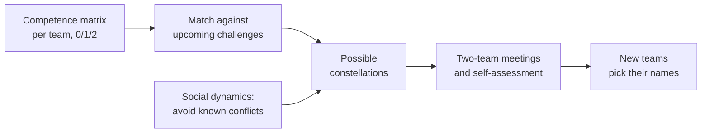

Team composition is usually decided in a meeting room the developers never enter. Someone looks at an
org chart, moves a few names around, and the next Monday people find out which team they're in. Then
everyone wonders why the new teams take months to perform.

In the project with six Scrum teams I worked on for about four years, there came a point where the
upcoming challenges didn't fit the existing team setup any more. We re-formed the teams, and we did it
differently: with a **competence matrix** filled in by the teams themselves, with **social dynamics**
treated as a first-class input, and with the developers in the room. The result was some of the most
harmonious and motivated teams I've worked in. That's not marketing; it's how it felt.

## The problem with reshuffling by org chart

Moving people between teams by name has a few predictable failure modes:

- **Skills cluster by accident.** One team ends up with three cloud experts, another with none.
- **Knowledge islands get worse.** The only person who knows a subsystem moves to a team that doesn't
  work on it.
- **Personal conflicts get ignored.** Two people who don't work well together end up side by side, and
  the whole team pays for it.
- **Nobody feels ownership.** If you didn't have a say in your team, it's not really *your* team.

## Step 1: a simple competence matrix

Each Scrum team compiled a competence matrix for every developer. We deliberately kept it simple:
**three levels, 0, 1 and 2**, per skill.

A simple scale is the whole point. With five or ten levels, people start debating whether they're a 6
or a 7. With three, the conversation is short. Here's how I'd describe the levels:

| Level | Meaning |
|---|---|
| **0** | No or very little experience |
| **1** | Can work on it, sometimes needs support |
| **2** | Works on it independently and can help others |

And here's what a matrix for one team could look like. The names and values are **fictional**, to show
the format:

| Skill | Dev A | Dev B | Dev C | Dev D | Dev E |
|---|---|---|---|---|---|
| .NET / C# | 2 | 2 | 1 | 2 | 1 |
| ASP.NET Core | 2 | 1 | 1 | 2 | 0 |
| Frontend | 0 | 1 | 2 | 0 | 2 |
| SQL | 1 | 2 | 0 | 1 | 1 |
| Azure | 2 | 0 | 1 | 1 | 0 |
| Infrastructure as Code | 1 | 0 | 0 | 2 | 0 |
| Automated testing | 2 | 1 | 1 | 2 | 1 |
| Domain: orders & invoicing | 2 | 2 | 0 | 1 | 1 |

You can read a lot from a table like this in a few seconds. Infrastructure as Code depends on one
person. Frontend is covered by two. Domain knowledge is strong in two people and weak in the rest.

### For growth, not for blame

The matrix was created with the **explicit intention of fostering growth, not assigning blame**. That
has to be said out loud, and it has to be true. If people suspect the matrix will show up in their
performance review, every value becomes a 2, and the matrix is worthless.

A 0 isn't a weakness. It's a growth opportunity, and a hint where pairing makes sense. A column full
of 2s isn't a hero; it's a risk if that person goes on holiday.

## Step 2: match teams to the upcoming challenges

With matrices for all teams, we evaluated which teams were best suited to the challenges ahead. A
challenge that's heavy on cloud infrastructure needs a team with 2s in the relevant rows, and at
least one 1 so the knowledge doesn't sit with a single person.

The matrices were combined into one overview that showed possible team assignments based on
competencies. That overview was a basis for discussion, not a decision.

## Step 3: take social dynamics seriously

This is the step most reorganizations skip, and I think it's the most important one. We made an
active effort to harmonize the social dynamics between developers and to **avoid team combinations
that could lead to personal or social conflicts**.

That doesn't mean everyone has to be friends. It means that when you already know two people clash,
you don't put them in the same team of five and hope for the best. Skills can be learned in a few
sprints. A broken team dynamic can take much longer to fix, if it gets fixed at all.

This is also why this can't be done purely on paper. The people who know where the friction is are
the teams themselves.

## Step 4: let the teams take part

The planning happened mostly in **meetings between two teams at a time**. In those, the teams discussed
how members could be reassigned to make the best use of their strengths for the upcoming challenges.
The teams also did self-assessments and thought about which configurations would be the most
harmonious and productive.

Sketching possible constellations helped those discussions:

| Constellation | Team 1 | Team 2 | Team 3 |
|---|---|---|---|
| Option A | Dev A, Dev C, Dev F | Dev B, Dev D, Dev G | Dev E, Dev H, Dev I |
| Option B | Dev A, Dev E, Dev G | Dev B, Dev C, Dev H | Dev D, Dev F, Dev I |

For each option, you check the combined matrix (are all critical skills covered at level 2 at least
once?) and the social side (any known conflicts?). Often one option is clearly better once you look at
both.

And then a small thing with a surprisingly big effect: **each new team picked a name for itself**. It
sounds silly. It isn't. A name the team chose is the first decision the new team makes together, and
it creates identity from day one.

## Matrix vs. other ways to form teams

| | Org chart reshuffle | Self-selection (free choice) | Competence matrix + team discussion |
|---|---|---|---|
| Skills covered deliberately | ❌ | ⚠️ by chance | ✅ |
| Social conflicts considered | ❌ | ✅ | ✅ |
| Teams feel ownership | ❌ | ✅ | ✅ |
| Aligned with upcoming challenges | ⚠️ | ❌ | ✅ |
| Effort | low | medium | medium |

Pure self-selection is great for ownership, but it tends to create teams of friends with similar
skills. The matrix adds the missing structure without taking away the say.

## Pitfalls

**The matrix leaks into performance reviews.** Once that happens, nobody fills it in honestly again.
Keep it a team tool.

**Too many skills.** A matrix with forty rows is a spreadsheet nobody reads. Pick the skills that
matter for the challenges ahead, plus domain knowledge.

**Forgetting domain knowledge.** Technology skills are easy to list. Knowing how the order process or
the invoicing rules actually work is often the scarcer skill.

**Optimizing only for skills.** A team that looks perfect in the matrix and can't stand each other
will lose against a slightly weaker team that works well together.

**Treating it as a one-off.** Skills change. Revisit the matrix when the challenges change, or use it
in retrospectives to plan pairing and learning.

## Using the matrix afterwards

The matrix isn't only for reorganizations. Once it exists, it's useful in day-to-day work:

- **Pairing:** put a 0 or 1 together with a 2 on a story in that area.
- **Planning:** check that every story has at least one person with a 2 in the relevant skill.
- **Learning goals:** "move from 0 to 1 in Infrastructure as Code this quarter" is a concrete goal.
- **Risk:** any row with only one 2 is a knowledge island worth working on.

## Summary

- When teams had to be re-formed, each team built a **competence matrix with three levels (0/1/2)**
  for every developer.
- The matrix was explicitly **for growth, not for blame**, otherwise it's worthless.
- Teams were matched to upcoming challenges, and **social dynamics** were treated as seriously as
  skills.
- The teams took part through two-team meetings and self-assessments, and each new team picked its own
  name.
- The result was harmonious teams with a lot of intrinsic motivation.
