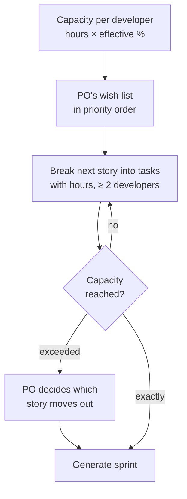

Here's a sprint planning I've seen in many places: the team has five developers, the sprint has ten
days, so there are 400 hours. Stories get pulled in until the estimates add up to 400. Two weeks later
half of them are still open, and everyone is surprised.

Nobody works 100 % of their hours on sprint tasks. Not the senior who has been on the product for
years, and certainly not the person who joined last Monday. In the project with six Scrum teams I
spent about four years on, we planned with that fact instead of against it. This post shows how,
including the numbers we used and the template you can steal.

## The problem: hours on paper vs. hours on tasks

The calendar says eight hours. What actually goes into sprint tasks is less, and not because people
are lazy:

- Scrum events: daily, refinement, planning, review, retrospective.
- Other meetings: alignment with other teams, questions from stakeholders, architecture discussions.
- Helping colleagues, code reviews, pairing with new team members.
- Context switches, a production bug someone has to look at, a build that breaks.

None of that is waste. Much of it is exactly what makes a team work. But it doesn't show up as hours
on a task, so if you plan as if it didn't exist, you overcommit every single sprint.

## The numbers we planned with

These are the rules of thumb from that project. They come from experience, not from a study, and
your numbers will differ, but they're a much better starting point than 100 %.

| Developer | Effective share of their hours on sprint tasks |
|---|---|
| Experienced in the domain and the technology | **65–75 %**, depending on the average amount of meetings |
| New, onboarding | **below 10 %** at the start, depending on many factors |

Two things surprised people the most.

**Even the best developers don't go above 75 %.** That's not a performance issue. The more
experienced someone is, the more they get pulled into discussions, reviews and questions from
others. That's valuable work, and it eats into task hours.

**New developers start close to zero.** Someone in their first sprints needs to set up their
environment, learn the domain, understand the architecture and ask a lot of questions. They also
*reduce* the capacity of the people helping them. Planning a new joiner at 80 % is the fastest way
to frustrate them and the team.

The important part is the word **per developer**. Each person gets their own percentage. A team
average hides exactly the information you need.

## The planning process

We used a planning tool that the Scrum Master introduced early on, a spreadsheet with a fair amount
of macro logic behind it. The tool itself isn't the point; the process it enforced is. It went like
this:

1. **Determine the total potential working hours** for the upcoming sprint, per developer, minus
   vacation and other absences, multiplied by that developer's effective percentage.
2. **List all stories** the Product Owner would like to have in the sprint, in priority order.
3. **Plan each story in detail**: break it into tasks and assign hours to every task.
4. **Assign at least two developers to every story.** This is for knowledge sharing and quality,
   among other things. More on that below.
5. **Keep adding stories until the capacity threshold is reached.** If the sprint turned out to be
   overplanned, the **Product Owner was asked which story had to move out**.
6. **Generate the sprint** from the plan, with all stories and their estimated tasks.

## A worked example

Here's what a capacity sheet looks like. The people and numbers are made up to show the mechanics,
using a ten-day sprint with eight-hour days:

| Developer | Available days | Hours | Effective % | Capacity (h) |
|---|---|---|---|---|
| Dev A (senior, long on the product) | 10 | 80 | 75 % | 60 |
| Dev B (experienced) | 10 | 80 | 70 % | 56 |
| Dev C (experienced, one day off) | 9 | 72 | 65 % | 47 |
| Dev D (joined last sprint) | 10 | 80 | 5 % | 4 |
| **Team** | | **312** | | **167** |

On paper, 312 hours. Realistically, 167. That difference is the reason so many sprints fail before
they start.

Then the stories go in, one at a time, in the PO's order:

| # | Story | Developers | Planned hours | Running total |
|---|---|---|---|---|
| 1 | Customers can download past invoices as PDF | A, D | 38 | 38 |
| 2 | Order confirmation e-mail shows delivery date | B, C | 26 | 64 |
| 3 | Product search filters by availability | A, C | 49 | 113 |
| 4 | Admin can block a customer account | B, D | 34 | 147 |
| 5 | Shipping cost preview in the cart | B, C | 31 | **178** ⚠️ |

Story 5 pushes the sprint over capacity. The team doesn't negotiate the hours down, and it doesn't
silently plan overtime. It goes to the Product Owner: "We can do four of these five. Which one moves
out?" Maybe the PO swaps story 4 for story 5. Maybe story 5 goes into the next sprint. That's the PO's
call, because priorities are the PO's job.

## Why two developers per story

Assigning at least two people to each story costs a little throughput in the short run. It paid off
in ways we wouldn't want to give up:

- **No knowledge islands.** Every piece of the system was known by at least two people.
- **Built-in review.** The second developer knows the context, so reviews were faster and better.
- **Holidays and sick days don't stop a story.** Someone else can continue.
- **Onboarding happens inside real work.** Pairing the new developer with a senior on a real story
  (like Dev D above) is far more effective than handing them documentation.

A side effect: nobody had five items in progress at once. Work was planned, communicated and queued.
In that project, eight-hour days were absolutely normal, and long overtime days were the rare
exception, not the plan. I'm convinced that honest capacity planning was a big part of that.

## What a planning tool should do for you

Whatever tool you use, whether it's a spreadsheet, your work tracker's built-in capacity view or
something custom, these features made the biggest difference for us:

| Feature | Why it matters |
|---|---|
| **Task templates** for recurring work (UI feature, backend feature, API integration) | Stories of the same kind need the same tasks. Templates stop you from forgetting tests or deployment. |
| **Predefined task lists** per story type | Makes estimates comparable between stories. |
| **Capacity per developer** | The core of everything above. |
| **Live capacity feedback** while planning | You see immediately whether one more story fits. |
| **Generate the sprint** at the end | Nobody types forty tasks by hand after a long planning session. |
| **Velocity and size-to-hours mapping** from historical data | After more than a year of data, abstract sizes could be translated into realistic hours. |

The last point deserves a note. Abstract sizes (story points or T-shirt sizes) are great for
refinement. For capacity planning you eventually need hours. If you record both over a long enough
period, you can derive a mapping from data instead of guessing.

## Pitfalls

**Using one percentage for the whole team.** It hides the onboarding developer and overestimates the
team every time someone new joins.

**Forgetting the helpers.** When a new person joins, the seniors who help them lose capacity too. Lower
their percentage a bit for the first sprints.

**Treating the percentage as a performance metric.** The moment someone feels judged by their
"efficiency", the numbers become political. They are planning inputs, nothing more.

**Planning to 100 % of the realistic capacity.** Production bugs were the one kind of interruption we
allowed into a running sprint. If you know they happen, don't plan as if they don't.

**The team deciding what moves out.** When the sprint is too full, it's tempting for the team to
drop "the least interesting" story. That's a prioritization decision, and it belongs to the PO.

## How to calibrate your own numbers

You don't need a big analysis. After each sprint, compare per developer:

- planned task hours vs. hours actually spent on sprint tasks,
- and note what ate the rest (meetings, support, incidents).

After a few sprints you'll see a stable range per person. Use that range in the next planning, and
revisit it whenever the team composition or the meeting load changes.

## Summary

- Nobody works 100 % on sprint tasks. Plan with a realistic percentage **per developer**.
- Experienced developers reached about **65–75 %**, depending on meetings. New developers started
  **below 10 %**.
- Plan story by story, assign **at least two developers** to each, and stop at the capacity
  threshold.
- If the sprint is overplanned, the **Product Owner decides** which story moves out.
- A good planning tool gives you task templates, per-developer capacity, live feedback and, over
  time, a mapping from sizes to hours based on real data.
