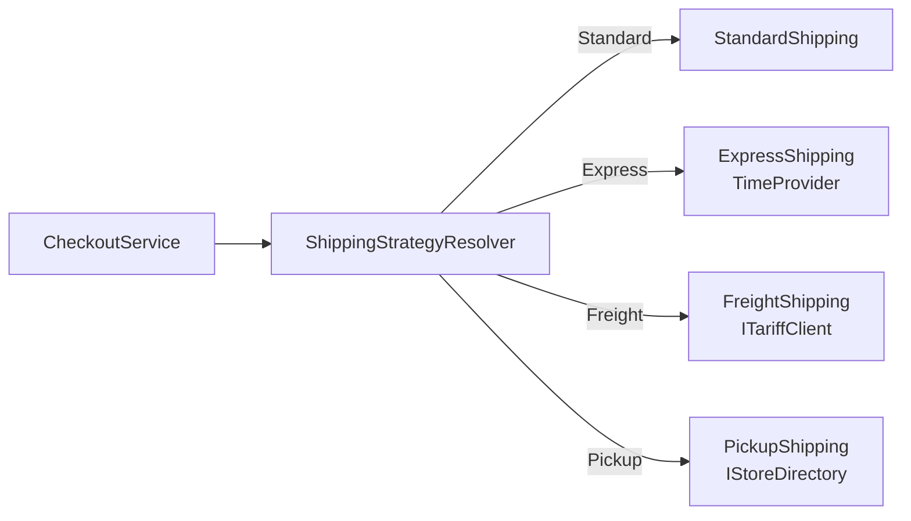

Every codebase I've worked on had at least one enum that everything switched on. An order type, a
shipping method, a machine model, a telegram kind. The first `switch` is perfectly reasonable. The
fifth one, spread over four classes and each with a dozen lines per case, is where adding a new
value turns into a scavenger hunt.

This post is about recognizing when a switch has outgrown itself, how to replace it with the strategy
pattern, and how .NET 8 keyed services fit in. It's also about the switches you should leave alone.

## The problem: one decision, many places

A shop with four shipping methods:

```csharp
public enum ShippingMethod { Standard, Express, Freight, Pickup }

public sealed class ShippingService(TimeProvider clock)
{
    public Money CalculateCost(Order order)
    {
        switch (order.ShippingMethod)
        {
            case ShippingMethod.Standard:
                return order.Subtotal >= Money.Euro(50) ? Money.Zero : Money.Euro(4.90m);

            case ShippingMethod.Express:
                var lateSurcharge = clock.GetLocalNow().Hour >= 14 ? Money.Euro(5) : Money.Zero;
                return Money.Euro(9.90m) + lateSurcharge;

            case ShippingMethod.Freight:
                return Money.Euro(1.20m) * Math.Ceiling(order.TotalWeightKg);

            case ShippingMethod.Pickup:
                return Money.Zero;

            default:
                throw new ArgumentOutOfRangeException(nameof(order), order.ShippingMethod, null);
        }
    }

    public DateOnly EstimateDelivery(Order order)
    {
        var today = DateOnly.FromDateTime(clock.GetLocalNow().DateTime);
        switch (order.ShippingMethod)
        {
            case ShippingMethod.Standard: return today.AddDays(3);
            case ShippingMethod.Express:  return today.AddDays(1);
            case ShippingMethod.Freight:  return today.AddDays(7);
            case ShippingMethod.Pickup:   return today;
            default: throw new ArgumentOutOfRangeException(nameof(order));
        }
    }

    public IReadOnlyList<string> Validate(Order order)
    {
        switch (order.ShippingMethod)
        {
            // freight needs a delivery address with a loading dock,
            // pickup needs a selected store, express isn't available for heavy orders ...
        }
        // ...
    }
}
```

And somewhere else, the UI has its own switch for the display names, and the label printer has one for
the label format. What hurts:

- **Adding a method touches every switch.** A fifth option means finding all of them. Miss one and
  you get the `default` exception at runtime, in exactly the path nobody tested.
- **The logic for one method is scattered.** Everything about freight lives in five places. To
  understand freight, you read all of them.
- **One class, many reasons to change.** A pricing change to express shipping and a new validation
  rule for pickup both edit `ShippingService`, which is the opposite of single responsibility and
  open/closed.
- **The dependencies add up.** If freight needs a weight-tariff client and pickup a store directory,
  `ShippingService` needs both, even when only standard shipping is used.
- **Testing is awkward.** You can't test the express rules without constructing a service that knows
  about freight.

## Why it happens

The first switch is the right call, and that's the trap. One method, four lines, an enum. Then a
second method needs the same distinction, and copying the shape is the obvious move. Nobody ever
decides "let's spread shipping logic over five classes". It accumulates one reasonable change at a time.

## When a switch is fine

Not every switch is a smell. I leave these alone:

```csharp
public static string DisplayName(this ShippingMethod method) => method switch
{
    ShippingMethod.Standard => "Standard (3 days)",
    ShippingMethod.Express  => "Express (next day)",
    ShippingMethod.Freight  => "Freight forwarding",
    ShippingMethod.Pickup   => "Pick up in store",
    _ => throw new UnreachableException()
};
```

A switch expression that **maps a value to a value**, lives in **one place**, and has no dependencies
is clear, fast and exhaustively checked by the compiler (CS8509 warns if you forget a case). Turning it
into four classes would be ceremony.

The smell is the combination: the **same decision repeated** in several places, **algorithms** in the
cases instead of values, and **dependencies** that only some cases need.

## The fix: one strategy per case

Collect everything that varies by shipping method into one interface:

```csharp
namespace MyShop.Shipping;

public interface IShippingStrategy
{
    ShippingMethod Method { get; }

    Money CalculateCost(Order order);
    DateOnly EstimateDelivery(Order order, DateOnly today);
    IEnumerable<string> Validate(Order order);
}
```

Each method gets its own class with exactly the dependencies it needs:

```csharp
internal sealed class ExpressShipping(TimeProvider clock) : IShippingStrategy
{
    private static readonly Money BasePrice = Money.Euro(9.90m);
    private static readonly Money LateSurcharge = Money.Euro(5);
    private const decimal MaxWeightKg = 30;

    public ShippingMethod Method => ShippingMethod.Express;

    public Money CalculateCost(Order order) =>
        clock.GetLocalNow().Hour >= 14 ? BasePrice + LateSurcharge : BasePrice;

    public DateOnly EstimateDelivery(Order order, DateOnly today) => today.AddDays(1);

    public IEnumerable<string> Validate(Order order)
    {
        if (order.TotalWeightKg > MaxWeightKg)
            yield return $"Express shipping is limited to {MaxWeightKg} kg.";
    }
}

internal sealed class PickupShipping(IStoreDirectory stores) : IShippingStrategy
{
    public ShippingMethod Method => ShippingMethod.Pickup;

    public Money CalculateCost(Order order) => Money.Zero;

    public DateOnly EstimateDelivery(Order order, DateOnly today) => today;

    public IEnumerable<string> Validate(Order order)
    {
        if (order.PickupStoreId is not { } storeId || !stores.Exists(storeId))
            yield return "Select a store for pickup.";
    }
}
```

`StandardShipping` and `FreightShipping` look the same. Everything about express is now in one file,
and its test only needs a `FakeTimeProvider`.

### Selecting the strategy: a small resolver

Register all strategies against the same interface, and let a resolver build a lookup once:

```csharp
public static IServiceCollection AddShipping(this IServiceCollection services)
{
    services.AddSingleton<IShippingStrategy, StandardShipping>();
    services.AddSingleton<IShippingStrategy, ExpressShipping>();
    services.AddSingleton<IShippingStrategy, FreightShipping>();
    services.AddSingleton<IShippingStrategy, PickupShipping>();
    services.AddSingleton<ShippingStrategyResolver>();
    services.TryAddSingleton(TimeProvider.System);
    return services;
}
```

```csharp
public sealed class ShippingStrategyResolver(IEnumerable<IShippingStrategy> strategies)
{
    private readonly FrozenDictionary<ShippingMethod, IShippingStrategy> _byMethod =
        strategies.ToFrozenDictionary(s => s.Method);   // duplicate keys throw here

    public IShippingStrategy For(ShippingMethod method) =>
        _byMethod.TryGetValue(method, out var strategy)
            ? strategy
            : throw new NotSupportedException($"No shipping strategy registered for {method}.");
}
```

The consumer has no switch left:

```csharp
public sealed class CheckoutService(ShippingStrategyResolver shipping, TimeProvider clock)
{
    public ShippingQuote Quote(Order order)
    {
        var strategy = shipping.For(order.ShippingMethod);
        var today = DateOnly.FromDateTime(clock.GetLocalNow().DateTime);

        return new ShippingQuote(
            strategy.CalculateCost(order),
            strategy.EstimateDelivery(order, today),
            [.. strategy.Validate(order)]);
    }
}
```

Adding a fifth method now means adding an enum value, one class and one registration line. No
existing strategy changes.



### Keyed services (.NET 8+)

Since .NET 8, the built-in container can do the lookup itself. Register each strategy with a key:

```csharp
services.AddKeyedSingleton<IShippingStrategy, StandardShipping>(ShippingMethod.Standard);
services.AddKeyedSingleton<IShippingStrategy, ExpressShipping>(ShippingMethod.Express);
services.AddKeyedSingleton<IShippingStrategy, FreightShipping>(ShippingMethod.Freight);
services.AddKeyedSingleton<IShippingStrategy, PickupShipping>(ShippingMethod.Pickup);
```

When the key is known at **compile time**, inject the one you need directly:

```csharp
public sealed class ExpressUpgradeOffer(
    [FromKeyedServices(ShippingMethod.Express)] IShippingStrategy express)
{
    public Money PriceFor(Order order) => express.CalculateCost(order);
}
```

That works in constructors and in minimal API handlers. When the key comes from **data** (the order's
shipping method), you have to ask the provider at runtime:

```csharp
var strategy = serviceProvider.GetRequiredKeyedService<IShippingStrategy>(order.ShippingMethod);
```

That's a service locator call. I keep it out of business code and hide it behind a resolver like the
one above, so the rest of the code still depends on a plain type and stays easy to test.

Two things to know about keyed services: keyed registrations are **not** included when you resolve
`IEnumerable<IShippingStrategy>` without a key, and a missing key only fails when it's first
requested. That's why I usually prefer the `IEnumerable` + dictionary resolver for runtime selection.
It fails at startup on duplicates and is trivial to test for completeness.

### Pick one, or run all?

The resolver picks **one** strategy. Sometimes you want **all** of them: every export target, every
validation rule, every notification channel. Then the consumer iterates over
`IEnumerable<IExportTarget>` and calls each. (For logging, don't build this yourself: `ILogger` already
fans out to all registered providers.) Be explicit about which of the two you mean. A consumer that
calls `Single()` on a list of strategies is a resolver without the error message.

## Comparison

| | `switch` in place | Switch expression (value map) | Dictionary of delegates | Strategy + resolver | Keyed services |
|---|---|---|---|---|---|
| Good for | one-off decisions | mapping values to values | small, dependency-free logic | algorithms with dependencies | compile-time known keys |
| Logic per case in one place | ❌ when repeated | ✅ | ✅ | ✅ | ✅ |
| Per-case dependencies | ❌ all in one class | n/a | ❌ | ✅ | ✅ |
| Compiler checks completeness | ⚠️ statements: no | ✅ CS8509 | ❌ | ❌ needs a test | ❌ needs a test |
| New case without editing existing code | ❌ | ❌ | ⚠️ | ✅ | ✅ |
| Ceremony | none | none | low | medium | low |

If the type is your own and the behaviour is intrinsic to it, there's a fifth option: put the method
on the type itself (polymorphism). That works for domain objects, not for an enum coming from a
database or an API.

## Pitfalls

**Strategy explosion.** Four classes for four one-line cases is worse than a switch expression.
Introduce strategies when the cases carry logic and dependencies, not before.

**The switch moves into the factory.** A `ShippingStrategyFactory` that does `switch (method) { case
Express: return new ExpressShipping(...); }` still has to be edited for every new case. Let the
container collect the strategies, and let each strategy declare its own key.

**Missing strategies at runtime.** Neither the dictionary nor keyed services know your enum. Add a test
(below) so a new enum value without a strategy fails in CI.

**Lifetime mismatches.** A singleton strategy that depends on a scoped `DbContext` is a captive
dependency. Either register the strategies as scoped (and the resolver too), or give them a factory.
See [DI lifetimes and service registration](/blog/2026-di-lifetimes-and-service-registration/).

**Leaky strategies.** If consumers check `strategy is FreightShipping`, the interface is missing a
member. A "do nothing" case belongs in a strategy too; that's the
[null object pattern](/blog/2026-null-object-pattern-and-nullable-reference-types/) in strategy form.

## Enforce it

A completeness test makes the open/closed promise safe:

```csharp
[TestMethod]
public void Every_shipping_method_has_exactly_one_strategy()
{
    using var provider = new ServiceCollection()
        .AddSingleton<IStoreDirectory, InMemoryStoreDirectory>()
        .AddSingleton<ITariffClient, FakeTariffClient>()
        .AddShipping()
        .BuildServiceProvider(validateScopes: true);

    var resolver = provider.GetRequiredService<ShippingStrategyResolver>();   // throws on duplicates

    foreach (var method in Enum.GetValues<ShippingMethod>())
        Assert.AreEqual(method, resolver.For(method).Method);                 // throws if missing
}
```

For the switches that remain:

- Treat **CS8509** (non-exhaustive switch expression) as an error, so value maps can't silently miss
  a case.
- **CA1502** ("Avoid excessive complexity") flags methods whose cyclomatic complexity crosses a
  threshold. Long switch statements with logic in every case trip it reliably. The threshold is
  configurable via a `CodeMetricsConfig.txt` additional file.
- **IDE0010** and **IDE0072** offer to add missing cases to switch statements and expressions.

```ini
# .editorconfig
[*.cs]
dotnet_diagnostic.CS8509.severity = error
dotnet_diagnostic.CA1502.severity = warning
```

More on wiring analyzers into the pipeline in
[Roslynator and analyzers in CI](/blog/2026-roslynator-and-analyzers-in-ci/).

## Summary

- A switch is fine when it **maps values in one place**. It's a smell when the **same decision is
  repeated**, the cases contain **algorithms**, and only some cases need certain **dependencies**.
- Move everything that varies into one **strategy interface**, one class per case, each with its own
  dependencies.
- Select at runtime with a small **resolver** over `IEnumerable<T>`, or use **keyed services** when the
  key is known at compile time.
- Don't hide the switch in a factory, and don't replace one-line cases with classes.
- Guard it with a **completeness test**, CS8509 as an error and a complexity threshold.
