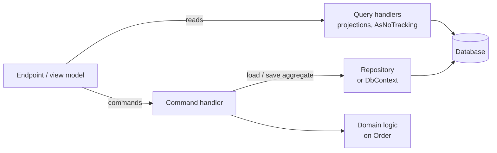

In one codebase I worked on, you could find out where the orders came from by searching for
`"SELECT"`. The hits were spread across view models, background services, a reporting helper and two
controllers. Each place had its own idea of what an "open order" was. One filtered out cancelled
orders, one didn't, and one also hid orders older than a year because "nobody needs those".

That's what a **missing data access layer** looks like. Nothing is broken on its own, and still
nobody can answer "where do we read orders, and what rules apply?" without a full-text search.

This post is about giving data access a home. I'll compare the two patterns that come up every time,
**repository** and **query object**, and show the one rule that matters more than the choice between
them.

## The problem: data access everywhere

Here's a condensed version of what that looks like:

```csharp
public sealed class OrderOverviewViewModel(MyShopDbContext db)
{
    public async Task LoadAsync(int customerId, CancellationToken ct)
    {
        Orders = await db.Orders
            .Where(o => o.CustomerId == customerId && o.Status != "Cancelled")
            .OrderByDescending(o => o.CreatedAt)
            .ToListAsync(ct);
    }

    public IReadOnlyList<OrderEntity> Orders { get; private set; } = [];
}

public sealed class ReminderJob(MyShopDbContext db)
{
    public async Task RunAsync(CancellationToken ct)
    {
        var open = await db.Orders
            .Where(o => o.Status == "Open")          // "open" means something else here
            .ToListAsync(ct);
        // ...
    }
}
```

The problems pile up quietly:

- **No single point of truth.** "Open order" is defined in several places, and they drift.
- **Persistence leaks upward.** The view model works with `OrderEntity`, a database type with
  navigation properties, string status columns and whatever else the schema needs. A renamed column
  becomes a UI change.
- **Hard to test.** Every consumer needs a database, or a mocked `DbContext`, which is painful and
  lies about behaviour anyway.
- **Hard to change.** Moving a table, adding an index-friendly filter or switching a hot query to
  [Dapper](/blog/2026-dapper-in-practice/) means touching every caller.

## Why it happens

Nobody decides to scatter SQL. It happens because the `DbContext` is *right there*. It's registered
in DI, it's injectable everywhere, and writing a three-line LINQ query is faster than finding out
whether someone already wrote it. Every individual shortcut is reasonable. The sum is a codebase where
data access is everybody's job and therefore nobody's.

The fix is a layer whose only job is **accessing data**. Two patterns are the usual candidates.

## Option 1: the repository

A repository looks like an in-memory collection of domain objects. It hides how they're stored and
offers a small set of operations on one aggregate.

```csharp
namespace MyShop.Orders;

public interface IOrderRepository
{
    Task<Order?> FindAsync(OrderId id, CancellationToken ct);
    Task<IReadOnlyList<Order>> GetOpenForCustomerAsync(CustomerId customerId, CancellationToken ct);
    void Add(Order order);
    Task SaveChangesAsync(CancellationToken ct);
}
```

```csharp
namespace MyShop.Orders.Persistence;

internal sealed class OrderRepository(MyShopDbContext db) : IOrderRepository
{
    public async Task<Order?> FindAsync(OrderId id, CancellationToken ct)
    {
        var entity = await db.Orders
            .Include(o => o.Lines)
            .SingleOrDefaultAsync(o => o.Id == id.Value, ct);

        return entity?.ToDomain();
    }

    public async Task<IReadOnlyList<Order>> GetOpenForCustomerAsync(
        CustomerId customerId, CancellationToken ct)
    {
        var entities = await db.Orders
            .AsNoTracking()
            .Where(o => o.CustomerId == customerId.Value && o.Status == OrderStatus.Open)
            .OrderByDescending(o => o.CreatedAt)
            .ToListAsync(ct);

        return [.. entities.Select(e => e.ToDomain())];
    }

    public void Add(Order order) => db.Orders.Add(OrderEntity.FromDomain(order));

    public Task SaveChangesAsync(CancellationToken ct) => db.SaveChangesAsync(ct);
}
```

Two details matter more than the pattern name:

1. **The interface speaks the domain.** `Order`, `OrderId`, `CustomerId`, no `OrderEntity`, no
   `IQueryable`. The mapping happens inside (see
   [mapping as an anti-corruption layer](/blog/2026-mapping-as-anti-corruption-layer/)).
2. **The implementation is `internal`.** Only the interface is visible outside the persistence
   project, so nobody can reach around it.

:::caution[The generic repository trap]
You'll still find advice like "write one `IRepository<T>` with `GetAll`, `Get(Predicate<T>)`,
`Add`, `Update`, `Delete` and you're done". With EF Core that's a step backwards. `DbSet<T>` already
*is* a generic repository, and `Get(Predicate<T>)` is worse than what it replaces: a `Predicate<T>`
is a compiled delegate, not an expression tree, so the filter runs **in memory after loading the
whole table**. `GetAll()` returning `IEnumerable<T>` has the same problem. If you build a repository,
make it specific to one aggregate and give its methods intention-revealing names.
:::

### Where repositories hurt

Repositories are good at the write side: load an aggregate, change it through its methods, save it.
They get uncomfortable on the read side. Every new screen wants a slightly different filter or
projection, and the interface grows `GetOpenForCustomer`, `GetOpenForCustomerWithLines`,
`GetOverdueByRegionPaged`… After a year the "small" repository has forty methods, half of them used
once. That's the moment to look at query objects.

## Option 2: the query object

A query object is **one class per question**. It has its inputs, it has its result, and it knows how
to get the answer.

```csharp
namespace MyShop.Orders.Overview;

public sealed record OpenOrdersForCustomer(CustomerId CustomerId, int Page = 1, int PageSize = 50);

public sealed record OrderSummary(OrderId Id, DateTimeOffset CreatedAt, decimal Total, int LineCount);

public interface IQueryHandler<in TQuery, TResult>
{
    Task<TResult> HandleAsync(TQuery query, CancellationToken ct);
}

internal sealed class OpenOrdersForCustomerHandler(MyShopDbContext db)
    : IQueryHandler<OpenOrdersForCustomer, IReadOnlyList<OrderSummary>>
{
    public async Task<IReadOnlyList<OrderSummary>> HandleAsync(
        OpenOrdersForCustomer query, CancellationToken ct) =>
        await db.Orders
            .AsNoTracking()
            .Where(o => o.CustomerId == query.CustomerId.Value && o.Status == OrderStatus.Open)
            .OrderByDescending(o => o.CreatedAt)
            .Skip((query.Page - 1) * query.PageSize)
            .Take(query.PageSize)
            .Select(o => new OrderSummary(
                new OrderId(o.Id),
                o.CreatedAt,
                o.Lines.Sum(l => l.Quantity * l.UnitPrice),
                o.Lines.Count))
            .ToListAsync(ct);
}
```

The view model now asks exactly one question and gets exactly the shape it needs:

```csharp
public sealed class OrderOverviewViewModel(
    IQueryHandler<OpenOrdersForCustomer, IReadOnlyList<OrderSummary>> openOrders)
{
    public IReadOnlyList<OrderSummary> Orders { get; private set; } = [];

    public async Task LoadAsync(CustomerId customerId, CancellationToken ct) =>
        Orders = await openOrders.HandleAsync(new OpenOrdersForCustomer(customerId), ct);
}
```

What you get:

- **Small classes** that change for exactly one reason.
- **Read-optimized projections.** The query selects four columns instead of loading the aggregate
  with all its lines. That's often the biggest performance win in the whole refactoring.
- **Freedom per query.** One handler can use EF Core, the next can use hand-tuned SQL with Dapper,
  and nobody else notices.
- **Easy to find.** The query is named after the question, so search finds it.

If this looks familiar, it is: a query object plus a handler is the read side of
[CQRS without the ceremony](/blog/2026-cqrs-with-mediatr-without-ceremony/), and it fits perfectly
into [vertical slices](/blog/2026-vertical-slices/). You don't need MediatR for it. The interface
above is all the infrastructure you need.

The downside is the same as the upside: one query, one class. There is no single file that lists
everything you can ask about orders. A consistent folder and naming convention compensates for that.

## How I combine them

In practice I rarely pick one. My default:



- **Reads** go through query objects that project straight into DTOs.
- **Writes** load an aggregate, call domain methods, save. Whether that goes through a repository or
  directly through the `DbContext` in the command handler depends on the team. With EF Core, the
  `DbContext` already provides unit of work and change tracking, so a thin repository mainly buys you
  a domain-shaped interface and a test seam.

| | Generic `IRepository<T>` | Specific repository | Query objects | `DbContext` everywhere |
|---|---|---|---|---|
| Single place for data rules | ⚠️ | ✅ | ✅ (per query) | ❌ |
| Read-optimized projections | ❌ | ⚠️ grows methods | ✅ | ✅ |
| Hides persistence types | ⚠️ | ✅ | ✅ | ❌ |
| Easy to test consumers | ✅ | ✅ | ✅ | ❌ |
| Stays small over time | ✅ but useless | ❌ tends to grow | ✅ | n/a |
| Write side (aggregates) | ⚠️ | ✅ | ❌ not its job | ⚠️ |

## The one rule: no business logic in the data access layer

Whichever pattern you pick, the most important rule is the same: **the data access layer accesses
data. Nothing else.**

```csharp
// ❌ business rule hidden in the repository
public async Task CancelAsync(OrderId id, CancellationToken ct)
{
    var order = await db.Orders.SingleAsync(o => o.Id == id.Value, ct);

    if (order.Status == OrderStatus.Shipped)                 // business rule
        throw new InvalidOperationException("Too late.");

    order.Status = OrderStatus.Cancelled;
    await mailer.SendCancellationAsync(order.CustomerId, ct); // side effect
    await db.SaveChangesAsync(ct);
}
```

When the rule "shipped orders can't be cancelled" lives in the repository, the next developer who
needs a cancellation path for returns writes a second method without it. Rules belong to the domain
object or the handler:

```csharp
public sealed class Order
{
    public OrderStatus Status { get; private set; }

    public Result Cancel() =>
        Status == OrderStatus.Shipped
            ? Result.Failure("Shipped orders can't be cancelled.")
            : SetStatus(OrderStatus.Cancelled);

    private Result SetStatus(OrderStatus status)
    {
        Status = status;
        return Result.Success();
    }
}
```

The handler loads, calls `order.Cancel()`, saves and triggers the mail. The repository only loads and
saves. (The `Result` type is covered in
[out parameters vs. result types](/blog/2026-out-parameters-vs-result-types/).)

The same goes for "smart" stored procedures that validate, calculate prices and send notifications.
They are business logic that happens to be written in SQL, invisible to your tests and your code
review.

## Pitfalls

**Leaking `IQueryable`.** A repository that returns `IQueryable<OrderEntity>` hasn't hidden anything.
Callers compose queries again, and you're back to data access everywhere, just with an extra hop.

**Repository per table.** Repositories belong to aggregates, not tables. An `OrderLineRepository`
next to an `OrderRepository` invites people to change lines without going through the order.

**Mocking `DbContext` for tests.** Test query handlers against a real database with
[Testcontainers](/blog/2026-testcontainers/). Mock the *interface* when you test consumers. Mocking EF
Core itself tests your mocks, not your queries.

**Sync over async.** Repository methods that return `IEnumerable<T>` and call `.Result` internally
are still around in older code. Data access is I/O, so it's `async` with a `CancellationToken`
(see [async/await pitfalls](/blog/2026-async-await-pitfalls/)). For large result sets that are
streamed, look at [IAsyncEnumerable done right](/blog/2026-iasyncenumerable-done-right/).

## Enforce it

As always, a rule that only lives in a wiki erodes. An architecture test keeps the `DbContext` where
it belongs:

```csharp
[TestMethod]
public void Only_persistence_and_query_handlers_may_use_the_DbContext()
{
    var result = Types.InAssembly(typeof(MyShopDbContext).Assembly)
        .That().DoNotResideInNamespaceMatching(@"MyShop\..*\.(Persistence|Queries)")
        .And().DoNotHaveNameEndingWith("Handler")
        .ShouldNot().HaveDependencyOn("Microsoft.EntityFrameworkCore")
        .GetResult();

    Assert.IsTrue(result.IsSuccessful,
        $"Use a query object or repository: {string.Join(", ", result.FailingTypeNames ?? [])}");
}
```

Making the implementations `internal` and the persistence types non-public does half of that work
for free. More ideas in [self-defending codebases](/blog/2026-self-defending-codebases/).

## Summary

- A **missing data access layer** means scattered queries, drifting rules and persistence types
  leaking into the UI.
- **Repositories** fit the write side: one aggregate, domain types in, domain types out, a handful of
  intention-revealing methods. Skip the generic `IRepository<T>` on top of EF Core.
- **Query objects** fit the read side: one question per class, projected straight into the shape the
  caller needs.
- Combining them, queries for reads and aggregates for writes, works well in most backends.
- **No business logic below the line.** The data access layer loads and saves. Rules live in the
  domain or the handler.
- Enforce the boundary with `internal` types and an architecture test.
