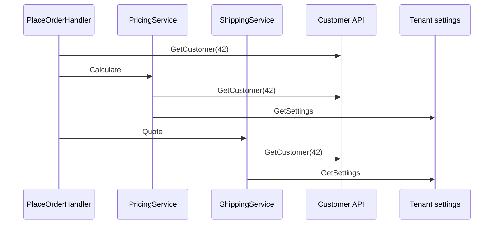
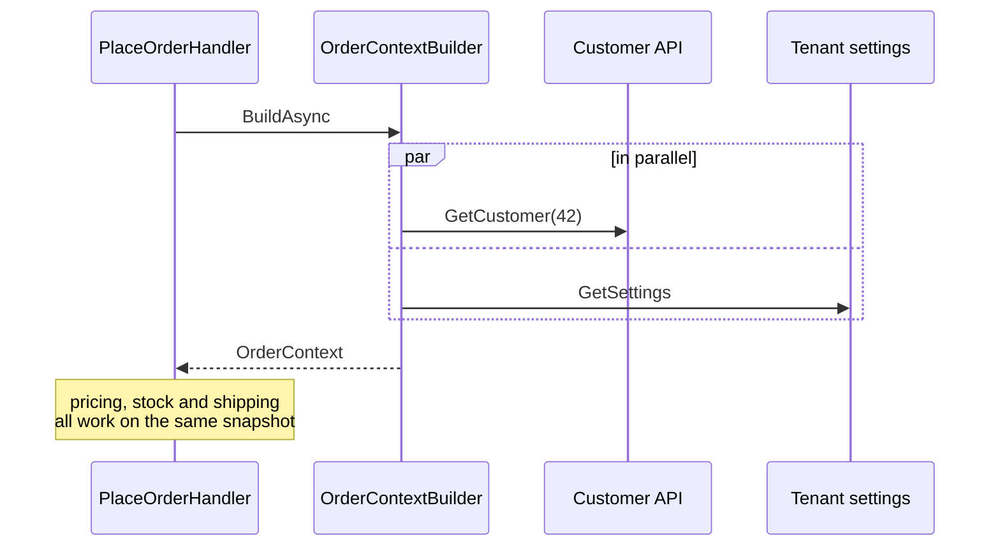

Most performance problems I've had to debug in backend services weren't slow algorithms. They were
**the same data being loaded over and over** inside a single request. No single line of code looks
wrong. Every service is clean, every method does one thing, and still the database or the
downstream API gets hit five times for one customer record.

This post shows the pattern I use against that: a **Request Context Builder**, which is a flavour
of the classic *Context Object* pattern. It also covers how that pattern can quietly fail even when
it's already in place.

## The problem: every service is "self-sufficient"

Take a typical flow: placing an order. The handler orchestrates a few services:

```csharp
public sealed class PlaceOrderHandler(
    ICustomerClient customers,
    IPricingService pricing,
    IStockService stock,
    IShippingService shipping)
{
    public async Task<OrderResult> HandleAsync(PlaceOrder command, CancellationToken ct)
    {
        var customer = await customers.GetCustomerAsync(command.CustomerId, ct);

        if (customer.IsBlocked)
            throw new CustomerBlockedException(customer.Id);

        var price        = await pricing.CalculateAsync(command, ct);
        var reservation  = await stock.ReserveAsync(command, ct);
        var shippingCost = await shipping.QuoteAsync(command, ct);

        return new OrderResult(price, reservation, shippingCost);
    }
}
```

That looks fine. Now look inside the services:

```csharp
public sealed class PricingService(
    ICustomerClient customers,
    ITenantSettingsClient settings,
    ICatalogClient catalog) : IPricingService
{
    public async Task<Money> CalculateAsync(PlaceOrder command, CancellationToken ct)
    {
        var customer = await customers.GetCustomerAsync(command.CustomerId, ct); // again
        var tenant   = await settings.GetAsync(command.TenantId, ct);
        var products = await catalog.GetProductsAsync(command.ProductIds, ct);
        // ... discount rules based on customer tier and tenant settings
    }
}

public sealed class ShippingService(
    ICustomerClient customers,
    ITenantSettingsClient settings) : IShippingService
{
    public async Task<Money> QuoteAsync(PlaceOrder command, CancellationToken ct)
    {
        var customer = await customers.GetCustomerAsync(command.CustomerId, ct); // and again
        var tenant   = await settings.GetAsync(command.TenantId, ct);            // and again
        // ... shipping rules based on the customer address
    }
}
```

Each service was written to be **self-sufficient**. You give it an ID and it gets what it needs.
That's a reasonable instinct, because the service is easy to call from anywhere. Put several of
them together, though, and you get an N+1 problem that runs across service boundaries instead of
inside one query:



Three calls for the same customer and two for the same settings. Add a fourth service and a
permission check, and the numbers keep growing.

There's a second, less obvious problem: **consistency**. If the customer is updated between the
first and the third read, pricing and shipping work with two different versions of the same customer
within one request. Bugs like that almost never show up in a test, and they're very hard to
reproduce in production.

## The pattern: gather once, validate once, pass along

The fix is to turn it around. Services stop fetching their own data. Instead:

1. A **builder** collects everything the flow needs, once, in parallel where possible.
2. It **validates** the data centrally, once.
3. It **precomputes** values that several steps need.
4. It returns an **immutable context object**, which is passed to every step.

```csharp
public sealed record OrderContext(
    PlaceOrder Command,
    Customer Customer,
    TenantSettings Settings,
    IReadOnlyDictionary<ProductId, Product> Products,
    bool IsPrivilegedUser,
    Lazy<Task<CreditLimit>> CreditLimit);
```

```csharp
public sealed class OrderContextBuilder(
    ICustomerClient customers,
    ITenantSettingsClient settings,
    ICatalogClient catalog,
    ICurrentUser currentUser,
    ICreditClient credit)
{
    public async Task<OrderContext> BuildAsync(PlaceOrder command, CancellationToken ct)
    {
        // 1. Fetch everything that is independent in parallel, exactly once.
        var customerTask   = customers.GetCustomerAsync(command.CustomerId, ct);
        var settingsTask   = settings.GetAsync(command.TenantId, ct);
        var productsTask   = catalog.GetProductsAsync(command.ProductIds, ct);
        var privilegedTask = currentUser.IsInRoleAsync("order-admin", ct);

        await Task.WhenAll(customerTask, settingsTask, productsTask, privilegedTask);

        var customer = await customerTask;

        // 2. Validate centrally, before any step runs.
        if (customer.IsBlocked)
            throw new CustomerBlockedException(customer.Id);

        // 3. Expensive and only needed in some branches? Load it lazily.
        var creditLimit = new Lazy<Task<CreditLimit>>(
            () => credit.GetLimitAsync(customer.Id, ct));

        return new OrderContext(
            command,
            customer,
            await settingsTask,
            (await productsTask).ToDictionary(p => p.Id),
            await privilegedTask,
            creditLimit);
    }
}
```

The services become much simpler. Many of them don't even need to be `async` any more:

```csharp
public sealed class PricingService : IPricingService
{
    public Money Calculate(OrderContext context)
    {
        // pure logic: customer tier, tenant discount rules, product prices
    }
}

public sealed class PlaceOrderHandler(
    OrderContextBuilder contextBuilder,
    IPricingService pricing,
    IStockService stock,
    IShippingService shipping)
{
    public async Task<OrderResult> HandleAsync(PlaceOrder command, CancellationToken ct)
    {
        var context = await contextBuilder.BuildAsync(command, ct);

        var price        = pricing.Calculate(context);
        var reservation  = await stock.ReserveAsync(context, ct);
        var shippingCost = shipping.Quote(context);

        return new OrderResult(price, reservation, shippingCost);
    }
}
```



What you get out of it:

- **One round trip per piece of data**, and the independent ones run in parallel.
- **A consistent snapshot.** Every step sees the same customer.
- **One place for validation.** Steps can rely on the context being valid.
- **Testable steps.** `PricingService.Calculate` is a pure function, so a unit test needs a record
  instead of four mocks.
- **Less boilerplate.** The same "load customer, load settings, check permissions" block no longer
  appears in every flow.

## A lesson from production: having the pattern isn't enough

In one codebase I worked on, a context builder like this had existed for years. It loaded the core
entity, permissions, connection info and cache settings, all in parallel, all once.

Then someone did a systematic audit of the request pipeline. In some flows, the same entity was
still being loaded **twice, three times and in one case four times per request**, and one of those
results was never even used. Several handlers also explicitly bypassed the cache (`useCache: false`)
for data that was perfectly cacheable.

How did that happen, with the pattern in place? There were two reasons:

1. **A wrapper around the builder.** A feature-specific builder extended the generic one, received
   the finished context, and then loaded the main entity again, even though it was sitting right
   there in the context.
2. **The raw clients were still injectable.** Handlers could inject the data client next to the
   context, and they did. Out of habit, "to be safe", or because nobody knew the context already
   contained the data.

Almost every fix was a one-liner: `var entity = context.Entity;` instead of another remote call.
The real lesson is a different one, though: **a pattern that's only a convention erodes.**

## Make the context the only way in

If the steps aren't supposed to fetch data themselves, make that something the build can check
instead of something people have to remember. An architecture test does it in a few lines, for
example with [NetArchTest](https://github.com/BenMorris/NetArchTest):

```csharp
[TestMethod]
public void Order_flow_steps_must_not_call_data_clients_directly()
{
    var result = Types.InAssembly(typeof(OrderContext).Assembly)
        .That().ResideInNamespace("MyShop.Orders.Place.Steps")
        .ShouldNot().HaveDependencyOnAny("MyShop.Clients")
        .GetResult();

    Assert.IsTrue(result.IsSuccessful,
        $"Use OrderContext instead: {string.Join(", ", result.FailingTypeNames ?? [])}");
}
```

The test fails as soon as someone injects `ICustomerClient` into a step. A Roslyn analyzer can do the
same thing directly in the IDE. That's the idea behind
[self-defending codebases](/blog/2026-self-defending-codebases/): rules the team agreed on should
be enforced by the code, not just written down in a wiki.

## Why not just cache it?

Caching is the first thing people suggest, and it does help, but it solves a different problem:

| | Distributed cache | Scoped "memoizing" service | Request Context Builder |
|---|---|---|---|
| Fewer database / API calls | ✅ | ✅ | ✅ |
| Fewer calls to the cache itself | ❌ every read still costs a round trip and a deserialization | ✅ | ✅ |
| Consistent snapshot within the request | ❌ entries can change between reads | ✅ | ✅ |
| Central validation | ❌ | ❌ | ✅ |
| Dependencies of a step are visible in its signature | ❌ | ❌ | ✅ |
| Works across requests | ✅ | ❌ | ❌ |

They don't exclude each other. The builder can read from the cache. A cache just doesn't fix a
design in which every step asks for everything again. It only makes the repetition a bit cheaper.

A **scoped memoizing service** (a per-request cache in front of the client) is a good lightweight
alternative when you can't restructure the flow. What it doesn't do is make a step's dependencies
visible or centralize validation.

## Pitfalls

**Over-fetching.** A context that loads everything any step might ever need makes the simple paths
slower. Use `Lazy<Task<T>>` for expensive data that only some branches need, as with `CreditLimit`
above.

**The god context.** One global `RequestContext` for the whole application quickly turns into a
second service locator. Build **one context per flow**: `OrderContext`, `InvoiceContext`, and so on.
They can share building blocks without sharing a single type.

**Stale data in long-running flows.** A snapshot is the point for a 200 ms HTTP request. For a
background job that runs for minutes, decide explicitly which parts have to be reloaded.

**Mutability.** If steps can change the context, you're back to hidden coupling. Use records and
read-only collections. If a step produces new data, it returns it instead of writing it into the
context.

## Make it measurable

You can't improve what you don't count. Two cheap ways to keep this under control:

- **Telemetry.** With OpenTelemetry or Application Insights, every outgoing HTTP or database call
  is a dependency span. Count dependency calls per operation and alert when a flow suddenly makes
  twice as many.
- **A test.** Register a counting `DelegatingHandler` for the downstream client in an integration
  test and assert that placing an order makes exactly one customer call. That catches the
  "wrapper loads it again" regression before it's merged.

## Summary

- Self-sufficient services are convenient to call, and together they cause an N+1 problem across
  service boundaries.
- Gather the data a flow needs **once**, validate it **once**, and pass it along as an
  **immutable context**.
- Steps become simpler, often synchronous and easy to test, and they all work on the same consistent
  snapshot.
- A pattern that's only a convention erodes. **Enforce it** with architecture tests or analyzers,
  and keep an eye on the number of calls per request.
