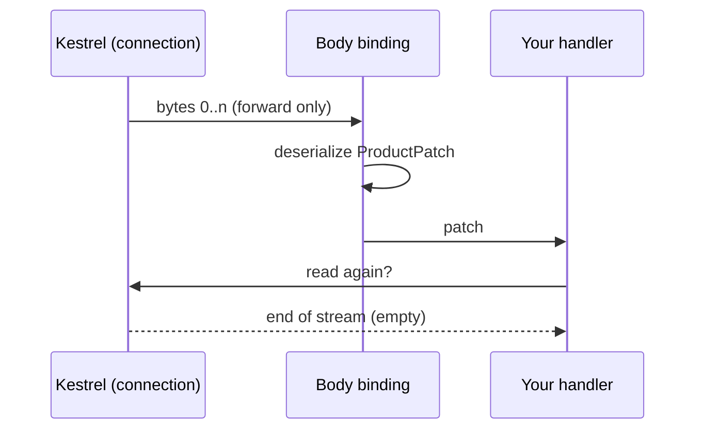

:::note[Series]
Part of the series [*REST & OpenAPI design*](/series/rest-and-openapi-design/).
:::

Here's a bug report that usually arrives right after someone implements their first
[merge-patch endpoint](/blog/2026-patch-with-json-merge-patch/): "the raw JSON is always empty".

```csharp
app.MapPatch("/products/{id:guid}", async (Guid id, ProductPatch patch, HttpContext http) =>
{
    using var reader = new StreamReader(http.Request.Body);
    var raw = await reader.ReadToEndAsync();   // "" — always

    // ...
});
```

The typed `patch` parameter is filled correctly. The raw body is empty. No exception, no warning,
just an empty string, or with `JsonNode.Parse` a confusing "the input does not contain any JSON
tokens".

## Why: the request body is a forward-only stream

`HttpRequest.Body` isn't a byte array sitting in memory. It's a stream reading directly from the
connection (Kestrel's pipe, or IIS). That's deliberate: a 200 MB upload shouldn't need 200 MB of RAM
just because it arrived. The price is that the stream can be read **once**. It's not seekable,
`CanSeek` is `false`, and setting `Position = 0` throws `NotSupportedException`.

When a minimal API binds `ProductPatch patch` from the body, the framework calls
`ReadFromJsonAsync` on that stream before your handler runs. By the time your code executes, the
stream is at its end, and there's nothing left to read.



## When do you need the raw body at all?

Before working around it, check whether you really do. Legitimate reasons I've come across:

- **Property presence** for JSON Merge Patch: was `description` omitted or sent as `null`?
- **Signature verification** of webhooks: the HMAC is computed over the exact bytes, and
  re-serializing the DTO won't reproduce them.
- **Auditing**: store exactly what the client sent, not what your DTO made of it.
- **Unknown properties**: reject or log fields the DTO doesn't know.

For pure request *logging*, use the built-in `AddHttpLogging()` with `HttpLoggingFields.RequestBody`
instead. It handles the buffering for you, and you can limit it per endpoint with `.WithHttpLogging(...)`.

## Option 1: don't read twice, read once

The cleanest fix is to avoid the second read entirely. Read the body once into a `JsonObject` and
deserialize the typed DTO from that. A type with a static `BindAsync` method does that transparently,
as shown in the [merge patch post](/blog/2026-patch-with-json-merge-patch/):

```csharp
app.MapPatch("/products/{id:guid}",
    async (Guid id, MergePatch<ProductPatch> patch) => { /* patch.Value + patch.Json */ });
```

No buffering, no stream tricks. If you control the parameter type, this is what I'd choose.

## Option 2: enable buffering, but only where needed

Sometimes you can't change the binding: the endpoint is generated, a shared framework binds the
DTO, or you need the exact bytes (signatures). Then you need buffering.
`HttpRequest.EnableBuffering()` wraps the body in a `FileBufferingReadStream`: the first read pulls
from the connection and keeps a copy, in memory up to a threshold and in a temp file beyond that.
After that the stream is seekable.

The key is **where and when** you switch it on. It must happen *before* the body binding runs, and it
shouldn't happen for every endpoint. Endpoint metadata solves both: mark the endpoints that need it,
and let a tiny middleware check for the marker.

```csharp
/// <summary>Marks an endpoint whose request body may be read again after binding.</summary>
public sealed class BufferedBodyMetadata(int maxBytes = 1024 * 1024)
{
    public int MaxBytes { get; } = maxBytes;
}

public static class BufferedBodyExtensions
{
    public static TBuilder WithBufferedBody<TBuilder>(this TBuilder builder, int maxBytes = 1024 * 1024)
        where TBuilder : IEndpointConventionBuilder
        => builder.WithMetadata(new BufferedBodyMetadata(maxBytes));

    public static IApplicationBuilder UseBufferedBodies(this IApplicationBuilder app)
        => app.Use(async (http, next) =>
        {
            var metadata = http.GetEndpoint()?.Metadata.GetMetadata<BufferedBodyMetadata>();
            if (metadata is not null)
            {
                http.Request.EnableBuffering(
                    bufferThreshold: 64 * 1024,     // keep up to 64 KB in memory
                    bufferLimit: metadata.MaxBytes); // fail beyond this size
            }

            await next(http);
        });
}
```

`GetEndpoint()` only returns something after routing. With `WebApplication`, routing runs at the
start of the pipeline automatically, so the middleware just has to be registered before the endpoints
execute:

```csharp
var app = builder.Build();

app.UseExceptionHandler();
app.UseAuthentication();
app.UseAuthorization();
app.UseBufferedBodies();   // after routing, before the endpoint runs
```

And a helper that reads the buffered body safely, as often as you like:

```csharp
public static class RawBodyExtensions
{
    public static async Task<JsonObject> GetJsonPayloadAsync(this HttpContext http, CancellationToken ct)
    {
        var body = http.Request.Body;
        if (!body.CanSeek)
            throw new InvalidOperationException(
                "The request body isn't buffered. Add .WithBufferedBody() to the endpoint.");

        body.Position = 0;
        try
        {
            return await JsonNode.ParseAsync(body, cancellationToken: ct) as JsonObject
                ?? throw new BadHttpRequestException("The request body must be a JSON object.");
        }
        finally
        {
            body.Position = 0;   // leave it where the next reader expects it
        }
    }
}
```

The endpoint now gets both:

```csharp
app.MapPatch("/products/{id:guid}", async (Guid id, ProductPatch patch, HttpContext http,
    UpdateProductHandler handler, CancellationToken ct) =>
{
    var json = await http.GetJsonPayloadAsync(ct);
    return await handler.HandleAsync(id, patch, json, ct);
})
.Accepts<ProductPatch>("application/merge-patch+json")
.WithBufferedBody();
```

The marker makes the cost visible: one line on the endpoint, readable in code review, and every
other endpoint keeps streaming as before.

### The webhook variant: the exact bytes

For signature checks you want the bytes, not a parsed tree:

```csharp
public static async Task<byte[]> GetRawBodyAsync(this HttpContext http, CancellationToken ct)
{
    var body = http.Request.Body;
    body.Position = 0;
    using var buffer = new MemoryStream();
    await body.CopyToAsync(buffer, ct);
    body.Position = 0;
    return buffer.ToArray();
}

app.MapPost("/webhooks/payments", async (PaymentEvent evt, HttpContext http,
    IOptions<WebhookOptions> options, CancellationToken ct) =>
{
    var raw = await http.GetRawBodyAsync(ct);
    var expected = HMACSHA256.HashData(options.Value.SecretBytes, raw);
    var received = Convert.FromHexString(http.Request.Headers["X-Signature"].ToString());

    if (!CryptographicOperations.FixedTimeEquals(expected, received))
        return Results.Unauthorized();

    // evt is typed, raw was verified
    return Results.Accepted();
})
.WithBufferedBody(maxBytes: 256 * 1024);
```

`FixedTimeEquals` matters: a plain `SequenceEqual` leaks timing information about how many bytes
matched.

## Why not an endpoint filter?

The obvious idea is an `IEndpointFilter` that calls `EnableBuffering()`. It doesn't work.
**Endpoint filters run after parameter binding.** By the time your filter executes, the body has been
consumed, and `EnableBuffering()` happily wraps an exhausted stream. You get a seekable stream with
nothing in it. Buffering has to start in middleware, before the endpoint's request delegate.

## Comparison

| Approach | Typed binding | Raw access | Memory cost | Scope |
|---|---|---|---|---|
| Read only the DTO | ✅ | ❌ | none | n/a |
| Read only `JsonObject` | ❌ | ✅ | the tree | per endpoint |
| `BindAsync` wrapper (read once) | ✅ | ✅ parsed | the tree | per parameter type |
| `EnableBuffering()` globally | ✅ | ✅ | a copy of **every** body | all endpoints ❌ |
| Metadata + middleware (`WithBufferedBody`) | ✅ | ✅ exact bytes | a copy, only where marked | per endpoint ✅ |
| Endpoint filter + `EnableBuffering()` | ✅ | ❌ too late | n/a | doesn't work |

## Pitfalls

**Forgetting `Position = 0`.** After the binder has read the buffered stream, its position is at the
end. Reset it before reading, and reset it again afterwards for whoever reads next.

**Disposing the body.** `new StreamReader(http.Request.Body)` disposes the stream when the reader is
disposed. Use `leaveOpen: true`, or the helpers above, which don't wrap it at all.

**Size limits.** Kestrel's `MaxRequestBodySize` (30 MB by default) still applies. The `bufferLimit`
of `EnableBuffering` is an additional cap; exceeding it throws an `IOException` during the read. Keep
it small for JSON endpoints, and never buffer file uploads.

**Temp files.** Above the threshold, the buffer goes to disk (`ASPNETCORE_TEMP` or the system temp
folder). In read-only containers, make sure that path is writable, or keep the threshold and the limit
equal so everything stays in memory.

**Enabling it globally "just in case".** It works, and it quietly doubles the memory or I/O cost of
every request with a body. Opt in per endpoint.

## Make it testable

Two integration tests cover the important behaviour. The first one:

```csharp
[TestMethod]
public async Task Raw_payload_is_available_after_binding()
{
    using var content = new StringContent("""{ "description": null }""",
        Encoding.UTF8, "application/merge-patch+json");

    var response = await client.PatchAsync($"/products/{productId}", content);

    Assert.AreEqual(HttpStatusCode.OK, response.StatusCode);
    var product = await client.GetFromJsonAsync<ProductDto>($"/products/{productId}");
    Assert.IsNull(product!.Description, "Presence of 'description' was not detected.");
}
```

The second test sends a body just above the endpoint's `MaxBytes` and asserts it isn't accepted.
Run it once and look at what actually comes back: depending on who hits the limit first (Kestrel's
`MaxRequestBodySize`, the buffering stream or the JSON binder), you'll see a `413`, a `400` or an
exception. Decide which response you want, map it in your exception handler, and pin it in the test.

And if you want to be strict: a startup check that iterates over `EndpointDataSource.Endpoints` and
fails when an endpoint with `BufferedBodyMetadata` has a `MaxBytes` above your agreed limit.

## Summary

- The request body is a **forward-only stream**. After body binding, it's empty.
- First choice: **read once** into a `JsonObject` and deserialize the DTO from it (a `BindAsync`
  wrapper).
- If you need a second read or the exact bytes, call **`EnableBuffering()` in middleware**, before
  binding, **only for marked endpoints**.
- **Endpoint filters are too late**: they run after binding.
- Reset `Position`, don't dispose the stream, and keep a **tight size limit**.
