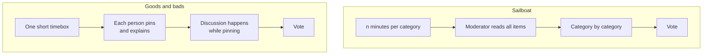

:::note[Series]
Part of the series [*Scrum in the real world*](/series/scrum-in-the-real-world/).
:::

There are dozens of retrospective formats, and every few months someone suggests a new one. Starfish,
mad/sad/glad, speedboat, sailboat, 4Ls. The underlying assumption is that a fresher format leads to
better retros.

In the project with six Scrum teams where I spent about four years, our team used two formats over
time: a plain **"goods and bads"** retro and the more elaborate **sailboat** retro. The fancier one
wasn't the better one. This post compares both, gives you templates for each, and explains why I'd
pick the simple one for most teams.

## Format 1: the sailboat

The sailboat retrospective uses a picture: a boat on its way to an island. Each part of the picture is
a category. A typical setup:

| Category | Question |
|---|---|
| ⛵ Wind | What pushed us forward? |
| ⚓ Anchor | What held us back? |
| 🪨 Rocks | What risks do we see ahead? |
| 🏝️ Island | Where do we want to go? |

### How we ran it

1. **Idea generation:** everyone gets *n* minutes **per category** to put their thoughts on the board.
2. **Presentation and clarification:** the moderator reads each item aloud. If something is unclear,
   the author is asked to explain.
3. **Category by category:** we went through the categories one after the other. Think of an iterator
   that only has `Current` and `MoveNext()`.
4. **Voting and prioritization:** at the end, everyone votes on what to focus on in the next sprint.

### What was good about it

- The board **looks great**. That's not nothing; a nice board makes people want to contribute.
- The **idea behind it is good**. The metaphor makes it easy to think about risks and goals, not only
  about the past sprint.
- Items end up **well categorized**.
- The moderator actively helped **group similar items**.

### What didn't work for us

- **Little interaction.** The process left very little room for people to actually talk.
- **Little communication between team members.** Most of it went through the moderator.
- **Few real discussions.** The format just didn't encourage them.
- **Monotonous.** After a few sprints, it felt uninspiring.
- **Too much work for the moderator.** Reading everything aloud, clarifying, grouping: the moderator
  carried the whole meeting.
- **Too many categories.** People spent time thinking about *where* an item belongs and how to phrase
  it, instead of *what* the problem is. Is a flaky build an anchor or a rock?

## Format 2: goods and bads

The other format is as plain as it gets. Two columns: **what was good** and **what was bad** in the
last sprint.

### How we ran it

1. **Cards:** every developer takes as many cards as they need. At the beginning we limited it to
   three per developer, and the outcome wasn't good. People held back things that mattered.
2. **Reflection:** everyone writes down the good and the bad things of the last sprint, in **one**
   short timebox of a few minutes. Not one timebox per category.
3. **Explain while you pin:** one after the other, everyone walks to the board, pins their cards and
   explains them.
4. **Voting:** same as before, everyone votes on what to focus on.

### What was good about it

- **Easy to understand.** Good or bad. Nobody needs to think about categories.
- **More focus per item.** Each card gets attention when it's pinned, from the person who wrote it.
- **More spontaneous discussion.** When someone pins a card and explains it, others react right away.
  That happened far more often than in the sailboat.
- **More interaction.** The whole team was more involved.
- **Less redundancy.** If someone already pinned your point, you add your card next to it or leave it
  out. The grouping happens naturally.
- **Lighter moderator role.** The moderator mostly keeps the meeting on track instead of carrying it.
- **More self-organization.** The team runs its own retro.

### What wasn't

- **It can take longer**, depending on how long and intense the discussions get. In my opinion, that's
  the point of a retro, but you need to keep an eye on the timebox.

## Side by side

| | Sailboat | Goods and bads |
|---|---|---|
| Easy to explain to new members | ⚠️ needs the metaphor | ✅ |
| Interaction between team members | ❌ goes through the moderator | ✅ |
| Spontaneous discussions | ❌ | ✅ |
| Workload for the moderator | high | low |
| Looks good on the board | ✅ | ⚠️ plain |
| Thinks about risks and goals ahead | ✅ rocks and island | ⚠️ only if someone brings it up |
| Time needed | predictable | depends on discussions |
| Risk of overthinking categories | ✅ high | ❌ none |

The key difference is in the middle. In the sailboat, the **moderator** presents the items. In goods
and bads, the **author** does. That one change moved our retros from a reading session to a
conversation.

## What the Scrum Master or moderator should do

Whatever format you use, the job of whoever facilitates is the same:

- **Organize the meeting:** set an agenda and make sure the necessary material is there, such as
  feedback from the review or notes from the last retro.
- **Keep it blame-free:** people need to feel safe to say what went wrong, including their own
  mistakes.
- **Turn talk into action:** help the team prioritize what was discussed and come out with concrete,
  actionable items.

The last point is where retros most often fail. A retro that ends with a list of complaints and no
owner for any of them is a venting session.

## What happens with the results

Not every outcome of a retro is something the team can fix. We distinguished between problems the team
could solve itself and problems that needed someone outside the team. The first kind became backlog
items or team meetings. The second kind needed a different approach, which I describe in
[Putting impediments in the manager's path](/blog/2026-putting-impediments-in-the-managers-path/).

## Pitfalls

**Limiting the number of cards.** We tried three per person. It made people filter themselves, and
the important-but-awkward topics were the first to be filtered out.

**The moderator does all the talking.** If the moderator reads every card, the team becomes an
audience. Let authors present their own cards.

**Format hopping.** Changing the format every sprint keeps things fresh, but if the real problem is
that nothing changes after the retro, a new picture on the board won't fix it.

**No follow-up.** Start each retro by looking at the actions from the last one. If they keep
disappearing, that's your first topic.

**Too many categories.** If people discuss where a card belongs, the format is in the way.

## A minimal template

If you want to try goods and bads tomorrow:

| Step | Timebox | Who |
|---|---|---|
| Review last retro's actions | 5 min | Moderator |
| Write cards, good and bad, as many as you like | 5–7 min | Everyone, silently |
| Pin and explain, one person at a time | open, watch the clock | Each author |
| Vote on focus topics | 5 min | Everyone |
| Define actions with an owner | 10 min | Team |
| Sort: team-resolvable vs. needs outside help | 5 min | Team |

## Summary

- We used both the **sailboat** and a plain **goods and bads** retro.
- The sailboat looked nicer and covered risks and goals, but led to little interaction, overloaded the
  moderator and made people overthink categories.
- Goods and bads was simpler and produced far more discussion, mainly because **authors explain their
  own cards** while pinning them.
- Don't limit the number of cards, keep the moderator light, and always end with actions that have an
  owner.
- Sort results into what the team can fix and what needs help from outside.
