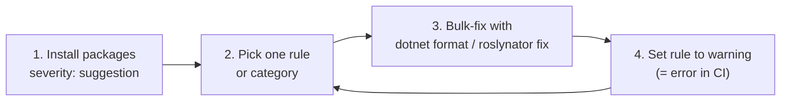

Ask a team whether they use analyzers, and you often get "yes, I have Roslynator installed". In Visual Studio.
On their machine. With their own settings. The colleague next to them has a different set of extensions,
the build agent has none, and the rules never fail anything. That's not code analysis. It's a personal
preference with squiggly lines.

This post is about the analyzers you **don't** write yourself: the .NET SDK analyzers and Roslynator, and how
to turn them into something that's the same for every developer, every IDE and every CI run. Writing your own
analyzers and code fixes is a different topic. I covered that in
[the 2017 post on Roslyn analyzers](/blog/2017-roslyn-analyzers-and-argument-checks/), and team-specific rules
in [self-defending codebases](/blog/2026-self-defending-codebases/).

## Why IDE-only analyzers don't work

Analyzers can reach your code in three ways:

| Delivery | Who runs it | Same for everyone? | Runs in CI? |
|---|---|---|---|
| IDE extension (VSIX, Rider plugin) | only developers who installed it | ❌ | ❌ |
| Built into the .NET SDK (`CAxxxx`, `IDExxxx`) | everyone, if enabled | ✅ with `.editorconfig` | ✅ |
| NuGet package (`Roslynator.Analyzers`, ...) | everyone who builds | ✅ | ✅ |

Only the last two are part of the build. They're versioned with the repository, configured in the repository and
run wherever `dotnet build` runs. IDE extensions are fine for refactorings and personal productivity. Rules belong
in the build.

## Step 1: the analyzers you already have

The .NET SDK ships a large set of analyzers for correctness, performance, security and style. They're enabled, but
mostly at a low level. Turn them up in [Directory.Build.props](/blog/2026-directory-build-props/):

```xml
<PropertyGroup>
  <EnableNETAnalyzers>true</EnableNETAnalyzers>
  <AnalysisLevel>latest-recommended</AnalysisLevel>
  <EnforceCodeStyleInBuild>true</EnforceCodeStyleInBuild>
  <TreatWarningsAsErrors>true</TreatWarningsAsErrors>
</PropertyGroup>
```

`AnalysisLevel` picks the rule set: `latest-minimum`, `latest-recommended` or `latest-all`. Use `latest`
variants so you pick up new rules when you upgrade the SDK. That's a feature: every SDK upgrade becomes a small
review of what's new. `EnforceCodeStyleInBuild` makes the `IDExxxx` code-style rules run in the build, not only in
the editor.

## Step 2: Roslynator

[Roslynator](https://github.com/dotnet/roslynator) is a .NET Foundation project with several hundred analyzers,
refactorings and code fixes. What I like about it: it's actively maintained, configurable entirely through
`.editorconfig`, and it covers a lot of the "simplify this", "this is redundant", "use this pattern" findings the SDK
analyzers don't.

It comes in three NuGet packages:

| Package | Contents |
|---|---|
| `Roslynator.Analyzers` | general code analysis (`RCS1xxx`) |
| `Roslynator.Formatting.Analyzers` | formatting rules (`RCS0xxx`) |
| `Roslynator.CodeAnalysis.Analyzers` | rules for people writing Roslyn code themselves |

With [Central Package Management](/blog/2026-central-package-management/), add them once for every project:

```xml
<!-- Directory.Packages.props -->
<ItemGroup>
  <GlobalPackageReference Include="Roslynator.Analyzers" Version="4.12.9" />
  <GlobalPackageReference Include="Roslynator.Formatting.Analyzers" Version="4.12.9" />
</ItemGroup>
```

`GlobalPackageReference` is private by default, so the analyzers don't become a dependency of the packages you
publish.

## Step 3: configure severities in .editorconfig

Installing an analyzer package doesn't make every rule an error. Many Roslynator rules are off or at `info` by
default. You decide which ones matter, in the root `.editorconfig`:

```ini
root = true

[*.cs]
# All Roslynator rules that are on by default: warnings
dotnet_analyzer_diagnostic.category-roslynator.severity = warning

# Opt in to specific rules that are off by default
dotnet_diagnostic.RCS1046.severity = warning   # async method names end with 'Async'
dotnet_diagnostic.RCS1229.severity = warning   # use async/await when necessary

# Opt out where the team disagrees, with a reason
dotnet_diagnostic.RCS1021.severity = none      # lambda style: left to the author

# SDK analyzers
dotnet_diagnostic.CA2007.severity = none       # ConfigureAwait: not relevant in ASP.NET Core apps
dotnet_diagnostic.CA1848.severity = warning    # use LoggerMessage delegates for logging
```

Two levels of control are useful here: a **category** switch (`category-roslynator`) to set a baseline, and
**individual rules** on top. Every `none` deserves a comment. In six months, someone will ask why that rule is off.

:::tip[Opt-in vs. opt-out]
Roslynator can also turn *all* analyzers on or off by default with `roslynator_analyzers.enabled_by_default`. That
option only works in a `.roslynatorconfig` file, not in `.editorconfig`. For a repository setup, I prefer the
`.editorconfig` route above: it's the standard mechanism, every IDE understands it, and it sits next to the other
rule severities.
:::

## Rolling out in an existing codebase

Turning on a few hundred rules as errors in a five-year-old solution produces a wall of errors, and the PR that
does it gets reverted. Roll out in stages:



The bulk-fix step is where the tooling pays off. Many rules have code fixes, and you can apply them across the
solution from the command line:

```bash
# fix one diagnostic across the solution with the SDK tooling
dotnet format analyzers MyShop.sln --diagnostics RCS1036 --severity info

# or with the Roslynator CLI
dotnet tool install -g roslynator.dotnet.cli
roslynator fix MyShop.sln --supported-diagnostics RCS1036
```

One rule per PR keeps the diffs reviewable: "this PR removes redundant empty lines everywhere" is easy to approve.
A PR that applies fifty different fixes to 400 files is not.

For rules without a code fix, set them to `warning` for new code by fixing the existing occurrences first, or
accept a temporary `#pragma warning disable` with a ticket reference in the few places that need real work.

## Making it a CI gate

With the configuration above, there's nothing special to do in CI. That's the point. `dotnet build` runs the
analyzers, `TreatWarningsAsErrors` turns findings into errors, and the build fails:

```yaml
- run: dotnet build MyShop.sln -c Release
```

Two additions are worth it.

**SARIF output for code scanning.** The compiler can write all findings to a SARIF file, which GitHub code scanning
and Azure DevOps can display as annotations on the pull request:

```xml
<PropertyGroup Condition="'$(CI)' == 'true'">
  <ErrorLog>$(MSBuildThisFileDirectory)artifacts/sarif/$(MSBuildProjectName).sarif,version=2.1</ErrorLog>
</PropertyGroup>
```

**A formatting check.** Formatting rules can run in the build too, but `dotnet format --verify-no-changes` gives a
clearer signal. That's the topic of the
[post on consistent formatting](/blog/2026-consistent-formatting-locally-and-in-ci/).

## Which analyzers?

| | .NET SDK analyzers | Roslynator | StyleCop.Analyzers | Meziantou.Analyzer | Custom analyzers |
|---|---|---|---|---|---|
| Focus | correctness, perf, security, style | simplification, redundancy, patterns | style and documentation layout | correctness and best practices | your team's rules |
| Effort to adopt | none | low | medium (opinionated) | low | high |
| Maintained | Microsoft | .NET Foundation | community, slow releases | community | you |
| Overlap | baseline | some with SDK `IDE` rules | some with SDK `IDE` rules | some with SDK `CA` rules | none |

My default stack is the SDK analyzers at `latest-recommended` plus Roslynator, with severities tuned in
`.editorconfig`. Add more packages only when they cover something specific you care about. Every additional
package costs build time and adds overlapping rules you have to reconcile.

## Pitfalls

**Analyzer packages that leak into consumers.** If you reference an analyzer with a plain `PackageReference` in a
library, consumers of your NuGet package get it too. Use `GlobalPackageReference` or `PrivateAssets="all"`.

**Different results in IDE and CI.** Usually caused by an IDE extension with a different version than the NuGet
package, or by rules configured in IDE settings instead of `.editorconfig`. Uninstall the extension (or keep it
for refactorings only), and keep all severities in the repository.

**Slow builds.** Analyzers run on every build. If builds get noticeably slower, measure instead of guessing:
`dotnet build -bl -p:ReportAnalyzer=true` adds per-analyzer timings to the binary log. Then decide whether the
expensive rule is worth it.

**`#pragma` sprawl.** Suppressions are fine as exceptions. If you find the same rule suppressed in twenty places,
the rule is probably wrong for your codebase. Turn it off in `.editorconfig` with a comment, and stop
fighting it.

**Upgrades that break the build.** A new Roslynator or SDK version can add or tighten rules. That's why the package
version is pinned centrally, and why an analyzer upgrade gets its own PR.

## Summary

- Analyzers that only live in IDE extensions **don't protect anything**. Rules belong in the build.
- Turn up the **.NET SDK analyzers** with `AnalysisLevel`, `EnforceCodeStyleInBuild` and `TreatWarningsAsErrors`.
- Add **Roslynator** via `GlobalPackageReference` and configure severities per category and per rule in
  **`.editorconfig`**, with a comment for every rule you turn off.
- Roll out in a legacy codebase **one rule at a time**: suggestion → bulk fix with `dotnet format` or
  `roslynator fix` → warning.
- In CI it's just **`dotnet build`**, plus SARIF output for PR annotations.
- Measure analyzer cost with **`ReportAnalyzer`**, keep IDE and CI on the same versions, and upgrade analyzers in
  their own PR.
