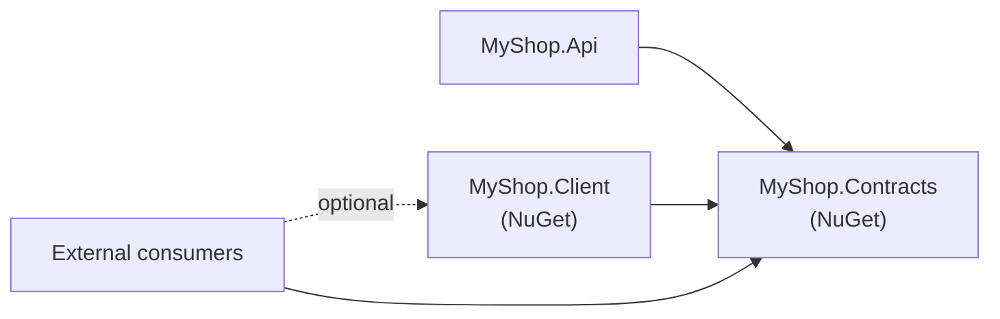

:::note[Series]
Part of the series [*Architecture in practice*](/series/architecture-in-practice/).
:::

A .NET client for an internal API, built the way many teams build them: copy the request and response
classes from the API project into the client project, adjust the namespaces, done. It works for months.
Then the API adds a value to an enum. The client doesn't get the update, because nobody remembered that
the enum exists twice. The first response containing the new value fails to deserialize in every consumer
that uses the client.

I've seen exactly this in a codebase I worked on: an enum in the client had fewer values than the same
enum in the API, and client compatibility broke. It wasn't a one-off. Copied contracts **always** drift.
The only question is when you notice.

This post describes the fix that worked: a dedicated **contracts library**, shared by API and client,
published as a NuGet package.

## The old approach: copy and hope

```text
src/
├── MyShop.Api/
│   └── Api/Orders/V1/
│       ├── PlaceOrderRequest.cs      ← original
│       └── OrderStatus.cs            ← original
└── MyShop.Client/
    └── Models/
        ├── PlaceOrderRequest.cs      ← copy, slightly different
        └── OrderStatus.cs            ← copy, one value missing
```

What goes wrong, in my experience roughly in this order:

| Issue | What happens | Impact |
|---|---|---|
| Duplication | Every DTO, enum and event type exists twice | Every change needs two edits |
| Drift | A fix lands in the API but not in the client | Serialization mismatches at runtime |
| Validation | Attributes like sample values or "not empty" rules only exist on one side | Client accepts input the API rejects |
| Events | Event payloads differ between producer and consumer | Consumers make wrong assumptions |
| Docs | OpenAPI is generated from the API types, the client uses its own | Swagger says one thing, client does another |

The root cause is simple: **there are two sources of truth for one contract.**

## The fix: one contracts library



`MyShop.Contracts` contains the types that cross the wire:

- request and response types,
- enums used in those types,
- event payloads (for messages and webhooks),
- shared value types (`Money`, `Address`) used in the contract,
- attributes that describe the contract (sample values, simple validation markers).

The API references it for endpoint signatures. The client references it for request and response models.
External consumers can reference just the contracts if they want to write their own client, or use the
typed client package that depends on it.

### Structure

```text
src/
├── MyShop.Contracts/
│   ├── Common/
│   │   ├── Money.cs
│   │   └── PagedResult.cs
│   ├── Orders/
│   │   ├── V1/
│   │   │   ├── PlaceOrderRequest.cs
│   │   │   ├── PlaceOrderResponse.cs
│   │   │   ├── Order.cs
│   │   │   └── OrderStatus.cs
│   │   └── V2/
│   └── Events/
│       └── OrderPlaced.cs
├── MyShop.Api/             → references MyShop.Contracts
└── MyShop.Client/          → references MyShop.Contracts
```

The contracts are organized like the API: domain first, then version. That keeps V1 and V2 types apart and
makes it obvious which types belong to which endpoint.

A contract type is a plain record:

```csharp
namespace MyShop.Contracts.Orders.V1;

public sealed record PlaceOrderRequest
{
    public required int CustomerId { get; init; }
    public required IReadOnlyList<PlaceOrderLine> Lines { get; init; }
    public string? VoucherCode { get; init; }
}

public sealed record PlaceOrderLine(string ProductId, int Quantity);

[JsonConverter(typeof(JsonStringEnumConverter<OrderStatus>))]
public enum OrderStatus { Placed, Paid, Shipped, Cancelled }
```

The client uses exactly the same types:

```csharp
public sealed class OrdersClient(HttpClient http)
{
    public async Task<PlaceOrderResponse> PlaceAsync(PlaceOrderRequest request, CancellationToken ct)
    {
        using var response = await http.PostAsJsonAsync("v1/orders", request, ct);
        await response.EnsureSuccessOrThrowProblemAsync(ct);   // own extension: turns ProblemDetails into an exception
        return (await response.Content.ReadFromJsonAsync<PlaceOrderResponse>(ct))!;
    }
}
```

If the API changes `PlaceOrderRequest`, the client gets the change with the next package version. There's
nothing to forget.

## What does NOT go into contracts

This is where contracts libraries usually go wrong. The rule from one team's decision log is the one I use:
**contracts contain only serialization- and validation-friendly types, no API infrastructure and no database
entities.**

Concretely, the contracts project must not reference:

- ASP.NET Core (`Microsoft.AspNetCore.*`): no `IResult`, no `ProblemDetails` from MVC, no `[FromBody]`.
- Entity Framework or any persistence library. Entities are internal.
- MediatR or other application frameworks. A contract type should not implement `IRequest`.
- Internal domain logic. No methods with business rules.

Why so strict? Because every consumer inherits every dependency of the package. A contracts package that
pulls in EF Core forces EF Core onto a mobile app. And a request type that implements `IRequest` couples
every client to your choice of mediator, and to its license.

That has a consequence for the API side: the API still has its own internal types (MediatR requests,
entities, domain models) and maps between them and the contracts. That's the
[anti-corruption layer](/blog/2026-mapping-as-anti-corruption-layer/) doing its job. The contracts are the
public surface; everything behind them can change freely.

## Before and after

| Aspect | Copied DTOs | Contracts package |
|---|---|---|
| Source of truth | Two (or more) | One |
| Enum and type drift | Inevitable | Impossible within one version |
| Validation markers | Inconsistent | Same attributes everywhere |
| OpenAPI schemas | Generated from API copies | Generated from the shared types |
| Effort per change | Edit twice, hope | Edit once, publish |
| External consumers | Copy from docs | Reference the package |
| Versioning | Implicit, unclear | SemVer, consumers upgrade when ready |

## Alternatives

A contracts package is not the only way to get one source of truth:

| | Shared contracts package | Client generated from OpenAPI | Copied DTOs |
|---|---|---|---|
| Single source of truth | ✅ C# types | ✅ the OpenAPI document | ❌ |
| Works for non-.NET clients | ❌ | ✅ | ❌ |
| Keeps attributes, XML docs, custom types | ✅ | ⚠️ depends on generator | ✅ until drift |
| Needs a generator in the build | ❌ | ✅ (NSwag, Kiota, ...) | ❌ |
| Events and messages (not HTTP) | ✅ | ❌ not in OpenAPI | ✅ until drift |

If your consumers are mostly .NET services, a contracts package is the simplest option. If you have
TypeScript or Java clients, generate them from the OpenAPI document, which you then generate from the same
contract types. The two approaches complement each other well.

## Versioning and breaking changes

A contracts package is a public API in the strictest sense. Treat it like one:

- **SemVer.** New optional property or new type: minor. Renamed property, removed type, changed type: major.
- **Adding enum values is a breaking change in practice**, even if the compiler doesn't think so. A client
  that switches over the enum or deserializes into it will hit the new value. Either bump the major version,
  or make consumers tolerant (see pitfalls).
- **Turn on package validation.** The .NET SDK can compare the new package against the last published version
  and fail the build on binary breaking changes:

```xml
<PropertyGroup>
  <EnablePackageValidation>true</EnablePackageValidation>
  <PackageValidationBaselineVersion>2.3.0</PackageValidationBaselineVersion>
</PropertyGroup>
```

Removing a property or changing its type now fails `dotnet pack`, before anyone downloads the package.

## Pitfalls

**The contracts package becomes a "common" package.** Helpers, extension methods, constants for the API's
internals, a logging abstraction. Keep it boring. If it doesn't go over the wire, it doesn't belong there.

**Target framework too new.** If consumers are on .NET 8 and the contracts target .NET 10 only, they can't
upgrade. Multi-target (`net8.0;net10.0`) or target the oldest supported version.

**Intolerant clients.** Configure the client's JSON options so unknown properties are ignored (the default for
`System.Text.Json`), and consider a fallback for unknown enum values, for example by deserializing enums as
strings in places where new values are expected. A tolerant reader turns many breaking changes into
non-events.

**Versioning the API without versioning the contracts.** If the API has `V1` and `V2` endpoints, the contracts
need `V1` and `V2` namespaces. Changing a V1 type in place breaks V1 clients.

**Publishing manually.** Contracts and API must ship together. Build and publish the package in the same
pipeline that deploys the API, so the package version always matches what's running.

## Enforce the boundary

An architecture test keeps forbidden dependencies out of the contracts assembly:

```csharp
[TestMethod]
public void Contracts_have_no_infrastructure_dependencies()
{
    var result = Types.InAssembly(typeof(PlaceOrderRequest).Assembly)
        .ShouldNot().HaveDependencyOnAny(
            "Microsoft.AspNetCore",
            "Microsoft.EntityFrameworkCore",
            "MediatR",
            "MyShop.Api",
            "MyShop.Database")
        .GetResult();

    Assert.IsTrue(result.IsSuccessful,
        $"Contracts must stay plain: {string.Join(", ", result.FailingTypeNames ?? [])}");
}
```

Together with package validation in CI, that covers the two ways a contracts package typically goes bad:
growing the wrong dependencies, and breaking consumers without a major version.

## Summary

- Copying DTOs into a client creates **two sources of truth**, and they always drift. Enums are usually the
  first to break.
- A **contracts library** holds requests, responses, enums, events and contract attributes. API and client
  both reference it, and it's published as a NuGet package.
- Contracts contain **only wire types**: no ASP.NET Core, no EF Core, no mediator interfaces, no business logic.
- Treat the package as a public API: **SemVer**, package validation, versioned namespaces, published from the
  same pipeline as the API.
- Make clients **tolerant** of unknown values, and enforce the contracts' dependencies with an architecture test.
