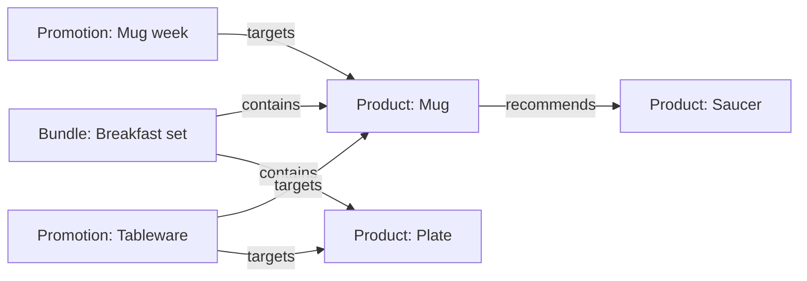
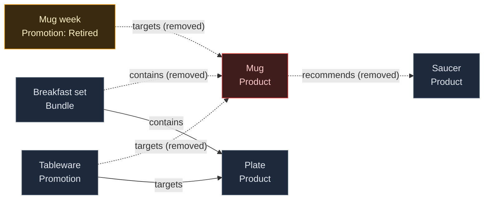

Most business objects can be tested in isolation. An invoice is an invoice; you create one, change
it, check it. But some domains are **graphs**: entities connected by relations, where one operation
ripples through everything attached to it. Deleting a node removes its edges, which deactivates a
rule, which changes what another node is allowed to do.

I've worked on a platform like that, where the core model was a dependency graph and a single
delete could cascade through half a dozen entity types. The test strategy we ended up with, after
trying the obvious approach first, was snapshot testing of the whole graph plus a generated visual
diff. This post explains why, with a neutral example.

## The example: a catalog graph

Picture a shop catalog where products don't stand alone:

- **Products** are the nodes.
- **Bundles** contain products (`contains` edges).
- **Recommendations** connect products ("frequently bought with").
- **Promotions** target one or more products.

Deleting a product must:

1. remove it from every bundle (and deactivate bundles that become empty),
2. remove recommendation edges from and to it,
3. retire promotions that targeted *only* this product,
4. and leave everything else untouched.



## The hidden risk: wrong cascades

In a graph, the dangerous bugs aren't "the product wasn't deleted". They're the **cascade bugs**:

- The product is deleted, but the recommendation edge **isn't**. Now there's an edge pointing at
  nothing, and the storefront crashes on it next week.
- The promotion for *Mug week* is retired correctly, but so is *Tableware*, which still targets
  the plate. **Over-cascading** is silent: nothing crashes, a promotion just disappears.

Both bugs are about entities the test author didn't think about. That's exactly what classic
assertions are bad at.

## Option A: classic assertions

```csharp
[TestMethod]
public async Task Should_Remove_Product_From_Graph_When_Deleted()
{
    var mug    = await Catalog.CreateProductAsync("Mug");
    var plate  = await Catalog.CreateProductAsync("Plate");
    var saucer = await Catalog.CreateProductAsync("Saucer");
    var bundle = await Catalog.CreateBundleAsync("Breakfast set", mug, plate);
    await Catalog.RecommendAsync(mug, saucer);
    var mugWeek   = await Catalog.CreatePromotionAsync("Mug week", mug);
    var tableware = await Catalog.CreatePromotionAsync("Tableware", mug, plate);

    await Catalog.DeleteProductAsync(mug);

    await AssertDeletedAsync(mug);
    await AssertBundleContainsOnlyAsync(bundle, plate);
    await AssertNoRecommendationsAsync(saucer);
    await AssertRetiredAsync(mugWeek);
    await AssertActiveAsync(tableware);
    await AssertExistsAsync(plate);
    await AssertExistsAsync(saucer);
}
```

It's explicit, it's familiar, and it has three structural problems:

- **It only checks what someone remembered.** Add a new relation type next quarter (say, *product
  replaces product*) and this test stays green while the new edges dangle.
- **It explodes.** Every scenario needs assertions for every entity type. Real tests in that graph
  platform grew to dozens of assertions per scenario.
- **It doesn't show what happened.** When `AssertActiveAsync(tableware)` fails, you know one fact.
  You don't see the graph.

## Option B: snapshot the whole graph

Instead of asserting individual facts, take the complete state of the affected graph after the
operation and compare it with an approved snapshot:

```csharp
[TestMethod]
public async Task Should_Remove_Product_From_Graph_When_Deleted()
{
    var graph = await CatalogScenario.BreakfastSetAsync(Catalog, TestTag);   // the graph from above

    await Catalog.DeleteProductAsync(graph["Mug"]);

    var after = await GraphSnapshot.LoadAsync(Catalog, TestTag);
    await Verify(after);
}
```

`GraphSnapshot` is the important piece. It turns the API's view of the graph into something that's
stable and readable:

```csharp
public sealed record GraphSnapshot(IReadOnlyList<NodeSnapshot> Nodes, IReadOnlyList<EdgeSnapshot> Edges)
{
    public static async Task<GraphSnapshot> LoadAsync(CatalogClient catalog, string tag)
    {
        var graph = await catalog.GetGraphAsync(tag);    // via the public API, filtered to this test's data
        var names = graph.Nodes.ToDictionary(n => n.Id, n => n.Name);

        return new GraphSnapshot(
            graph.Nodes
                 .Select(n => new NodeSnapshot(n.Name, n.Type, n.Status))
                 .OrderBy(n => n.Type).ThenBy(n => n.Name)
                 .ToList(),
            graph.Edges
                 .Select(e => new EdgeSnapshot(names[e.SourceId], e.Type, names[e.TargetId]))
                 .OrderBy(e => e.Source).ThenBy(e => e.Type).ThenBy(e => e.Target)
                 .ToList());
    }
}

public sealed record NodeSnapshot(string Name, string Type, string Status);
public sealed record EdgeSnapshot(string Source, string Type, string Target);
```

Two details make or break this:

- **Replace generated IDs with names.** IDs change on every run. Names are stable and make the
  snapshot readable for a reviewer.
- **Sort deterministically.** Graph traversal order isn't a contract. If the snapshot order depends
  on it, you get random failures.

The approved snapshot (`*.verified.json`, committed next to the test) then reads like a description
of the expected end state:

```json
{
  "Nodes": [
    { "Name": "Breakfast set", "Type": "Bundle",    "Status": "Active" },
    { "Name": "Plate",         "Type": "Product",   "Status": "Active" },
    { "Name": "Saucer",        "Type": "Product",   "Status": "Active" },
    { "Name": "Mug week",      "Type": "Promotion", "Status": "Retired" },
    { "Name": "Tableware",     "Type": "Promotion", "Status": "Active" }
  ],
  "Edges": [
    { "Source": "Breakfast set", "Type": "contains", "Target": "Plate" },
    { "Source": "Tableware",     "Type": "targets",  "Target": "Plate" }
  ]
}
```

Now **nothing can be forgotten**. A dangling recommendation edge shows up as an extra line. A
wrongly retired *Tableware* shows up as a changed status. A new relation type that doesn't cascade
shows up the first time a scenario touches it. One comparison replaces dozens of assertions, and an
intentional change means approving a new snapshot instead of rewriting tests.

I use [Verify](https://github.com/VerifyTests/Verify) for this (with MSTest, the test class gets the
`[UsesVerify]` attribute and is declared `partial`), but any snapshot mechanism that compares JSON
and shows a diff works, including the full-response comparison I described in the
[test SDK retrospective](/blog/2021-aspnetcore-simple-mstest-sdk/).

The remaining weakness: a JSON diff shows *data*, not *topology*. When a snapshot of forty nodes
fails, working out "which part of the graph changed" from a text diff is still slow.

## Option C: snapshot plus a generated visual diff

So we added one more step. Each graph test also produces a **visual diff** between the graph before
and after the operation, rendered as a Mermaid diagram in a Markdown file:

```csharp
var before = await GraphSnapshot.LoadAsync(Catalog, TestTag);
await Catalog.DeleteProductAsync(graph["Mug"]);
var after = await GraphSnapshot.LoadAsync(Catalog, TestTag);

var diff = GraphDiff.Between(before, after);

var reportPath = Path.Combine(TestContext.TestRunResultsDirectory!, $"{TestContext.TestName}.md");
await File.WriteAllTextAsync(reportPath, GraphReport.ToMarkdown(diff));
TestContext.AddResultFile(reportPath);       // attached to the test result in the IDE and pipeline

await Verify(new { after, diff.Summary });
```

The diff itself is plain set logic over the snapshot records:

```csharp
public sealed record GraphDiff(
    IReadOnlyList<NodeSnapshot> AddedNodes,
    IReadOnlyList<NodeSnapshot> RemovedNodes,
    IReadOnlyList<(NodeSnapshot Before, NodeSnapshot After)> ChangedNodes,
    IReadOnlyList<EdgeSnapshot> AddedEdges,
    IReadOnlyList<EdgeSnapshot> RemovedEdges,
    GraphSnapshot Before,
    GraphSnapshot After)
{
    public static GraphDiff Between(GraphSnapshot before, GraphSnapshot after)
    {
        var beforeByKey = before.Nodes.ToDictionary(n => (n.Type, n.Name));
        var afterByKey  = after.Nodes.ToDictionary(n => (n.Type, n.Name));

        return new GraphDiff(
            after.Nodes.Where(n => !beforeByKey.ContainsKey((n.Type, n.Name))).ToList(),
            before.Nodes.Where(n => !afterByKey.ContainsKey((n.Type, n.Name))).ToList(),
            after.Nodes.Where(n => beforeByKey.TryGetValue((n.Type, n.Name), out var b) && b != n)
                       .Select(n => (beforeByKey[(n.Type, n.Name)], n)).ToList(),
            after.Edges.Except(before.Edges).ToList(),
            before.Edges.Except(after.Edges).ToList(),
            before,
            after);
    }

    public string Summary =>
        $"nodes +{AddedNodes.Count} -{RemovedNodes.Count} ~{ChangedNodes.Count}, edges +{AddedEdges.Count} -{RemovedEdges.Count}";
}
```

`GraphReport.ToMarkdown` writes an impact table and a Mermaid diagram of the union of both graphs,
with a CSS class per status. For the mug scenario it renders like this:



Red is gone, orange changed, dashed edges were removed. You see the cascade at a glance, including
what it *didn't* touch. When the over-cascading bug from above happens, *Tableware* turns orange and
it's obvious before you've read a single line of JSON.

A nice side effect: these reports are **living documentation**. "What happens when I delete a
product?" is answered by a diagram that's regenerated on every test run, so it can't go stale.

## Comparison

| | Classic assertions | Snapshot | Snapshot + visual diff |
|---|---|---|---|
| Test size | ❌ dozens of asserts | ✅ one comparison | ✅ one comparison |
| Catches forgotten entities / new relation types | ❌ | ✅ | ✅ |
| Catches over-cascading | ⚠️ only if asserted | ✅ | ✅ |
| Understanding a failure | ⚠️ one fact at a time | ⚠️ JSON diff | ✅ visual diff |
| Maintenance on intentional change | ❌ rewrite asserts | ✅ approve snapshot | ✅ approve snapshot |
| Documents behaviour | ❌ | ⚠️ | ✅ diagrams per scenario |

The team I was on adopted the third option as the primary strategy for graph operations. Classic
assertions stayed for small, local rules where a snapshot would be overkill.

## Pitfalls

**Approving without reading.** The one real trade-off: snapshot changes must be **reviewed** in pull
requests. A reviewer who approves a 200-line snapshot diff without reading it has turned your strongest
test into a rubber stamp. The visual diff helps a lot here; so does keeping scenarios small.

**Auto-accepting snapshots.** Tools offer "accept all received files". Use it locally when you know
why everything changed, never in CI.

**Snapshotting the whole world.** A snapshot of every node in a shared environment changes whenever
anyone does anything. Load only the test's own subgraph, filtered by the test's tag, like any other
[isolated test data](/blog/2026-api-test-patterns-get-post-delete/).

**Volatile values.** IDs, timestamps, version counters: map them to names or remove them in the
snapshot model. Don't scrub them with regexes afterwards; build a snapshot model that doesn't contain
them in the first place.

**Diagrams nobody looks at.** If the report is only written to disk, nobody opens it. Attach it to
the test result (`TestContext.AddResultFile`) and, if your pipeline supports it, publish it on the
pull request when a graph test fails.

## Make it count

- **Track snapshot churn.** If the same snapshot changes in every other pull request, the scenario
  probably snapshots too much, or the model contains a volatile value.
- **Add invariants that must hold for every snapshot**, independent of the scenario: no edge may
  point to a missing node, no active bundle may be empty. A small `GraphInvariants.Check(after)`
  call in every graph test catches broken topology even in snapshots someone approved by mistake.

## Summary

- In graph domains, the dangerous bugs are **wrong cascades**: edges left behind and neighbours
  touched that shouldn't be.
- Classic assertions only check what someone remembered; **snapshots of the whole subgraph** check
  everything.
- Build a **stable snapshot model**: names instead of IDs, deterministic order, no volatile values.
- Add a generated **visual diff** (Mermaid in Markdown) so a failure shows the cascade at a glance,
  and the tests double as living documentation.
- Snapshots are only as good as their **review**. Keep scenarios small, never auto-accept in CI, and
  back them with graph invariants.
