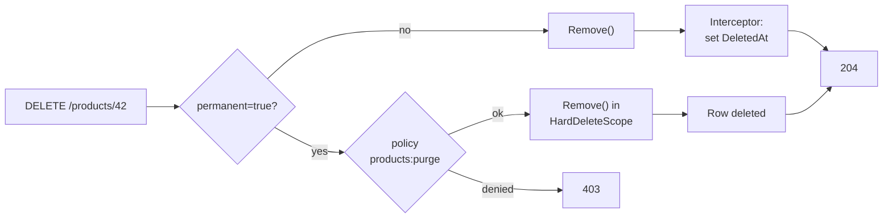

:::note[Series]
Part of the series [*REST & OpenAPI design*](/series/rest-and-openapi-design/).
:::

A discussion I've had in more than one API review goes like this. The team needs a way to delete
products. The backend won't actually remove the row, it'll set `IsDeleted = true`, so someone
proposes:

```http
POST /products/{id}/soft-delete
```

The reasoning sounds logical: "It's not really a delete, it's an update of a flag. And a `DELETE`
would promise that the data is gone." Then someone else asks how hard delete would work, and the API
grows a second endpoint, `POST /products/{id}/hard-delete`. Six months later, a third team asks why
deleting a product is a `POST` when every other resource uses `DELETE`.

My position is simple: **soft delete is an implementation detail. The API contract is `DELETE`.**

## The consumer doesn't care how you store it

Look at it from the caller's side. They want the product gone. Whether your backend:

- removes the row,
- sets a `DeletedAt` timestamp,
- moves the record to an archive table, or
- writes a tombstone event,

is your business, not theirs. From the outside, the resource is deleted: it doesn't show up in lists
any more, and `GET /products/{id}` stops returning it. That's what `DELETE` means in RFC 9110: the
origin server removes the association between the target URI and its current representation. It
says nothing about whether the bytes are wiped from disk. Plenty of systems have always kept
"deleted" data for backups, audit or legal reasons.

The `POST .../soft-delete` design has real costs:

- **It needs explanation.** Every consumer has to read the docs to learn how to delete a product.
- **Tooling loses the intent.** Generated SDKs produce `SoftDeleteAsync()` next to `UpdateAsync()`
  instead of `DeleteAsync()`. Gateways, caches and audit logs that treat `DELETE` specially don't
  recognize it.
- **It's not idempotent by contract.** `DELETE` is idempotent by definition; clients and retry
  policies can safely retry it. `POST` isn't, so a retry-aware client must treat it as unsafe.
- **It freezes an implementation detail.** If you later switch to hard deletes or to archiving,
  the URL is now lying, and changing the verb is a breaking change.

That last one matters most. **Changing an HTTP verb after release is one of the most expensive
breaking changes there is.** Adding an optional query parameter is cheap. So make the semantic choice
right the first time.

## The design

```http
DELETE /products/{id}                      → 204  soft delete (default)
DELETE /products/{id}?permanent=true       → 204  hard delete, restricted
GET    /products/{id}                      → 404  after either delete
POST   /products/{id}/restore              → 200  if you support restore, restricted
GET    /products?includeDeleted=true       →      admin view, restricted
```

A few decisions behind that table.

**Soft delete is the safe default.** The common case, a user deleting something in a UI, gets the
recoverable behaviour. That covers accidental deletes, support cases and audit.

**Hard delete is explicit and authorized.** You need it for GDPR erasure requests, for cleaning up
test environments and for cleanup jobs. It's an opt-in flag on the same verb, protected by a
stricter policy. The name of the flag is a matter of taste; I prefer `permanent=true` over
`force=true` because it says what happens, not how hard you're pushing.

**Restore is an action, and that's fine.** Undeleting doesn't map to any standard verb, so it's one
of the few cases where an action endpoint is the right call. (The
[next post](/blog/2026-property-updates-vs-action-endpoints/) goes into when actions are justified.)

**No request body.** `DELETE /products/{id}` without a body is the simplest and most widely
supported form. Resist the urge to add an empty `DeleteProductRequest` DTO "for future
extensibility". It's boilerplate with no value until there's a real requirement.

:::caution[What about a deletion reason?]
Some guidelines suggest an optional JSON body like `{ "reason": "..." }` for `DELETE`. Be careful:
RFC 9110 says content in a `DELETE` request has **no generally defined semantics**, and some proxies,
gateways and HTTP clients drop or reject it. If you need a reason, pass it as a query parameter
(`?reason=customer-request`) or a header. Both are optional, so adding them later isn't a breaking
change.
:::

## What happens on the second DELETE?

Idempotency means the *state* is the same after one or many calls, not that the response is
identical. Both options are common:

| Second `DELETE` returns | Pro | Con |
|---|---|---|
| `204 No Content` | Retries look exactly like the first call | Hides typos in IDs |
| `404 Not Found` | Honest: there's nothing at this URI | Retry logic must treat 404 as success |

I go with `204` for a resource that existed and is soft-deleted, and `404` for an ID that never
existed. That keeps retries clean and still catches wrong IDs.

## Implementation with EF Core

The nice thing about soft delete in EF Core is that you can make it almost invisible to the rest of
the code.

```csharp
public interface ISoftDeletable
{
    DateTimeOffset? DeletedAt { get; set; }
    string? DeletedBy { get; set; }
}

public sealed class Product : ISoftDeletable
{
    public Guid Id { get; init; }
    public required string Sku { get; set; }
    public required string Name { get; set; }
    public DateTimeOffset? DeletedAt { get; set; }
    public string? DeletedBy { get; set; }
}
```

A **global query filter** hides deleted rows from every query, and a filtered unique index keeps
`Sku` unique among live products only:

```csharp
protected override void OnModelCreating(ModelBuilder model)
{
    model.Entity<Product>(e =>
    {
        e.HasQueryFilter(p => p.DeletedAt == null);
        e.HasIndex(p => p.Sku).IsUnique().HasFilter("[DeletedAt] IS NULL");
    });
}
```

An **interceptor** turns every `Remove()` into a soft delete, so handlers just call `Remove` and
don't need to know:

```csharp
public sealed class SoftDeleteInterceptor(TimeProvider clock, ICurrentUser user)
    : SaveChangesInterceptor
{
    public override ValueTask<InterceptionResult<int>> SavingChangesAsync(
        DbContextEventData eventData,
        InterceptionResult<int> result,
        CancellationToken ct = default)
    {
        if (eventData.Context is null)
            return ValueTask.FromResult(result);

        foreach (var entry in eventData.Context.ChangeTracker.Entries<ISoftDeletable>())
        {
            if (entry.State != EntityState.Deleted || HardDeleteScope.IsActive)
                continue;

            entry.State = EntityState.Modified;
            entry.Entity.DeletedAt = clock.GetUtcNow();
            entry.Entity.DeletedBy = user.Id;
        }

        return ValueTask.FromResult(result);
    }
}

public static class HardDeleteScope
{
    private static readonly AsyncLocal<bool> active = new();
    public static bool IsActive => active.Value;

    public static IDisposable Begin()
    {
        active.Value = true;
        return new Reset();
    }

    private sealed class Reset : IDisposable
    {
        public void Dispose() => active.Value = false;
    }
}
```

The endpoint stays small:

```csharp
app.MapDelete("/products/{id:guid}", async Task<Results<NoContent, NotFound, ForbidHttpResult>> (
    Guid id, bool? permanent, ShopDbContext db, IAuthorizationService auth,
    ClaimsPrincipal user, CancellationToken ct) =>
{
    var product = await db.Products.IgnoreQueryFilters()
        .SingleOrDefaultAsync(p => p.Id == id, ct);

    if (product is null)
        return TypedResults.NotFound();

    if (permanent == true)
    {
        if (!(await auth.AuthorizeAsync(user, "products:purge")).Succeeded)
            return TypedResults.Forbid();

        using var _ = HardDeleteScope.Begin();
        db.Products.Remove(product);
        await db.SaveChangesAsync(ct);
        return TypedResults.NoContent();
    }

    if (product.DeletedAt is null)
    {
        db.Products.Remove(product);   // the interceptor turns this into a soft delete
        await db.SaveChangesAsync(ct);
    }

    return TypedResults.NoContent();   // idempotent: already deleted is fine
});
```

EF Core 10 adds **named query filters**, so you can combine soft delete with a tenant filter and
disable only one of them (`IgnoreQueryFilters(["SoftDelete"])`). On older versions,
`IgnoreQueryFilters()` switches off all filters, including the tenant filter. Keep that in mind,
because the restore and admin endpoints are exactly where you'd call it.



## Comparison

| Design | Intent clear | Idempotent | Survives implementation change | SDK-friendly |
|---|---|---|---|---|
| `POST /products/{id}/soft-delete` | ❌ needs docs | ❌ | ❌ URL names the mechanism | ❌ |
| `PATCH /products/{id}` `{ "isDeleted": true }` | ❌ looks like an edit | ✅ | ❌ flag is part of the model | ❌ |
| `DELETE /products/{id}` (soft by default) | ✅ | ✅ | ✅ | ✅ |
| `DELETE ...?permanent=true` for hard delete | ✅ explicit | ✅ | ✅ | ✅ |

## Pitfalls

Soft delete is cheap in the API and expensive in the backend. Those costs are real, they just don't
belong in the contract.

**Forgotten filters.** Every raw SQL query, report and view must exclude deleted rows. Global query
filters help for EF Core, they don't help for the stored procedure someone wrote three years ago.

**Uniqueness.** "Delete product `SKU-1`, create a new product `SKU-1`" fails with a plain unique
index. Use a filtered index as above, or include `DeletedAt` in the key.

**Referential integrity.** An order line still points to the soft-deleted product, and that's
usually what you want (the order history must stay intact). But navigation properties now load
"deleted" entities in some paths and not in others. Decide per relationship, and test it.

**Data growth and the right to erasure.** Soft-deleted data still counts as stored personal data.
You need a cleanup job that hard-deletes or anonymizes after a retention period, and you need
`permanent=true` for erasure requests that can't wait.

**Leaking the flag.** Don't return `isDeleted` or `deletedAt` in the normal resource representation.
For the normal consumer, a deleted resource is a 404. The admin view with `includeDeleted=true` can
show it.

**Cascades.** Deleting a customer: are their addresses soft-deleted too? EF Core's cascade delete
runs on `Deleted` entities, but the interceptor turns them into `Modified`, so the cascade doesn't
happen. Handle child entities explicitly.

## Enforce and document it

- **Document the behaviour** in the OpenAPI description of the `DELETE` operation: default is
  recoverable, `permanent=true` needs a specific permission, a deleted resource returns 404. That's
  the one place where the consumer *should* hear about soft delete.
- **An integration test** that deletes a resource and asserts the follow-up `GET` returns 404, a list
  no longer contains it, and a second `DELETE` returns 204.
- **An OpenAPI lint rule** that flags operations whose path ends in `/delete`, `/remove` or
  `/soft-delete`. Spectral can do that in a few lines, and it stops the design from creeping back.
- **An architecture test** that every entity implementing `ISoftDeletable` has a query filter
  configured. Iterate over `db.Model.GetEntityTypes()` and check `GetDeclaredQueryFilters()` (or
  `GetQueryFilter()` before EF Core 10).

## Summary

- Soft delete is an **implementation detail**. The contract is `DELETE /resource/{id}`.
- Make **soft delete the default** and **hard delete explicit**: `?permanent=true`, behind its own
  authorization policy.
- **No mandatory request body.** If you need a reason, use an optional query parameter or header.
- A soft-deleted resource is a **404** for normal consumers. Repeated `DELETE`s stay idempotent.
- In EF Core: global query filter, a `SaveChanges` interceptor, filtered unique indexes.
- The hard parts (filters, uniqueness, cascades, retention) are **backend concerns**. Solve them
  there, not by leaking them into the API.
- **Pick the verb right the first time.** Changing it later is a breaking change.
