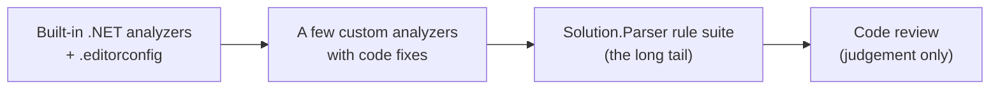

If you've used [NetArchTest](https://github.com/BenMorris/NetArchTest), you know the idea: write
your architecture rules as ordinary unit tests, and let the build tell you when someone breaks them.
"The domain doesn't depend on infrastructure" stops being a sentence on a wiki page and becomes a test
that fails. I love that idea, and it's the same way of thinking that got me started on
[Solution.Parser](https://github.com/RenePeuser/Solution.Parser).

This post shows how far that idea goes when the rules can see the **whole solution**: not only
types and namespaces, but how code is written, project files, packages and XAML. And, to be fair,
where a rule is better off as a Roslyn analyzer.

This is the last post of the series. The earlier ones covered
[getting started](/blog/2026-solution-parser-your-solution-as-a-queryable-model/),
[the code model](/blog/2026-solution-parser-reading-code-like-code/) and
[project and XAML rules](/blog/2026-solution-parser-architecture-tests-for-projects-and-xaml/).

## What a rule can see

Where a rule looks decides which rules you can write:

| | Reads | Sees | Fails |
|---|---|---|---|
| Roslyn analyzer | source, inside the compiler | everything the compiler sees, one compilation at a time | while typing and on build |
| Solution.Parser | sln/slnx, csproj, C# source, XAML, nuspec | projects, packages, statements, expressions, markup; symbols on demand | in a unit test |

An analyzer runs one compilation at a time, so rules that span projects are hard. A test can't put a
squiggle under your code while you type. And a rule about a `.csproj` or a `.xaml` file needs a tool
that actually reads those files.

## The classic: layering

The rule everybody starts with: *the domain doesn't depend on infrastructure.* In Solution.Parser,
on the project level:

```csharp
var findings = from reference in Solution.Project("Shop.Domain").ProjectReferences
               where reference.Name.Contains(".Infrastructure", StringComparison.Ordinal)
               select $"Shop.Domain references {reference.Name}";

findings.ShouldBeEmpty("The domain must not depend on infrastructure");
```

Same idea as a NetArchTest rule, one level up: it looks at the project graph instead of the compiled
types. The [previous post](/blog/2026-solution-parser-architecture-tests-for-projects-and-xaml/)
takes this further with transitive references and namespace layering. If type-to-type dependencies
are all you need, a NetArchTest rule over the compiled assembly is a perfectly good fit too, and it
combines nicely with the rules below.

## Rules about how code is written

Now a rule from a real review checklist: *log with a message template, not an interpolated string.*

```csharp
logger.LogInformation($"Order {order.Id} placed by {customer.Name}");   // what the rule should find
logger.LogInformation("Order {OrderId} placed by {Customer}", order.Id, customer.Name);
```

After compilation, both are just calls to `LogInformation` with a string. In the source, the
difference is obvious, and in Solution.Parser it's the expression's kind:

```csharp
from call in trees.Invocations
where call.Name.StartsWith("Log", StringComparison.Ordinal)
   && call.Arguments.Any(a => a.Kind == ExpressionKind.InterpolatedString)
select $"{call.Location}: {call.Name} with an interpolated string loses the structure, pass a template";
```

The same goes for most rules about **how code is written** rather than what it depends on:

- an `else` after a branch that returns,
- `throw ex;` instead of `throw;`,
- `await` inside a `foreach`, `SaveChanges` inside a loop,
- `#pragma warning disable` without a reason,
- a `switch` expression without a `_` arm,
- `== null` instead of `is null`.

And everything that isn't C# at all: project references, package versions, test projects referenced
from production, a binding path in XAML that doesn't exist on its view model. All of that lives in
files a solution-wide rule can read.

## Where Solution.Parser stops

To be fair about its limits:

- **No feedback while typing.** A Solution.Parser rule fails when the tests run. If a developer
  should see the problem the moment they type it, that's an analyzer's job.
- **No code fix.** A finding tells you where and what to do instead. It doesn't rewrite the code with
  a light bulb.
- **Syntax first.** Without symbols, matching goes by the written name: a class of your own called
  `List` counts as a collection. `ParseMode.WithSymbols` fixes that, but it needs a restored solution
  and takes longer.
- **It's a test run, not an incremental build.** On a very large solution, parsing everything takes
  seconds rather than milliseconds. It's cached within a run, but it's not free.
- **Maintained by one person.** I'm committed to it and it has a fair number of NuGet downloads, but
  it's not backed by a company the way Roslyn is.

## Roslyn analyzers: unbeatable feedback, real cost

Analyzers are the gold standard for feedback. The squiggle appears while typing, the build fails with
`TreatWarningsAsErrors`, and a code fix can repair the violation in one click. The compiler's semantic
model is right there.

The cost is everything around it: a `netstandard2.0` project, packaging or analyzer references, a test
harness of its own, and care about performance because the analyzer runs on every keystroke in every
open file. I wrote about that trade-off in my
[2017 post on Roslyn analyzers](/blog/2017-roslyn-analyzers-and-argument-checks/). For a rule that
fires daily and has an obvious fix, it's worth it. For the long tail of team conventions, most of them
never get written that way.

## A decision guide

| The rule… | Pick |
|---|---|
| is about dependencies between projects, namespaces or types | Solution.Parser (NetArchTest works nicely for type-level rules too) |
| is about how code is written: statements, expressions, patterns, logging, async | Solution.Parser |
| involves project or package references, test projects, target frameworks | Solution.Parser |
| involves XAML, or checks markup against C# | Solution.Parser |
| spans several projects ("every endpoint has a test", "every DTO is mapped") | Solution.Parser |
| should be visible while typing, fires often and has an obvious automatic fix | Roslyn analyzer + code fix |
| is new and you're not sure it's right yet | Solution.Parser first, analyzer later if it earns it |

That last row is the one I use most. Writing a rule as a test takes minutes, so it's cheap to find out
whether a rule is actually right: whether it has false positives, whether the team agrees with it,
whether it fires at all. The few rules that prove themselves *and* fire often enough to deserve
feedback while typing get promoted to an analyzer.

## The mix I actually use

In practice, a mature codebase I work on ends up with layers:



- **Built-in analyzers and `.editorconfig`** for everything Microsoft already ships: nullability,
  `ConfigureAwait`, naming, formatting.
- **A handful of custom analyzers** for the rules that fire constantly and have a mechanical fix.
- **A Solution.Parser rule suite** for the long tail: team conventions, project structure, XAML,
  cross-project checks. Often dozens of rules, each a few lines.
- **Code review** for what actually needs human judgement: naming that's technically fine but
  misleading, design trade-offs, whether the code solves the right problem.

The goal is that reviewers stop writing the same comment for the fifth time, and that an AI agent gets
a clear, located, actionable message instead of a wiki page it never reads. The talk recap
[Self-defending codebases](/blog/2026-self-defending-codebases/) shows that whole pipeline, from a rule
as a test to analyzers and code fixes, and
[RunJit and RuleJIT](/blog/2024-clientgenerator-runjit-rulejit/) is where the idea of pushing rule
suites into many repositories started.

## Pitfalls

- **One mechanism for everything.** An analyzer for a rule that fires once a quarter is wasted
  effort. A test for a rule that fires ten times a day is slow feedback.
- **Stopping at the layering rule.** "Domain doesn't reference infrastructure" is a great first
  rule. The real value shows up in the second, third and twentieth rule.
- **Duplicating a rule across tools.** If a rule moves from a test to an analyzer, delete the test.
  Two sources of truth drift.
- **Rules without an owner.** Whatever the tool, a rule that nobody can explain gets suppressed. Every
  rule needs a reason in its message.

## Summary

- Architecture rules as unit tests, the idea NetArchTest made popular, work for far more than
  layering.
- Solution.Parser applies that idea to the whole solution: how code is written, projects, packages
  and XAML.
- Roslyn analyzers give the best feedback, at the highest cost per rule. Reserve them for rules that
  fire often and have an automatic fix.
- Start a new rule as a Solution.Parser test, find out if it's right, and promote it to an analyzer
  only if it earns it.

Solution.Parser is on [GitHub](https://github.com/RenePeuser/Solution.Parser) and
[NuGet](https://www.nuget.org/packages/Solution.Parser/). The README's cookbook is the fastest way to
your first rules, and every sample in it runs as a test, so what you copy works.
