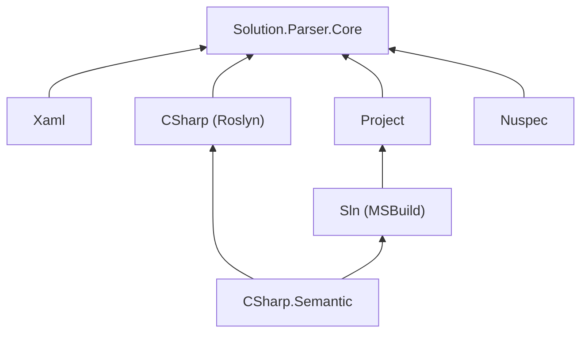

Most architecture rules aren't about a single line of code. They're about **how the pieces connect**:
which project may reference which, which package may depend on what, which namespace may use which.
And in a WPF application, some of the most expensive bugs live in a place no C# rule ever looks at:
the XAML.

This post uses two real examples from the
[Solution.Parser](https://github.com/RenePeuser/Solution.Parser) repository itself. The library tests
its own package layering with its own API, and it ships a small WPF sample application whose markup is
checked against its view models. Both are worth copying. For the basics of writing a rule, see
[the first post of this series](/blog/2026-solution-parser-your-solution-as-a-queryable-model/).

## Example 1: a package split that has to stay split

Solution.Parser ships as one NuGet package, but the source is split into assemblies with deliberately
narrow dependencies:

| Assembly | What it parses | What it drags in |
|---|---|---|
| `Solution.Parser.Core` | shared contracts | nothing |
| `Solution.Parser.CSharp` | C# files into syntax trees | Roslyn |
| `Solution.Parser.CSharp.Semantic` | symbols | Roslyn, CSharp and Sln |
| `Solution.Parser.Xaml` | XAML markup | nothing but Core |
| `Solution.Parser.Project` | csproj, old and SDK style | nothing but Core |
| `Solution.Parser.Sln` | sln and slnx, and their projects | MSBuild |
| `Solution.Parser.Nuspec` | nuspec files and NuGet folders | nothing but Core |
| `Solution.Parser.AspNet` | controllers, routes, response types | NuGet client libraries |

The split only pays off as long as nobody adds a reference that quietly puts Roslyn or MSBuild back
under an assembly that doesn't need them. One innocent `<ProjectReference>` and a consumer who only
wants to parse XAML pulls a compiler and a build engine.

A comment in a csproj can't enforce that. A test can:



```csharp
[TestClass]
public class LayeringTest
{
    private const string LayeringFix =
        "Adding this reference undoes the package split. Put the code that needs it in a package "
        + "that already depends on it, or extend the file list instead of ProjectFile";

    private static SolutionFile _solution = null!;

    [ClassInitialize]
    public static void ClassInit(TestContext _)
    {
        _solution = SolutionFile.Find("Solution.Parser.sln");
    }

    private static ImmutableList<string> ProjectReferencesOf(string name)
    {
        return _solution.Project(name).ProjectReferences.Select(r => r.Name).Order(StringComparer.Ordinal).ToImmutableList();
    }

    private static ImmutableList<string> PackageReferencesOf(string name)
    {
        return _solution.Project(name).PackageReferences.Select(r => r.Include).Order(StringComparer.Ordinal).ToImmutableList();
    }

    [TestMethod]
    public void Xaml_Needs_Neither_Roslyn_Nor_MsBuild()
    {
        Assert.That.AreEqual<string>(["Solution.Parser.Core"],
                                     ProjectReferencesOf("Solution.Parser.Xaml"),
                                     because: "parsing markup needs nothing but the shared contracts",
                                     fix: LayeringFix);

        Assert.That.All(PackageReferencesOf("Solution.Parser.Xaml"),
                        p => !p.StartsWith("Microsoft.CodeAnalysis", StringComparison.Ordinal)
                             && !p.StartsWith("Microsoft.Build", StringComparison.Ordinal)
                             && !p.StartsWith("NuGet.", StringComparison.Ordinal),
                        "is not a compiler, build engine or package manager dependency",
                        because: "a consumer that only parses XAML must not pull Roslyn, MSBuild or NuGet",
                        fix: LayeringFix);
    }

    [TestMethod]
    public void Project_Knows_No_Language()
    {
        Assert.That.AreEqual<string>(["Solution.Parser.Core"],
                                     ProjectReferencesOf("Solution.Parser.Project"),
                                     because: "a csproj reader that knows about C# and XAML forces both on "
                                              + "everyone who reads a solution",
                                     fix: LayeringFix);
    }
}
```

The assertions use `Assert.That` with `because` and `fix` from
[AspNetCore.Simple.MsTest.Sdk](https://github.com/RenePeuser/AspNetCore.Simple.MsTest.Sdk), my test
helper library, so a failure explains *why* the rule exists and *what to do*. With plain MSTest
assertions the structure is the same, the message just carries less.

### Transitive references

Direct references aren't enough. "Reading a solution does not pull XAML" has to hold through every
hop. The test walks the reference graph itself, in a dozen lines:

```csharp
[TestMethod]
public void Writing_AspNet_Rules_Does_Not_Pull_Xaml()
{
    Assert.That.DoesNotContain(TransitiveProjectReferencesOf("Solution.Parser.AspNet"),
                               "Solution.Parser.Xaml",
                               because: "ASP.NET code rules must not drag the markup parser along",
                               fix: LayeringFix);
}

private static ImmutableList<string> TransitiveProjectReferencesOf(string name)
{
    var seen = ImmutableList.CreateBuilder<string>();
    Walk(name, seen);
    return seen.ToImmutable();
}

private static void Walk(string name, ImmutableList<string>.Builder seen)
{
    foreach (var reference in ProjectReferencesOf(name).Where(r => !seen.Contains(r)))
    {
        seen.Add(reference);
        Walk(reference, seen);
    }
}
```

One more test in that file is my favourite, because it guards a promise to *users* rather than a
technical constraint: the meta package `Solution.Parser` has to keep referencing every assembly, or an
existing `PackageReference` silently loses part of its API.

```csharp
[TestMethod]
public void The_Meta_Package_Still_Offers_Everything()
{
    Assert.That.AreEqual<string>([
                                     "Solution.Parser.AspNet",
                                     "Solution.Parser.CSharp",
                                     "Solution.Parser.CSharp.Semantic",
                                     "Solution.Parser.Core",
                                     "Solution.Parser.Nuspec",
                                     "Solution.Parser.Project",
                                     "Solution.Parser.Sln",
                                     "Solution.Parser.Xaml"
                                 ],
                                 ProjectReferencesOf("Solution.Parser"),
                                 because: "an existing PackageReference to Solution.Parser must keep the surface it had",
                                 fix: "Add the new package to the meta project as well, or existing users lose it");
}
```

### The same idea for your solution

In an application, the typical layering rules look like this. Projects:

```csharp
// The domain references no infrastructure project
var findings = from reference in Solution.Project("Shop.Domain").ProjectReferences
               where reference.Name.Contains(".Infrastructure", StringComparison.Ordinal)
               select $"Shop.Domain references {reference.Name}";

findings.ShouldBeEmpty("The domain must not depend on infrastructure");

// Production code never references a test project
var testProjects = Solution.UnitTestProjects.Select(p => p.Name).ToHashSet();

var leaks = from project in Solution.ProductionProjects
            from reference in project.ProjectReferences
            where testProjects.Contains(reference.Name)
            select $"{project.Name} references the test project {reference.Name}";

leaks.ShouldBeEmpty("Test projects are never deployed");
```

And namespaces, for codebases that keep layers inside one project:

```csharp
// Nothing in a Domain namespace imports Infrastructure
var findings = from tree in Solution.ProductionTrees
               where tree.Namespace.Name.Contains(".Domain", StringComparison.Ordinal)
               from @using in tree.Usings
               where @using.Name.Contains(".Infrastructure", StringComparison.Ordinal)
               select $"{@using.Location}: {tree.Namespace.Name} imports {@using.Name}";

findings.ShouldBeEmpty("The domain must not depend on infrastructure");
```

A `using` is a weak signal, because fully qualified names and global usings bypass it. For a strict
boundary, [the symbol layer](/blog/2026-solution-parser-reading-code-like-code/#when-the-syntax-isnt-enough-symbols)
can check where each called method actually comes from.

## Example 2: XAML rules that no compiler runs

WPF has a class of bugs that compiles, starts and shows nothing:

```xml
<TextBlock Text="{Binding FulName}" />
```

`FulName` is a typo for `FullName`. The binding fails silently at runtime, the output window logs a
line nobody reads, and the field stays empty. Same for `{StaticResource NoSuchStyle}`, except that one
throws when the view is first shown, possibly on a screen nobody tested.

Solution.Parser parses XAML into the same shape of model as C#, so a rule can reach across markup and
code behind. The repository contains `SampleApp.Wpf`, a small but real WPF application, and
`SampleApp.Wpf.Test`, which is what a consumer of the library looks like.

### Finding the application through the solution

The test project uses the library on itself: the solution parser finds the project, the project hands
out its files, the language parsers turn them into typed views:

```csharp
internal static class SampleApp
{
    private static readonly Lazy<Parsed> Lazy = new(Load);

    internal static ImmutableList<XamlSyntaxTree> Views => Lazy.Value.Views;

    internal static ImmutableList<TypeDeclaration> Types => Lazy.Value.Types;

    private static Parsed Load()
    {
        var sampleApp = SolutionFile.Find("Solution.Parser.sln").Project("SampleApp.Wpf");

        return new Parsed(sampleApp.SourceFiles.GetXamlFiles().Select(XamlSyntaxTree.Parse).ToImmutableList(),
                          sampleApp.SourceFiles.GetCSharpFiles().Select(CSharpSyntaxTree.Parse).AllTypes());
    }

    private sealed record Parsed(ImmutableList<XamlSyntaxTree> Views, ImmutableList<TypeDeclaration> Types);
}
```

### The binding rule

Every view declares its view model through `d:DataContext`. The rule reads that declaration, finds the
view model among the C# types, and checks every bound path against its properties:

```csharp
internal static ImmutableList<string> FindUnresolvedPaths(XamlSyntaxTree view,
                                                          IEnumerable<TypeDeclaration> types)
{
    var viewModelName = view.DeclaredViewModel();
    if (viewModelName.IsNullOrEmpty())
    {
        return ImmutableList<string>.Empty;
    }

    var viewModel = types.FirstOrDefault(t => t.Name.EqualsTo(viewModelName));
    if (viewModel is null)
    {
        return ImmutableList.Create($"{view.Root.Location}: there is no type named {viewModelName}");
    }

    var known = viewModel.AllProperties().Select(p => p.Name).ToImmutableHashSet();

    return view.AllBindings()
               .Select(b => b.Path?.ValueText ?? string.Empty)
               // A dot binds to the data context itself and a nested path needs the semantic
               // model to follow, which this rule deliberately does not do.
               .Where(path => !path.IsNullOrEmpty() && !path.Contains('.'))
               .Where(path => !known.Contains(path))
               .Select(path => $"{view.FilePath}: {viewModelName} has no property {path}")
               .ToImmutableList();
}
```

(`IsNullOrEmpty` and `EqualsTo` are small string helpers from my `Extensions.Pack` package.)

`DeclaredViewModel` is a few lines over the root's properties. The `d:` prefix is what tells a design
time `d:DataContext` from a runtime `DataContext`, and `Property.Prefix` is the API that makes that
distinction possible:

```csharp
internal static string DeclaredViewModel(this XamlSyntaxTree view)
{
    var designContext = view.Root
                            .Properties
                            .FirstOrDefault(p => p.Prefix.EqualsTo("d") && p.Name.EqualsTo("DataContext"));

    var designInstance = designContext?.PropertyValue as MarkupExtension;

    return designInstance?["Type"]?.PropertyValue?.ValueText.Split(':').Last() ?? string.Empty;
}
```

Bindings aren't strings in this model. A `Binding` keeps the shape it was written in, so a rule reads
`binding.Path`, `binding.Converter`, `binding.RelativeSource` or `binding.StringFormat` instead of
parsing `{Binding Path=Total, Converter={StaticResource MoneyConverter}}` by hand.

### The resource rule

The second rule works across files: every `{StaticResource Key}` used anywhere has to be declared
somewhere in the application, in a window, a user control or a theme dictionary:

```csharp
internal static ImmutableList<string> FindUndeclaredKeys(IEnumerable<XamlSyntaxTree> views)
{
    var allViews = views.ToImmutableList();

    var declared = allViews.SelectMany(v => v.AllElements())
                           .Select(e => e.XKey)
                           .Where(key => key.Length > 0)
                           .ToImmutableHashSet();

    return allViews.SelectMany(view => view.AllMarkupExtensions()
                                           .OfType<StaticResource>()
                                           .Where(r => !declared.Contains(r.ResourceKey))
                                           .Select(r => $"{view.FilePath}: no resource named {r.ResourceKey}"))
                   .ToImmutableList();
}
```

### A rule that never fails proves nothing

Both rules come with a second test that runs them against a deliberately broken view. It's parsed from
memory, because a broken view can't live in a project that has to compile:

```csharp
[TestMethod]
public void The_Rule_Actually_Catches_A_Typo()
{
    const string brokenView =
        """
        <UserControl xmlns="http://schemas.microsoft.com/winfx/2006/xaml/presentation"
                     xmlns:d="http://schemas.microsoft.com/expression/blend/2008"
                     xmlns:vm="clr-namespace:SampleApp.Wpf.ViewModels"
                     d:DataContext="{d:DesignInstance Type=vm:PersonViewModel}">
          <TextBlock Text="{Binding FulName}" />
        </UserControl>
        """;

    var findings = BindingRule.FindUnresolvedPaths(brokenView.ParseXaml("Broken.xaml"), SampleApp.Types);

    Assert.That.HasCount(1,
                         findings,
                         because: "FulName is a typo for FullName and the rule has to say so",
                         fix: "Check BindingRule.FindUnresolvedPaths");
}
```

There's a second reason the sample app is a real `UseWPF` project rather than a folder of XAML strings:
markup that WPF would reject can't get in. Every parser test runs against XAML the WPF compiler
accepted.

## What else the XAML model offers

A quick overview of what's there for your own rules:

```csharp
tree.FullyQualifiedName         // "My.Sample.MainWindow", the x:Class
tree.AllElements()              // every element of the file
tree.AllStyles()                // every Style, however deep in the resource dictionaries
tree.AllTemplates()             // DataTemplate, ControlTemplate, ItemsPanelTemplate, …
tree.AllBindings()              // every Binding, nested ones included
tree.FindByName("Save")         // by x:Name
tree.OfTypeName("Button")       // every element written as <Button>
element["Grid.Row"]             // an attached property, by the name it is written with
element.Location                // path(line,column), clickable in a test runner
tree.Diagnostics                // what could not be read, instead of a lost file
```

Rules that fit naturally on top of that: every `Button` has an `AutomationProperties.AutomationId`
(UI tests need it), no hard-coded colours outside the theme dictionaries, every view has a
`d:DataContext`, and every `x:Class` has a matching code-behind type.

## Pitfalls

- **Name-based matching.** The binding rule matches view models by simple name. Two view models with
  the same name in different namespaces need the full name from the `clr-namespace` mapping.
- **Nested paths.** `{Binding Customer.Name}` needs the type of `Customer`, which the rule above
  deliberately skips. Start with simple paths, they're the majority.
- **Resource scopes.** The resource rule treats the application as one big scope. WPF resolves keys
  up the visual tree, so a key declared in one window isn't visible in another. The simple version
  still catches the common case, a typo or a deleted style.
- **Using a `using` as the only boundary check.** See above: fine as a first rule, not a guarantee.

## Summary

- Layering lives in project and package references, so test them directly:
  `project.ProjectReferences`, `project.PackageReferences`, walked transitively when needed.
- Solution.Parser tests its own package split this way, including a rule that protects existing
  users of the meta package.
- XAML is parsed into a typed model with real `Binding` and `StaticResource` objects, so rules can
  check markup against the C# behind it.
- Binding typos and missing resource keys are invisible to the compiler and cheap to catch with a
  rule.
- Every rule gets a second test against broken input. A rule that never fails proves nothing.

The [last post of this series](/blog/2026-solution-parser-architecture-rules-for-the-whole-solution/)
takes the idea of architecture rules as tests to the whole solution, and shows when a rule is better
off as a Roslyn analyzer.
