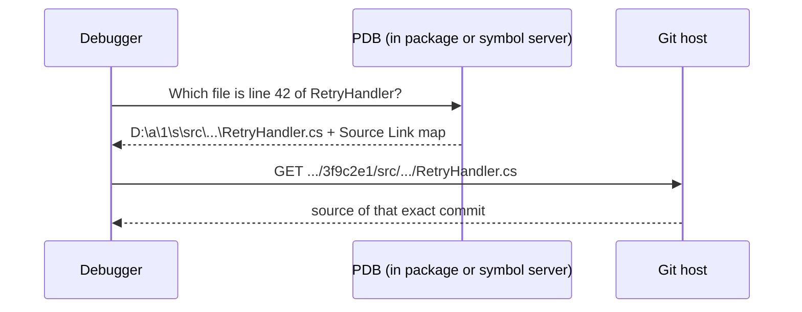

:::note[Series]
Part of the series [*Code quality & tooling*](/series/code-quality-and-tooling/).
:::

Shared NuGet packages are great until something goes wrong inside one of them. You're debugging a
service, the exception comes from `MyShop.Common.Http`, and you hit F11. One of three things happens:

1. The debugger steps over the call, because there are no symbols.
2. You land in decompiled code with a header that says something like "Decompiled with ...", local
   variable names gone and async methods turned into state machines.
3. You land in the **real source file**, at the exact version that's in your package, with breakpoints
   and locals working.

Only the third one is acceptable for packages your own teams build. That's what **Source Link** gives
you, and these days it costs you almost nothing to set up.

## Why the debugger can't find your code

When the compiler builds an assembly, it writes a PDB (the symbol file). The PDB maps IL back to source
lines and contains the **file paths at build time**, something like
`D:\a\1\s\src\MyShop.Common.Http\RetryHandler.cs` on a build agent. On your machine that path doesn't
exist. Without extra information, the debugger has the line numbers but no file.

Source Link adds one more piece to the PDB: a small JSON document that maps local paths to URLs of the
exact commit in your repository.

```json
{
  "documents": {
    "D:\\a\\1\\s\\*": "https://raw.githubusercontent.com/myshop/common/3f9c2e1.../*"
  }
}
```

Now the debugger can download `RetryHandler.cs` from the commit the package was built from. Not from
`main`, not from your local clone, but from the exact revision.



## The setup

Before .NET 8, you had to add a provider package such as `Microsoft.SourceLink.GitHub` or
`Microsoft.SourceLink.AzureRepos.Git` to every packable project. Many wikis still say so. **Since the
.NET 8 SDK, Source Link is built in** for GitHub, GitLab, Azure Repos and Bitbucket. The provider is
picked automatically from the git remote. For those hosts, all that's left is configuration:

```xml
<!-- Directory.Build.props (or Directory.Build.targets, conditioned on IsPackable) -->
<PropertyGroup>
  <!-- Write the repository URL and commit into the .nuspec -->
  <PublishRepositoryUrl>true</PublishRepositoryUrl>

  <!-- Include generated files (e.g. source generators, AssemblyInfo) that are not in git -->
  <EmbedUntrackedSources>true</EmbedUntrackedSources>

  <!-- Put the PDB into the DLL; see the comparison below -->
  <DebugType>embedded</DebugType>
</PropertyGroup>

<PropertyGroup Condition="'$(CI)' == 'true' or '$(TF_BUILD)' == 'true'">
  <!-- Normalize paths so the build is reproducible and the Source Link map is stable -->
  <ContinuousIntegrationBuild>true</ContinuousIntegrationBuild>
</PropertyGroup>
```

That's really it. Put it into your [Directory.Build.props](/blog/2026-directory-build-props/) and every
package in the repository gets it.

If your git host isn't on the built-in list, look for a Source Link provider for it (there are packages
for Gitea, GitWeb and others) before giving up. And if there's none, embedding the sources themselves
(`<EmbedAllSources>true</EmbedAllSources>`) still gives you real source in the debugger, at the cost of
larger binaries.

:::caution[ContinuousIntegrationBuild only in CI]
Don't set `ContinuousIntegrationBuild` unconditionally. It rewrites paths in the PDB to `/_/...`, which
breaks local debugging of your own projects. It belongs to the CI build only.
:::

## Where do the symbols go?

The PDB needs to reach the debugger somehow. There are three options:

| | `DebugType=embedded` | Symbol package (`.snupkg`) | Separate symbol server (e.g. Azure Artifacts) |
|---|---|---|---|
| Where the PDB lives | inside the DLL | separate package next to the `.nupkg` | a dedicated symbol store |
| Works with any feed | ✅ | ❌ only feeds that support `.snupkg` (nuget.org) | ❌ needs that server |
| Extra pipeline steps | none | `--include-symbols -p:SymbolPackageFormat=snupkg` | publish-symbols step |
| Package / DLL size | larger DLLs | unchanged | unchanged |
| Debugger configuration | none | add the symbol server | add the symbol server + auth |

For **internal packages on private feeds**, I go with `embedded`. Many private feeds don't support
`.snupkg` at all, the size overhead rarely matters for libraries, and there's nothing to configure on
the consumer side. For **public packages on nuget.org**, use `.snupkg`. Consumers who never debug don't
pay for the symbols.

## The consumer side: Visual Studio and Rider

Even a perfect package won't help if the IDE is configured to skip external code. In Visual Studio,
under **Tools → Options → Debugging → General**:

- **Enable Just My Code**: off. Otherwise the debugger ignores everything that isn't in your solution.
- **Enable Source Link support**: on (the default).
- **Suppress JIT optimization on module load (Managed only)**: on. This one has nothing to do with
  Source Link, but almost nobody knows it. Without it, release-built packages are optimized by the JIT,
  and you get "variable has been optimized away" and breakpoints that never hit.

If you went with `.snupkg` or a symbol server, add it under **Debugging → Symbols**.

For **private repositories**, the debugger has to authenticate against the git host to download the
source. Visual Studio uses your signed-in account or Git Credential Manager. ReSharper and Rider ask for
credentials the first time you navigate into a Source Link file. Use a personal access token with
**read-only code scope** and nothing more.

How to tell whether it works: navigate to a type from the package (Go To Implementation or F12). If you
see the original file, with comments and original names, Source Link is working. A "decompiled" banner
means it's missing in the package, not authenticated, or disabled in the IDE.

## Pitfalls

**Old provider packages plus the built-in support.** If you still reference `Microsoft.SourceLink.*`
version 1.x on a .NET 8+ SDK, you have two implementations competing. Remove the package reference
unless you need a provider the SDK doesn't ship. If you do keep one, update it to 8.x.

**Shallow clones and detached checkouts.** Source Link reads the commit and the remote URL from the local
git repository at build time. A build from a source archive without `.git` produces packages without a
Source Link map, and you get a warning that's easy to miss.

**Uncommitted or generated files.** If a file isn't in the commit, the URL points to nothing. That's what
`EmbedUntrackedSources` is for. It embeds those files directly in the PDB.

**Different remote URLs on agents.** Some CI systems check out via an internal mirror or SSH alias. The
Source Link map then contains a URL your developers can't reach. Make sure the `origin` remote on the
agent is the URL developers use, or map it with `SourceRoot` metadata.

**"Release" is fine.** You don't need debug builds of packages for a good experience. Release builds
plus Source Link plus "suppress JIT optimization" is the combination you want. Debug-build packages in a
feed are a smell.

## Verify it before anyone needs it

You find out that Source Link is broken exactly when you need it most: during an incident. Check it in
the pipeline instead. The [dotnet-validate](https://www.nuget.org/packages/dotnet-validate) tool inspects
a package for Source Link, deterministic builds and compiler flags:

```bash
dotnet tool install --global dotnet-validate
dotnet validate package local artifacts/MyShop.Common.Http.2.5.0.nupkg
```

Run it as a step after `dotnet pack`, and the build fails if a package ships without a usable Source
Link map. [NuGet Package Explorer](https://github.com/NuGetPackageExplorer/NuGetPackageExplorer) shows
the same "health" information visually if you want to check a package by hand.

Source Link builds on two other parts of this series:
[meaningful versions](/blog/2026-versioning-with-gitversion/) (so you know which commit you're looking at)
and [good package metadata](/blog/2026-creating-nuget-packages/).

## Summary

- Without Source Link, the PDB points to paths on the build agent, and you end up in decompiled code.
- Source Link writes a map from build paths to **URLs of the exact commit** into the PDB.
- Since the **.NET 8 SDK** it's built in for GitHub, GitLab, Azure Repos and Bitbucket. Set
  `PublishRepositoryUrl`, `EmbedUntrackedSources`, a `DebugType`, and `ContinuousIntegrationBuild` in CI.
- Use **embedded PDBs** for private feeds, **`.snupkg`** for nuget.org.
- Consumers need **Just My Code off** and should turn on **suppress JIT optimization**. Private repos
  need a read-only token.
- **Validate** packages in the pipeline with `dotnet-validate` instead of finding out during an incident.
