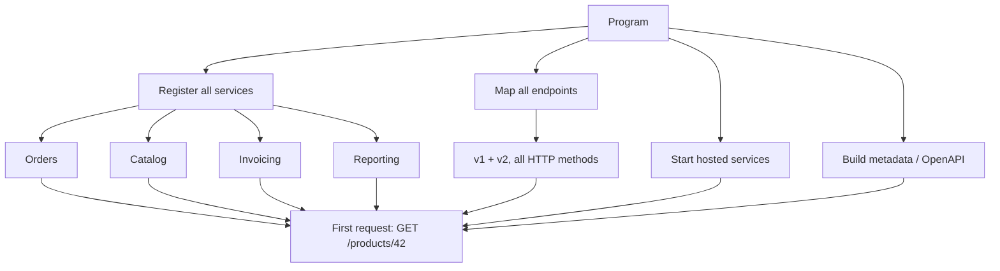

:::note[Series]
Part of the series [*.NET pitfalls*](/series/dotnet-pitfalls/).
:::

Startup time doesn't matter much for a service that starts once a week. It matters a lot when instances
come and go: autoscaling, scale-to-zero container platforms, serverless hosting, and every developer who
presses F5 forty times a day.

In one codebase I worked on, a large monolithic ASP.NET Core API was being evaluated for hosting on a
serverless container platform. Measured locally, it took **between 5.2 and 7.3 seconds to start**. For
a cold start that's far too long, and it was spent before the first request had done anything useful.

This post is about where that time goes, the quick win that made startup **three to four times
faster**, the more important insight behind it, and a `Lazy<T>` trap that I've now seen more than once.

## Where startup time goes

Even if the first request is a simple `GET /api/v1/products/{id}`, a typical large API does all of
this before it can answer:

- register **every** service of **every** domain in the DI container, often via assembly scanning and
  reflection
- register and build **every** endpoint, with its metadata, filters and route patterns
- validate the container (`ValidateOnBuild`, which is on by default in the `Development` environment)
- run `IHostedService.StartAsync` for every background service, sequentially by default
- validate options with `ValidateOnStart`
- build the EF Core model on first use
- generate the OpenAPI document, if something requests it at startup



Most of that work is irrelevant for the request that triggered the cold start.

## The quick win: lazy endpoints

The first idea was straightforward: **register only the endpoints that are needed.** The instance gets
a startup target, for example from command-line arguments, and only maps matching endpoints:

```json
{ "commandLineArgs": "--domain catalog --version v1 --http-method get" }
```

That quick win made startup **three to four times faster**. Good result, and a surprising one at first:
endpoints themselves are cheap to map. Why was the win so large?

## The real insight: it's the registration pipeline

Because skipping an endpoint also skipped the **service registrations behind it**. The expensive part
wasn't `MapGet`. It was everything that happened before: registering services, capabilities and
relations, building the dependency graph, and the reflection that goes with it.

That changes the optimization target from *endpoint registration* to the *registration pipeline*. And it
means the endpoints should stay dumb. You don't want an `if` in each of thousands of endpoints. You want
the pipeline to decide which **modules** to register at all:

```csharp
public sealed record StartupTarget(string? Domain, string? Version)
{
    public static StartupTarget All { get; } = new(null, null);

    public bool Includes(string domain) =>
        Domain is null || string.Equals(Domain, domain, StringComparison.OrdinalIgnoreCase);

    public static StartupTarget From(IConfiguration configuration) =>
        new(configuration["domain"], configuration["version"]);
}

public static class CatalogModule
{
    public static IServiceCollection AddCatalog(this IServiceCollection services, StartupTarget target)
    {
        if (!target.Includes("catalog"))
            return services;                                   // early exit: nothing below runs

        services.AddScoped<ProductQueries>();
        services.AddScoped<PriceListService>();
        // ... everything else the catalog domain needs
        return services;
    }

    public static IEndpointRouteBuilder MapCatalog(this IEndpointRouteBuilder app, StartupTarget target)
    {
        if (!target.Includes("catalog"))
            return app;

        var group = app.MapGroup("/api/v1/products");
        group.MapGet("/{id:int}", ProductEndpoints.GetById);
        // ...
        return app;
    }
}
```

```csharp
var target = StartupTarget.From(builder.Configuration);

builder.Services
    .AddCatalog(target)
    .AddOrders(target)
    .AddInvoicing(target);

var app = builder.Build();
app.MapCatalog(target).MapOrders(target).MapInvoicing(target);
```

This "early exit registration tree" is low-risk, easy to introduce module by module, and the default
(`StartupTarget.All`) behaves exactly like before. Further steps would be a central registration context,
a lookup table from endpoint name to the registrations it needs, and eventually a source generator that
produces that table at build time instead of discovering it with reflection at runtime.

:::caution[A warm instance only knows its slice]
An instance started for one domain returns `404` for every other route. That's fine if the platform
routes each path to its own function or container, and a disaster if a warm instance can receive any
request. Settle that question before you build anything. In the evaluation I'm describing, it was the
first open point on the list.
:::

There's a nice side effect: the module boundaries you need for this are the same boundaries you'd need to
split the monolith later. Startup optimization becomes a migration path.

## `Lazy<T>` for expensive dependencies

The second idea is narrower and useful in every app: make **expensive dependencies lazy**, so they're
only created when they're actually used.

First, a fact that surprises many people: the Microsoft DI container already creates singletons lazily,
on first resolution, not at `Build()`. So `AddSingleton<ExpensiveService>()` alone costs nothing at
startup. The cost appears when something that **is** resolved at startup depends on it: an endpoint class
resolved while mapping routes, a hosted service, a startup filter, an options validator. Then the whole
dependency chain is created eagerly.

That's where `Lazy<T>` helps: the eagerly resolved object gets a `Lazy<ExpensiveService>` and pays only
when it calls `.Value`.

### The trap: this looks lazy, but isn't

```csharp
services.AddSingleton<ReportQuery>();
services.AddSingleton<Lazy<ReportQuery>>();   // ❌ looks lazy
services.AddSingleton<IEndpoint, ReportEndpoint>();
```

`Lazy<T>` has several constructors. The DI container picks the one with the most parameters it can
satisfy. `Lazy<T>(Func<T>)` can't be satisfied, because there's no `Func<ReportQuery>` registration.
`Lazy<T>(bool)` can't either. But **`Lazy<T>(T value)`** can, because `ReportQuery` is registered. So
the container creates `ReportQuery` eagerly and wraps the finished instance in an already-initialized
`Lazy`. It compiles, it runs, and nothing is lazy.

The correct registration passes a factory explicitly:

```csharp
services.AddSingleton(sp => new Lazy<ReportQuery>(
    () => ActivatorUtilities.CreateInstance<ReportQuery>(sp),
    LazyThreadSafetyMode.ExecutionAndPublication));
```

If you need this more than a couple of times, register it once as an open generic:

```csharp
public sealed class LazyService<T>(IServiceProvider services)
    : Lazy<T>(services.GetRequiredService<T>, LazyThreadSafetyMode.ExecutionAndPublication)
    where T : notnull;

services.AddTransient(typeof(Lazy<>), typeof(LazyService<>));
```

Now every `Lazy<X>` resolves `X` from the same provider (and scope) on first access. Keep the lifetime of
the `Lazy` no longer than the lifetime of `X`: a singleton holding a `Lazy` of a scoped service is still a
captured dependency.

### A test that catches the trap

```csharp
[TestMethod]
public void Lazy_registrations_do_not_create_the_service()
{
    var services = new ServiceCollection();
    services.AddReporting();   // the real registration extension

    using var provider = services.BuildServiceProvider();
    var lazy = provider.GetRequiredService<Lazy<ReportQuery>>();

    Assert.IsFalse(lazy.IsValueCreated, "Lazy<ReportQuery> is registered eagerly (Lazy<T>(T value) constructor).");
}
```

## Other levers, roughly by effort

| Lever | What it saves | Effort |
|---|---|---|
| Early-exit registration per module | Registration and graph building for unused domains | Medium; large effect in monoliths |
| `Lazy<T>` for expensive dependencies of eagerly resolved objects | Construction of unused services | Low (register it correctly) |
| Replace assembly scanning with explicit registrations or a source generator | Reflection at startup | Medium |
| `HostOptions.ServicesStartConcurrently` (.NET 8+) | Sequential `StartAsync` of hosted services | Low |
| Don't block in `StartAsync`; move warm-up into `ExecuteAsync` | Startup waiting for background work | Low |
| Generate the OpenAPI document at build time | Document generation at runtime | Low |
| ReadyToRun compilation | JIT time at startup | Low (bigger binaries) |
| Native AOT | JIT and much of the reflection | High; not every library is compatible |

`ValidateOnBuild` deserves a note: it's valuable, because it catches missing registrations early. It's on in
`Development` by default and off elsewhere, which is the right trade-off. Keep it on in a test instead of
turning it on in production.

## Measure before and after

Startup optimization without measurement is guesswork. Cheap ways to see where the time goes:

- **Stopwatch per phase.** Wrap service registration, `builder.Build()` and endpoint mapping, and log the
  durations. Crude and surprisingly effective.
- **`dotnet-trace`**, started together with the app (`dotnet-trace collect -- dotnet MyShop.Api.dll`), gives
  you a CPU profile of the startup itself. Look for reflection, assembly loading and constructors.
- The **`Microsoft-Extensions-DependencyInjection`** event source reports when the provider is built and
  which services get resolved, which shows you what's created eagerly.
- **Track it in CI.** A test that starts the app with `WebApplicationFactory` and fails when startup
  exceeds a budget stops slow regressions from creeping back in. Leave generous headroom, since build agents
  are noisy.

## Summary

- Large APIs spend startup time on **registering and building everything**, not on the request that
  triggered the start.
- Registering only the needed endpoints made a 5.2–7.3 s startup **three to four times faster**. The win came
  from skipping the **registrations behind** the endpoints.
- Optimize the **registration pipeline**, not the endpoints. Early exits per module are low-risk and also
  prepare a later split.
- A sliced instance only knows its routes. Make sure the **platform routes accordingly**.
- DI singletons are already lazy. **`Lazy<T>`** helps for dependencies of things resolved at startup, but
  **`AddSingleton<Lazy<T>>()` is eager**. Register a factory or an open generic, and test `IsValueCreated`.
- **Measure** each phase, and keep a startup budget in CI.
