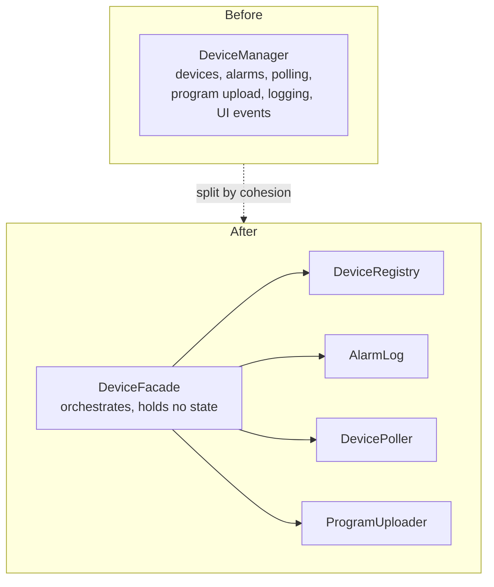

The hardest bugs I've chased in desktop and machine-control software were rarely in complicated
algorithms. They were in code that **depended on something it didn't ask for**. A method that read a
static `CurrentMode`. A field that one method set and another method assumed was still set. A `lock`
that protected some of the fields in a class, and nobody remembered which ones.

All of these are the same problem in different clothes: **shared mutable state**. This post goes
through its four common forms, global state, mutable members, locks in large classes and large
classes themselves, and shows what I do instead.

## Form 1: global state

```csharp
public static class MachineState
{
    public static OperatingMode Mode { get; set; }
    public static string? LoadedProgram { get; set; }
}

public sealed class SpindleController
{
    public double MaxRpm() =>
        MachineState.Mode == OperatingMode.Setup ? 500 : 12_000;
}
```

`MaxRpm()` looks like a function with no inputs. It isn't. Its real input is a static property that
anybody, anywhere, at any time can change. That has consequences:

- **You can't predict the result** by reading the call site. You have to know the history of the
  whole process.
- **You can't test it in isolation.** A test has to set `MachineState.Mode` and reset it afterwards.
  Tests that run in parallel suddenly influence each other, and the test suite becomes flaky.
- **Dependencies are hidden.** The constructor says `SpindleController` needs nothing. That's a lie
  the next maintainer has to discover by reading every method.

The fix is boring and effective: **pass what you use.**

```csharp
public sealed class SpindleController
{
    public double MaxRpm(OperatingMode mode) =>
        mode == OperatingMode.Setup ? 500 : 12_000;
}
```

When the value really lives longer than a call, make it an explicit dependency that the composition
root owns:

```csharp
public interface IOperatingModeProvider
{
    OperatingMode Current { get; }
}

public sealed class SpindleController(IOperatingModeProvider mode)
{
    public double MaxRpm() => mode.Current == OperatingMode.Setup ? 500 : 12_000;
}
```

The state still exists somewhere, which is fine. Machines have modes. The difference is that the
dependency is **visible in the constructor**, there's exactly one owner, and a test hands in a fake.
The same idea applies to the classic hidden statics: `DateTime.Now` becomes `TimeProvider`, file
access goes behind an abstraction, and configuration comes from
[the options pattern](/blog/2026-configuration-and-the-options-pattern/), not a static `Settings`
class.

:::note[Static isn't the problem, state is]
A static *pure* function like `Math.Max` or an extension method that only uses its arguments is
perfectly fine. The smell is a static **field or property that changes**. Singletons registered in DI
can carry the same smell when they hold mutable state. See
[Lazy and singletons done right](/blog/2026-lazy-and-singletons-done-right/).
:::

## Form 2: mutable members

Global state's smaller sibling lives in instance fields:

```csharp
public sealed class InvoiceCalculator
{
    private decimal _subtotal;
    private decimal _discount;
    private Customer? _customer;

    public void Load(Customer customer, IEnumerable<InvoiceLine> lines)
    {
        _customer = customer;
        _subtotal = lines.Sum(l => l.Quantity * l.UnitPrice);
    }

    public void ApplyDiscount()
    {
        _discount = _customer!.IsPremium ? _subtotal * 0.05m : 0m;
    }

    public decimal Total() => _subtotal - _discount;
}
```

Every method depends on which other methods ran before it, in which order. Call `Total()` before
`ApplyDiscount()` and you get a different answer. Call `ApplyDiscount()` before `Load()` and you get
a `NullReferenceException`. Register this class as a singleton and two requests overwrite each
other's `_subtotal`.

The fix is to make the flow of data explicit. Inputs go in, a result comes out, nothing is left
behind:

```csharp
public sealed record InvoiceTotals(decimal Subtotal, decimal Discount)
{
    public decimal Total => Subtotal - Discount;
}

public static class InvoiceCalculator
{
    public static InvoiceTotals Calculate(Customer customer, IReadOnlyCollection<InvoiceLine> lines)
    {
        var subtotal = lines.Sum(l => l.Quantity * l.UnitPrice);
        var discount = customer.IsPremium ? subtotal * 0.05m : 0m;
        return new InvoiceTotals(subtotal, discount);
    }
}
```

This version can't be called in the wrong order, can't be half-initialized, is thread-safe by
construction and needs no setup in a test. It's a pure function, and pure functions are the cheapest
code you'll ever maintain.

The same principle applies when you *do* need to change something: return a new value instead of
modifying the one you got.

```csharp
// ❌ modifies its argument; the caller has to know
public void ApplyVoucher(Order order, Voucher voucher) => order.Total -= voucher.Amount;

// ✅ returns a new value; the caller decides what to do with it (Order is a record here)
public static Order ApplyVoucher(Order order, Voucher voucher) =>
    order with { Total = order.Total - voucher.Amount };
```

Records, `init` accessors, `with` expressions, `required` members and
`ImmutableArray<T>` / `FrozenDictionary<TKey, TValue>` make this the easy path in modern C#. (A word
of caution on immutable collections in contracts:
[not all of them round-trip through JSON](/blog/2026-immutable-collections-serialization/).)

Not every member has to be immutable. A view model needs mutable properties, an aggregate has
state, a connection has a status. The goal is **as few mutable members as possible, owned by as few
methods as possible**, not zero.

## Form 3: locks in large classes

Once state is shared between threads, someone adds a lock:

```csharp
public sealed class DeviceManager
{
    private static readonly object Sync = new();          // one lock for everything

    private readonly Dictionary<string, Device> _devices = [];
    private readonly List<Alarm> _alarms = [];
    private DateTime _lastPoll;

    public void Register(Device device) { lock (Sync) { _devices[device.Id] = device; } }

    public void RaiseAlarm(Alarm alarm)
    {
        lock (Sync)
        {
            _alarms.Add(alarm);
            NotifyOperators(alarm);                         // calls out while holding the lock
        }
    }

    public IReadOnlyList<Alarm> Alarms() => _alarms;        // forgot the lock here
    // ... 40 more methods, some with lock, some without
}
```

Every problem you can have with locks is in there:

- **A static lock object** shared by all instances, so unrelated devices block each other.
- **Calling foreign code while holding the lock.** `NotifyOperators` may raise events, call into UI
  code or take another lock. That's how deadlocks are born.
- **Incomplete coverage.** `Alarms()` returns the live list without the lock, so a reader can
  enumerate while a writer adds, and you get an `InvalidOperationException` once in a blue moon.
- **Nobody can reason about it.** In a large class, every new method has to know which fields the
  lock protects and which invariants span several fields. That's knowledge nobody has.

The rule I follow: **lock only in small, focused classes, around very few lines, and never call out
while holding it.** Usually that means the lock disappears into a dedicated type, or isn't needed at
all:

```csharp
public sealed class DeviceRegistry
{
    private readonly ConcurrentDictionary<string, Device> _devices = new();

    public void Register(Device device) => _devices[device.Id] = device;

    public bool TryGet(string id, [NotNullWhen(true)] out Device? device) =>
        _devices.TryGetValue(id, out device);
}

public sealed class AlarmLog
{
    private readonly Lock _sync = new();                    // .NET 9+: System.Threading.Lock
    private ImmutableList<Alarm> _alarms = [];

    public void Add(Alarm alarm)
    {
        lock (_sync)
        {
            _alarms = _alarms.Add(alarm);
        }
    }

    public IReadOnlyList<Alarm> Snapshot() => _alarms;      // immutable, safe to hand out
}
```

Notifying operators moves out of the lock entirely, for example into a
[channel and a background consumer](/blog/2026-producer-consumer-with-channels/). And for the
general case of race conditions: use the concurrent collections, `Interlocked` and `Channel<T>` that
ship with .NET. Writing your own thread-safe collection is almost never a good idea.

:::tip[`lock` and `await` don't mix]
You can't `await` inside a `lock` block (the compiler stops you), and wrapping async code in a
`Monitor` by hand is worse. If async code needs mutual exclusion, use `SemaphoreSlim.WaitAsync` with
`try`/`finally`, or better, redesign so only one consumer owns the state.
:::

## Form 4: the large class

The `DeviceManager` above is the real culprit. Global state, mutable members and tangled locks all
grow best in a class with thousands of lines. You can spot it by:

- Methods that each touch only a few of the fields (**low cohesion**).
- A constructor with ten or more dependencies (**high coupling**).
- A name that ends in `Manager`, `Handler`, `Helper` or `Service` and doesn't tell you what it does.
- `#region` blocks used as a table of contents (see [code noise](/blog/2026-code-noise/)).
- A test class that needs dozens of lines of setup before the first assertion.

I don't believe in a hard line count, but if a class doesn't fit on two screens, I want a good reason.
The way out is to find the clusters: groups of fields and the methods that use them. Each cluster is
a class waiting to be extracted.



The remaining orchestrator, if you need one at all, holds no state of its own. It composes the small
classes. That's composition over inheritance in practice. Deep base class hierarchies
(`DeviceManagerBase` → `NetworkDeviceManagerBase` → …) are the other way people try to tame large
classes, and they make it worse because the state is now spread across files.

## Comparison

| Smell | Symptom | Fix |
|---|---|---|
| Global mutable state | Flaky tests, "works on my machine", hidden dependencies | Pass values as parameters, explicit dependencies, `TimeProvider` |
| Mutable members | Order-dependent methods, nulls, races in singletons | Pure functions, records, `with`, return new values |
| Locks in large classes | Deadlocks, rare `InvalidOperationException`, contention | Small owning types, concurrent collections, `Channel<T>`, `System.Threading.Lock` |
| Large classes | Low cohesion, huge constructors, painful tests | Split by field clusters, composition, stateless orchestrator |

## Pitfalls

**Immutability everywhere, at any price.** Copying a large object graph on every change in a
high-frequency loop costs allocations. Be pragmatic in hot paths, measure, and keep the mutation
local to one small type.

**Replacing statics with a singleton that holds the same state.** `services.AddSingleton<MachineState>()`
is more testable than a static, but if it's still a bag of settable properties used by everybody, you
moved the problem, you didn't solve it.

**Ambient context.** `AsyncLocal<T>` "current user" or "current tenant" helpers are global state
with a better reputation. Sometimes they're the right tool (logging scopes, tracing), but for
business data prefer an explicit parameter or a
[request context](/blog/2026-request-context-builder/).

**Splitting by layer instead of by responsibility.** Breaking a large class into `DeviceManagerPart1`
and `DeviceManagerPart2`, or into `partial` files, gives you two large classes in disguise.

## Enforce and measure

- **Analyzers.** `CA2211` (non-constant fields should not be visible), `CA1822` (mark members
  static when they use no instance data, which often reveals hidden pure functions), `IDE0044`
  (make field readonly), `CA1001`/`CA2213` for disposable fields. Roslynator adds more; see
  [Roslynator and analyzers in CI](/blog/2026-roslynator-and-analyzers-in-ci/).
- **Code metrics.** Visual Studio's code metrics or `Microsoft.CodeAnalysis.Metrics` report
  class coupling and maintainability index per type. `CA1506` (avoid excessive class coupling) and
  `CA1502` (avoid excessive complexity) can be turned on with thresholds.
- **Tests.** If a test needs to set a static and reset it in cleanup, that's a finding. If a class
  needs ten mocks, that's a finding too.
- **Banned APIs.** `BannedApiAnalyzers` can forbid `DateTime.Now` and other ambient statics in
  domain projects.

```ini
# .editorconfig
[*.cs]
dotnet_diagnostic.CA2211.severity = error
dotnet_diagnostic.IDE0044.severity = warning
dotnet_diagnostic.CA1822.severity = suggestion
dotnet_diagnostic.CA1506.severity = warning
```

## Summary

- **Shared mutable state** is the common root of untestable code, race conditions and code nobody
  dares to touch.
- **Global state:** pass what you use. When state must live on, make it an explicit dependency with
  one owner.
- **Mutable members:** prefer pure functions and records. Return new values instead of modifying
  arguments or fields.
- **Locks:** only in small, focused types, around a few lines, never calling out. Prefer concurrent
  collections, `Channel<T>` and `System.Threading.Lock`.
- **Large classes** are where all of the above grows. Split them by cohesion, and let a stateless
  orchestrator compose the pieces.
