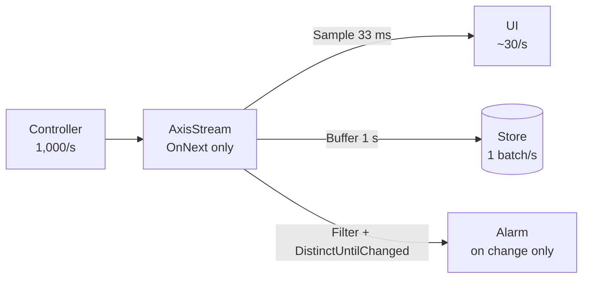

Some interfaces don't wait for you to ask. A machine controller reports axis positions every
millisecond. A sensor gateway pushes readings as fast as the hardware samples them. A price feed fires
on every tick. The callback is the same simple method every time, and that's exactly the trap: it
invites you to do *everything* in it.

This post is about getting control back over such sources: deciding how much of the stream you actually
need and handling only that. I'll use Reactive Extensions (Rx) for the time-based operators and
`System.Threading.Channels` for the cases where Rx is more than you need.

## The "before": one callback, every consumer

The interface is a callback that the controller's driver invokes on its own thread:

```csharp
public interface IAxisDataListener
{
    void OnAxisData(AxisPosition position);   // called every ~1 ms
}

public readonly record struct AxisPosition(int Axis, double Millimetres, long TimestampTicks);
```

And a typical first implementation:

```csharp
public sealed class AxisMonitor(
    AxisViewModel view,
    IAxisStore store,
    ILogger<AxisMonitor> logger) : IAxisDataListener
{
    public void OnAxisData(AxisPosition position)
    {
        Application.Current.Dispatcher.Invoke(() => view.Position = position.Millimetres);
        store.Save(position);
        logger.LogDebug("Axis {Axis} at {Position}", position.Axis, position.Millimetres);
    }
}
```

At a thousand calls per second, every line here is a problem:

- **The UI gets a thousand dispatcher round trips per second.** A screen refreshes at 60 Hz and a person
  can't read a number that changes more than a few times per second anyway. `Dispatcher.Invoke` is also
  synchronous, so the driver thread waits for the UI thread on every value.
- **The database gets a thousand single-row inserts per second**, each with its own round trip.
- **The logger writes a thousand lines per second**, even if debug logging is "off", because the call
  still has to be evaluated.
- **The driver thread is blocked** for the sum of all of that. Its budget per call is one millisecond. If
  your handler takes longer, the driver either buffers internally, drops values, or falls behind, and
  which of those happens depends on a driver you didn't write.

## Why it happens

The callback signature says "here's one value". It doesn't say "you have a millisecond, and you don't need
most of these". The real question isn't how to handle each event, but **what each consumer needs from
the stream**:

| Consumer | Needs | Technique |
|---|---|---|
| UI display | The latest value, ~30 times per second | **Sample** |
| Persistence | Every value (or every n-th), in batches | **Buffer / batch** |
| Alarm on limit violation | Only values that cross a threshold | **Filter** + distinct |
| "Input settled" (search box, slider) | The value after the stream goes quiet | **Debounce** (Rx: `Throttle`) |

Once you name it like that, the solution is to split the stream and give each consumer its own
operator. The callback itself does only one thing: hand the value over, fast.

## Solution 1: Rx for time-based shaping

Rx (`System.Reactive`) treats a stream of events as an `IObservable<T>` and gives you LINQ-like operators
with a notion of time. First, turn the callback into an observable:

```csharp
namespace Factory.Axes;

public sealed class AxisStream : IAxisDataListener, IDisposable
{
    private readonly Subject<AxisPosition> _subject = new();

    public IObservable<AxisPosition> Positions => _subject.AsObservable();

    // The only work done on the driver thread: one OnNext.
    public void OnAxisData(AxisPosition position) => _subject.OnNext(position);

    public void Dispose()
    {
        _subject.OnCompleted();
        _subject.Dispose();
    }
}
```

If the source is a .NET event instead of a callback interface, `Observable.FromEventPattern` does the
same job without a `Subject`.

Now each consumer takes what it needs:

```csharp
public sealed class AxisPipelines(AxisStream stream, AxisViewModel view, IAxisStore store,
    ILogger<AxisPipelines> logger) : IDisposable
{
    private readonly CompositeDisposable _subscriptions = new();

    public void Start(SynchronizationContext uiContext)
    {
        // UI: the latest value every 33 ms, delivered on the UI thread.
        stream.Positions
            .Sample(TimeSpan.FromMilliseconds(33))
            .ObserveOn(uiContext)
            .Subscribe(p => view.Position = p.Millimetres,
                       ex => logger.LogError(ex, "UI pipeline failed"))
            .DisposeWith(_subscriptions);

        // Persistence: every value, written in batches once per second, one batch at a time.
        stream.Positions
            .Buffer(TimeSpan.FromSeconds(1))
            .Where(batch => batch.Count > 0)
            .Select(batch => Observable.FromAsync(ct => store.SaveBatchAsync(batch, ct)))
            .Concat()
            .Subscribe(_ => { }, ex => logger.LogError(ex, "Persistence pipeline failed"))
            .DisposeWith(_subscriptions);

        // Alarm: only when an axis leaves the allowed range.
        stream.Positions
            .Select(p => (p.Axis, OutOfRange: p.Millimetres is < 0 or > 1_200))
            .DistinctUntilChanged()
            .Where(x => x.OutOfRange)
            .Subscribe(x => logger.LogWarning("Axis {Axis} out of range", x.Axis))
            .DisposeWith(_subscriptions);
    }

    public void Dispose() => _subscriptions.Dispose();
}

file static class DisposableExtensions
{
    public static void DisposeWith(this IDisposable d, CompositeDisposable c) => c.Add(d);
}
```



The callback now costs one `OnNext`. The UI gets about 30 updates per second on its own thread, the
database gets one batched insert per second, and the alarm fires once per violation instead of a
thousand times.

Two details in there are easy to get wrong:

- **`Select` + `Observable.FromAsync` + `Concat`** is how you call async code from a pipeline. Passing an
  async lambda to `Subscribe` compiles, but `Subscribe` takes an `Action<T>`, so the lambda becomes
  `async void`: exceptions crash the process and batches overlap. (More on that in
  [async/await pitfalls](/blog/2026-async-await-pitfalls/).)
- **`ObserveOn`** moves delivery to the UI thread. `Sample` emits on a timer thread, and touching a
  WPF or WinForms control from there throws.

:::caution[Throttle in Rx.NET is a debounce]
In Rx.NET, `Throttle(TimeSpan)` only emits a value after the source has been **quiet** for that duration.
On a source that fires every millisecond, it never goes quiet, so `Throttle(TimeSpan.FromMilliseconds(33))`
emits **nothing at all**. RxJS uses "throttle" for something else entirely, which adds to the confusion.
For "at most n per second" you want `Sample`. Use `Throttle` for "the user stopped typing".
:::

## Solution 2: Channels when you don't need the operators

Rx is a whole programming model, and for a team that doesn't use it elsewhere, it's a real learning
curve. For the two most common cases, "latest value only" and "batch everything", a channel does the job
with types everyone already knows. (The basics are in
[producer/consumer with Channels](/blog/2026-producer-consumer-with-channels/).)

**Latest value only**: a bounded channel with capacity 1 that drops the old value, read on a timer.

```csharp
public sealed class LatestAxisPosition : IAxisDataListener
{
    private readonly Channel<AxisPosition> _latest = Channel.CreateBounded<AxisPosition>(
        new BoundedChannelOptions(1)
        {
            FullMode = BoundedChannelFullMode.DropOldest,
            SingleReader = true,
            SingleWriter = true,
        });

    // Never blocks, never fails: the previous value is simply replaced.
    public void OnAxisData(AxisPosition position) => _latest.Writer.TryWrite(position);

    public async Task RunAsync(Action<AxisPosition> update, CancellationToken ct)
    {
        using var timer = new PeriodicTimer(TimeSpan.FromMilliseconds(33));
        while (await timer.WaitForNextTickAsync(ct))
        {
            if (_latest.Reader.TryRead(out var position))
                update(position);
        }
    }
}
```

In a WPF app, start `RunAsync` from the UI thread. The continuation after `await` returns to the UI
context, so `update` can set view-model properties directly.

**Batch everything**: a bounded channel in `Wait` mode, drained in chunks.

```csharp
public sealed class AxisBatchWriter(IAxisStore store) : IAxisDataListener
{
    private readonly Channel<AxisPosition> _channel = Channel.CreateBounded<AxisPosition>(
        new BoundedChannelOptions(50_000)
        {
            FullMode = BoundedChannelFullMode.DropWrite,  // never block the driver thread
            SingleReader = true,
            SingleWriter = true,
        });

    public void OnAxisData(AxisPosition position) => _channel.Writer.TryWrite(position);

    public async Task RunAsync(CancellationToken ct)
    {
        var batch = new List<AxisPosition>(capacity: 2_000);
        while (await _channel.Reader.WaitToReadAsync(ct))
        {
            while (batch.Count < 2_000 && _channel.Reader.TryRead(out var position))
                batch.Add(position);

            await store.SaveBatchAsync(batch, ct);
            batch.Clear();
        }
    }
}
```

The writer side uses `DropWrite` on purpose: the callback runs on the driver's thread and must never
wait. If the store falls so far behind that 50,000 values are queued, shedding load is better than
stalling the controller. Count those drops with the `itemDropped` overload and alert on them.

## Rx vs. Channels vs. a plain field

| | Latest-value field + timer | `Channel<T>` | Rx |
|---|---|---|---|
| Latest value at a fixed rate | ✅ simplest | ✅ | ✅ `Sample` |
| Batching | ❌ | ✅ manual loop | ✅ `Buffer` (by time and/or count) |
| Debounce, windowing, combining streams | ❌ | ❌ | ✅ |
| Backpressure, bounded memory | n/a | ✅ | ❌ mostly push-based, buffers grow |
| Async consumers | ✅ | ✅ natural | ⚠️ needs `FromAsync` + `Concat` |
| Testable with virtual time | ⚠️ | ⚠️ | ✅ `TestScheduler` |
| Learning curve | none | low | real |

My rule of thumb: for one display value, a field holding the latest value or a capacity-1 channel is
enough. (A multi-field struct can tear when one thread writes it while another reads it, so the field
needs a lock, or it should hold a reference to an immutable object that you swap with `Volatile.Write`.) For batching into storage, a channel. When you start combining streams (two axes, a
start/stop signal, windows over time), Rx earns its learning curve quickly.

## Pitfalls

**Doing work on the driver thread.** Anything more than a hand-off in the callback (formatting, logging,
locking, I/O) eats into a one-millisecond budget. Hand off, return.

**Concurrent `OnNext` calls.** Rx assumes calls to an observer never overlap. If the driver can invoke the
callback from several threads, add `.Synchronize()` before the operators, or use one subject per source
thread.

**Forgetting `onError`.** A `Subscribe` without an error handler rethrows the exception on whatever thread
the pipeline runs on, which on a timer thread terminates the process. Always pass `onError`.

**Not disposing subscriptions.** A subscription holds the subscriber alive. A view model that subscribes
and is never disposed keeps receiving values long after the window is closed.

**Sampling data you need to keep.** `Sample` and `DropOldest` throw values away by design. That's right for
a display and wrong for a quality record. Choose per consumer, not per stream.

**`Debug` logging in the hot path.** Use the source-generated `[LoggerMessage]` methods, which check
`IsEnabled` before doing any work, or better, don't log per value at all. Log the batch.

## How to measure and test

- **Measure the callback.** A `Histogram<double>` from `System.Diagnostics.Metrics` around `OnAxisData`
  tells you how much of the millisecond you use. Add counters for values received, values persisted and
  values dropped, and the three numbers explain most production questions.
- **Test with virtual time.** `Microsoft.Reactive.Testing` runs a second of a 1 kHz stream in
  microseconds and makes timing assertions deterministic:

```csharp
[TestMethod]
public void Sample_reduces_a_1kHz_stream_to_one_value_per_33ms()
{
    var scheduler = new TestScheduler();
    var ms = TimeSpan.TicksPerMillisecond;

    // 100 values, one every millisecond, offset by half a millisecond
    var source = scheduler.CreateHotObservable(
        Enumerable.Range(1, 100)
            .Select(i => ReactiveTest.OnNext(i * ms - ms / 2, i))
            .ToArray());

    var result = scheduler.Start(
        () => source.Sample(TimeSpan.FromMilliseconds(33), scheduler),
        created: 0, subscribed: 0, disposed: 200 * ms);

    // samples at 33, 66, 99 and 132 ms
    CollectionAssert.AreEqual(
        new[] { 33, 66, 99, 100 },
        result.Messages.Select(m => m.Value.Value).ToArray());
}
```

- **Analyzers.** `VSTHRD101` catches async lambdas passed to `Subscribe`, and CA1848/CA1873 push you
  towards `[LoggerMessage]` in hot paths.

## Summary

- A high-frequency callback is a **hand-off point**, not a place to do work. Push the value on and
  return.
- Ask **what each consumer needs**: latest value (sample), every value in batches (buffer), changes only
  (filter + distinct), or the settled value (debounce).
- **Rx** gives you those as operators with time built in. Use `Sample` for "n per second", and remember
  that Rx.NET's **`Throttle` is a debounce**.
- **Channels** cover "latest value" (capacity 1, `DropOldest`) and batching without a new programming
  model.
- Call async code from Rx with **`FromAsync` + `Concat`**, never with an async lambda in `Subscribe`.
- Measure callback duration and dropped values, and test timing with a **`TestScheduler`**.
