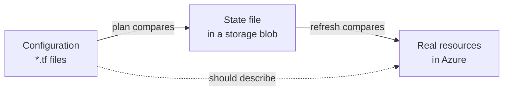

Terraform is great until the pipeline goes red on a Monday morning with an error message that reads
like it was written for the provider authors, not for you. Most of those errors aren't really
Terraform's fault. They come from a mismatch between three things that are supposed to agree: your
**configuration**, the **state file**, and the **real infrastructure**.

In one Azure codebase I worked on, the team collected every Terraform failure that cost them more
than half an hour in a wiki page. This post is the cleaned-up version of that list: eight problems,
one section each, with the cause and the fix. Resource names and IDs are neutral, the errors are
real.



Keep this triangle in mind. Almost every section below is one of its edges going out of sync.

## 1. `ContainerNotFound` during `terraform init`

```text
Initializing the backend...

Error: Failed to get existing workspaces: containers.Client#ListBlobs: Failure responding
to request: StatusCode=404 -- Original Error: autorest/azure: Service returned an error.
Status=404 Code="ContainerNotFound" Message="The specified container does not exist."
```

**Cause.** The `azurerm` backend stores state as a blob in a storage account. Terraform can create
almost anything in Azure, but **not the storage account and container that hold its own state**.
That's a chicken-and-egg problem: it needs the state before it can create anything. On a brand-new
environment, someone has to create them by hand (or with a separate bootstrap script) first.

**Fix.** Create the storage account and the container, then make sure the backend config points at
exactly those names:

```bash
az group create --name rg-tfstate --location westeurope
az storage account create --name sttfstateshop --resource-group rg-tfstate \
  --sku Standard_LRS --min-tls-version TLS1_2 --allow-blob-public-access false
az storage container create --name tfstate --account-name sttfstateshop --auth-mode login
```

```hcl
terraform {
  backend "azurerm" {
    resource_group_name  = "rg-tfstate"
    storage_account_name = "sttfstateshop"
    container_name       = "tfstate"
    key                  = "shop-dev.tfstate"
    use_azuread_auth     = true
  }
}
```

The 404 is honest here: the account exists, the container doesn't. Typos in `container_name` cause
the exact same error, so check the spelling before you check permissions. I wrote more about that
bootstrap step in [Azure setup 101](/blog/2026-azure-setup-101/).

## 2. `state blob is already locked`

```text
Error: Error acquiring the state lock

Error message: state blob is already locked
Lock Info:
  ID:        4f0b2e1a-...
  Path:      tfstate/shop-dev.tfstate
  Operation: OperationTypeApply
  Who:       build-agent@runner-123
  Version:   1.1.9

Error: Failed to load "tfplan" as a plan file
Error: stat tfplan: no such file or directory
```

**Cause.** Before writing state, Terraform takes a lease on the blob. If the previous run was
cancelled or the agent died mid-`apply`, the lease is never released. Every following run fails to
acquire the lock. The second error (`tfplan` not found) is just a consequence: `plan` failed, so
there's no plan file for `apply`.

**Fix.** First make sure nothing is actually still running. A lock is there for a reason, and two
concurrent applies against the same state are much worse than a red pipeline. Then release it:

```bash
# preferred: Terraform knows the lock ID from the error message
terraform force-unlock 4f0b2e1a-...

# if you can't run Terraform locally: break the blob lease directly
az storage blob lease break --container-name tfstate --blob-name shop-dev.tfstate \
  --account-name sttfstateshop --auth-mode login
```

In the portal, the same thing is the *Break lease* button on the blob. Don't "fix" this with
`-lock=false` in the pipeline. That just removes the protection for everyone.

To prevent it, give the pipeline a concurrency limit per environment (in GitHub Actions a
`concurrency:` group, in Azure DevOps an exclusive lock check on the environment), so two runs
never race for the same state in the first place.

## 3. Validate before you plan

This one isn't an error but the habit that saves you from many. When a configuration is new or
heavily refactored, `plan` fails with a mix of syntax errors and backend errors, and it's hard to
tell which is which. Split them:

```bash
terraform init -backend=false   # no state access needed
terraform fmt -check -recursive
terraform validate
```

`-backend=false` is the important part. `validate` only checks the configuration itself (types,
references, required arguments), so it doesn't need credentials or the state. That makes it a cheap
first step in every pull-request build, long before anyone has access to an environment.

## 4. "A resource with the ID ... already exists"

```text
Error: A resource with the ID "/subscriptions/<sub-id>/resourceGroups/rg-shop-qa/providers/
Microsoft.Insights/components/appi-shop-qa" already exists - to be managed via Terraform this
resource needs to be imported into the State.

  with azurerm_application_insights.main,
  on main.tf line 70, in resource "azurerm_application_insights" "main":
```

**Cause.** The resource exists in Azure, but not in the state. Common reasons: someone created it
in the portal, the state was reset, or `main.tf` was restructured (renamed resource, moved into a
module) and Terraform now thinks the "new" address is a different resource.

**Fix.** Import it once. The team I mentioned did this with temporary pipeline steps
(`terraform import ...` between `init` and `plan`) that were deleted after the first green run.
That works, but since Terraform 1.5 there's a much better way: **import blocks**, which are
reviewed in a pull request and run as part of the normal plan.

```hcl
import {
  to = azurerm_application_insights.main
  id = "/subscriptions/${var.subscription_id}/resourceGroups/rg-shop-qa/providers/Microsoft.Insights/components/appi-shop-qa"
}
```

`terraform plan` now shows `1 to import` instead of `1 to add`. After the apply, delete the block.
For renames and module moves, you don't even need an import. Tell Terraform about the new address:

```hcl
moved {
  from = azurerm_application_insights.application_insights
  to   = module.monitoring.azurerm_application_insights.main
}
```

That's the one I'd make a rule: **every rename of a resource address comes with a `moved` block.**
Otherwise the plan shows a destroy and a create, and for a database that's not a cosmetic issue.

## 5. A corrupt resource in the state file

This is the nastiest one on the list, because it stayed invisible for a long time.

**Story.** At some point, the same state file had accidentally been used for **all environments**.
That was fixed, and every environment got its own state. But some resources in the `test` state
still carried IDs that pointed to the `qa` subscription. Terraform didn't complain. `plan` refreshed
them happily:

```text
azurerm_redis_cache.main:  Refreshing state... [id=/subscriptions/<QA-sub>/...]
azurerm_linux_web_app.api: Refreshing state... [id=/subscriptions/<QA-sub>/...]
azurerm_service_plan.main: Refreshing state... [id=/subscriptions/<TEST-sub>/...]
```

Until the day someone added an alert rule that **links** to the web app. The service principal for
`test` had no read permission on the `qa` subscription, and apply failed:

```text
Status=403 Code="LinkedAuthorizationFailed"
Message="The client ... has permission to perform action 'Microsoft.Insights/activityLogAlerts/write'
on scope '/subscriptions/<TEST-sub>/...'; however, it does not have permission to perform action
'read' on the linked scope(s) '/subscriptions/<QA-sub>/.../app-shop-test'"
```

**Fix.** Remove the broken entries from the state and import them again from the real environment:

```bash
terraform state rm 'azurerm_linux_web_app.api'
terraform import 'azurerm_linux_web_app.api' \
  "/subscriptions/<TEST-sub>/resourceGroups/rg-shop-test/providers/Microsoft.Web/sites/app-shop-test"
```

`state rm` only forgets the resource. It doesn't delete anything in Azure. With current Terraform,
you can express the same thing declaratively: a `removed` block (1.7+) with `lifecycle { destroy =
false }` followed by an `import` block. Either way, **back up the state blob before you touch it**.
Blob versioning on the state container makes that automatic.

**How to catch it earlier.** Grep the state for subscription IDs that don't belong to the
environment. A three-line script in the pipeline would have found this months before the 403:

```bash
terraform show -json | jq -r '.. | objects | .id? // empty | strings' | grep '^/subscriptions/' \
  | grep -v "/subscriptions/${ARM_SUBSCRIPTION_ID}/" && exit 1 || exit 0
```

## 6. `parsing segment "staticResourceGroups"` after nobody changed anything

```text
Error: parsing "/subscriptions/<sub-id>/resourcegroups/rg-shop-prod/providers/
microsoft.operationalinsights/workspaces/log-shop-prod": parsing segment "staticResourceGroups":
expected the segment "resourcegroups" to be "resourceGroups"
```

**Cause.** The configuration said:

```hcl
azurerm = {
  source  = "hashicorp/azurerm"
  version = ">= 3.5.0, < 4.0.0"
}
```

The last green run had installed provider `3.18.0`. The next run, with **zero code changes**,
installed `3.20.0`, which parsed resource IDs more strictly. The ID in the state used lower-case
`resourcegroups` (Azure itself returns that casing for some resource types), and the new provider
refused it.

**Fix (short term).** Pin the last working version and get the pipeline green again.

**Fix (properly).** A version range without a lock file means every run can pick a different
provider. That's exactly what `.terraform.lock.hcl` is for: commit it, and `init` installs the same
version every time until someone runs `terraform init -upgrade` on purpose, in a pull request, where
the plan output can be reviewed.

```hcl
azurerm = {
  source  = "hashicorp/azurerm"
  version = "~> 4.0"   # range for humans, exact version comes from .terraform.lock.hcl
}
```

Tools like Renovate or Dependabot can then open those upgrade PRs for you. Upgrades still happen,
but never as a surprise on a Monday.

## 7. "Provider produced inconsistent final plan"

```text
Error: Provider produced inconsistent final plan

When expanding the plan for azurerm_monitor_scheduled_query_rules_alert.slow_requests to include
new values learned so far during apply, provider "registry.terraform.io/hashicorp/azurerm"
produced an invalid new value for .data_source_id:
  was cty.StringVal(".../resourcegroups/rg-shop-prod/providers/microsoft.operationalinsights/..."),
  but now cty.StringVal(".../resourceGroups/rg-shop-prod/providers/Microsoft.OperationalInsights/...").

This is a bug in the provider, which should be reported in the provider's own issue tracker.
```

**Cause.** Look closely: the two values differ **only in casing**. The plan had one form, Azure
returned the other during apply. The error message is right, it's a provider bug, and it's a cousin
of section 6.

**Fix.** Re-run the pipeline first. It often goes through the second time, because the state now
holds the casing Azure returns. If it keeps failing, stop building resource IDs by hand with string
interpolation and reference the resource instead (`azurerm_log_analytics_workspace.main.id`), so
Terraform always uses the casing the provider produced.

## 8. A date in `app_settings` that changes on every run

This one doesn't fail. It's worse: it silently changes your configuration.

**Repro.** Put an ISO 8601 date into the `app_settings` of an `azurerm_linux_web_app`:

```hcl
app_settings = {
  "Promotion__StartsAt" = "2027-01-17T00:00:00Z"
}
```

With the provider version that team used, the value ended up in the state **and** in the deployed
App Service as `01/17/2027 00:00:00`, the US format. On the next run, `plan` compared the two and
showed a change, every single time:

```text
~ resource "azurerm_linux_web_app" "api" {
    ~ app_settings = {
        ~ "Promotion__StartsAt" = "01/17/2027 00:00:00" -> "2027-01-17T00:00:00Z"
      }
  }
```

The same happens when the value comes from a pipeline variable via token replacement.

**Why it matters.** Your tests read `2027-01-17T00:00:00Z`, which is UTC and unambiguous. The
deployed app reads `01/17/2027 00:00:00`, which has lost the time zone. And if the app parses it with
a non-US culture, it doesn't even get that far:

```text
System.FormatException: String was not recognized as a valid DateTime.
```

**Fix.** The team's workaround was to always write dates in en-US format, since the App Service
culture is en-US anyway. That works, but I prefer to make the app robust instead, so it doesn't matter
which format arrives:

```csharp
public static class SettingParsers
{
    private static readonly string[] Formats =
    [
        "O",                       // 2027-01-17T00:00:00.0000000Z
        "yyyy-MM-dd'T'HH:mm:ssK",  // 2027-01-17T00:00:00Z
        "MM/dd/yyyy HH:mm:ss",     // 01/17/2027 00:00:00 (what came back)
    ];

    public static DateTimeOffset ParseUtc(string value) =>
        DateTimeOffset.ParseExact(
            value, Formats, CultureInfo.InvariantCulture,
            DateTimeStyles.AssumeUniversal | DateTimeStyles.AdjustToUniversal);
}
```

Even better: avoid the problem entirely. Dates that change (feature start dates, cut-offs) belong
in Azure App Configuration or a feature flag, not in infrastructure code that redeploys the
App Service to change them. And add a unit test that parses every date format you've seen in the wild,
so the next "it works in the pipeline" doesn't reach production.

## The pattern behind all of them

| Problem | Edge of the triangle | Prevent it with |
|---|---|---|
| `ContainerNotFound` | Backend missing | Bootstrap script for state storage |
| State lock | Concurrent / cancelled runs | Pipeline concurrency per environment |
| Config errors | Configuration | `init -backend=false` + `validate` in PR builds |
| Resource already exists | State ↔ real | `import` and `moved` blocks |
| Corrupt state entry | State ↔ real | One state per environment, state checks, blob versioning |
| Parsing segments | Provider version | Committed `.terraform.lock.hcl` |
| Inconsistent final plan | Provider ↔ Azure | Reference IDs, don't build them |
| Date in app settings | Provider ↔ Azure | Culture-independent parsing, App Configuration |

## Pitfalls when fixing state

- **Don't edit the state JSON by hand.** `state rm`, `import`, `moved` and `removed` exist so you
  never have to.
- **Temporary pipeline steps tend to become permanent.** An `import` step that runs on every build
  fails as soon as the resource is in the state. Import blocks are idempotent and much safer.
- **Every environment needs its own state key, and ideally its own service principal** that can only
  see its own subscription. In section 5, that permission boundary is what finally surfaced the bug.
  Without it, the wrong IDs could have lived on forever.

## Make it measurable

- Run `terraform plan -detailed-exitcode` on a schedule against each environment. Exit code `2` means
  there's drift, so the plan isn't empty even though nobody changed the code. Section 8 would have
  shown up there on day one.
- Fail the PR build on `fmt -check` and `validate`, and post the plan output as a PR comment so
  reviewers actually see what's going to change.
- Keep the provider lock file under review like any other dependency.

## Summary

- Most Terraform errors are a mismatch between **configuration, state and real resources**. Find
  out which edge broke first.
- The backend's storage container has to exist **before** `terraform init`.
- Break stale locks with `force-unlock`, and prevent them with **pipeline concurrency**.
- Use **`import`, `moved` and `removed` blocks** instead of one-off CLI steps in the pipeline.
- **Commit `.terraform.lock.hcl`.** Provider upgrades should be pull requests, not surprises.
- Casing differences in resource IDs are a provider problem: reference IDs instead of building them.
- Don't trust that a value in `app_settings` arrives in the same format you wrote it.
