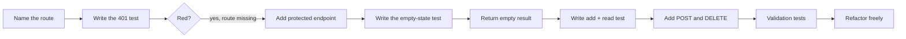

:::note[Series]
Part of the series [*Testing in practice*](/series/testing-in-practice/).
:::

"We'll add the tests once the endpoint works." I've heard that sentence in every team I've worked
with, and I've said it myself. What usually follows is an endpoint that works, a test that was
shaped around the implementation, no `401` test, and no way to clean up the data the test creates,
because nobody thought about a DELETE.

For APIs, I've become fairly strict about writing the test first. Not because of TDD dogma, but
because of what it does to the **design** of the API. This post walks through it step by step.

## The problem with "test after"

When you write the endpoint first, you write it as its implementer. You know the database, the
handler and the shortcuts. The test you write afterwards tends to mirror that knowledge:

```csharp
[TestMethod]
public async Task GetCustomers_Works()
{
    // seed directly, because there's no POST yet
    await using var db = Services.GetRequiredService<ShopDbContext>();
    db.Customers.Add(new CustomerEntity { Number = "C-1", Name = "Ada" });
    await db.SaveChangesAsync();

    var customers = await Client.GetFromJsonAsync<List<CustomerDto>>("api/v1/customers");

    Assert.AreEqual(1, customers!.Count);
}
```

Look at what that test knows: the `DbContext`, the entity type, the table. None of that is part of
the API. Rename a column and the test breaks although the contract didn't change. And a consuming
team can't write this test at all, because they don't have your `DbContext`.

There's also what the test *doesn't* know: whether the endpoint is protected. Nobody asked.

## Why test-first works better for APIs

When the test comes first, you're the **consumer**, not the implementer:

- You think about the **route and naming** before any code exists, from the caller's point of view.
- You have to deal with **authentication, authorization and validation** right away, because a
  consumer runs into them first.
- You can't seed data behind the API's back, because there's nothing behind it yet. You have to
  **create data through the API**, which means POST and DELETE become part of the design.
- You implement only what a test asks for. **No speculative endpoints.**
- The test only knows the HTTP contract, so it **survives refactoring** of everything behind it.



## A walk-through: a customers API

Starting point: an empty minimal API project and the
[test base class](/blog/2026-api-integration-test-base-class/) from earlier in this series, which
gives me an authenticated `Client` and an `AnonymousClient`.

### Step 1: name the route, write the 401 test

Before thinking about data, I think about who's allowed to call this:

```csharp
[TestClass]
public sealed class Customers_Tests : ApiTestBase
{
    [TestMethod]
    public async Task Should_Return_401_When_Listing_Customers_Without_Token()
    {
        var response = await AnonymousClient.GetAsync("api/v1/customers");

        Assert.AreEqual(HttpStatusCode.Unauthorized, response.StatusCode);
    }
}
```

Run it: red, with `404 Not Found`, because the route doesn't exist. That's the right kind of red.
Now the smallest implementation that makes it green:

```csharp
var customers = app.MapGroup("api/v1/customers")
                   .RequireAuthorization("customers:read")
                   .WithTags("Customers");

customers.MapGet("/", () => TypedResults.Ok());
```

Green. It feels silly to write a test for something this trivial. It isn't: this is the test that
fails when someone moves the endpoint into a different group next year and the
`RequireAuthorization` gets lost on the way.

### Step 2: the empty state

```csharp
[TestMethod]
public async Task Should_Return_Empty_List_When_No_Customers_Exist()
{
    var response = await Client.GetAsync($"api/v1/customers?tag={TestTag}");

    await response.AssertJsonAsync(HttpStatusCode.OK, "Customers/Results/Empty.json");
}
```

```json
{ "customers": [] }
```

Note the `tag` filter. I decided here, in the test, that the list must be filterable, because my
test needs to see only its own data on a shared environment. That's a design decision driven by
testability, and it turns out consumers want filters too.

The implementation returns an empty, correctly shaped response:

```csharp
customers.MapGet("/", (string? tag) =>
    TypedResults.Ok(new GetCustomersResponse([])));
```

Yes, that's "cheating". It's also exactly what a test-first rhythm wants: the next test forces the
real implementation.

### Step 3: you have to add a customer to get one

```csharp
private static readonly string TestTag = $"it-customers-{TestRun.RunnerName}";

[TestMethod]
public async Task Should_Return_The_Customer_That_Was_Added()
{
    // 1. add
    var post = await Client.PostAsync("api/v1/customers", TestFiles.Json("Customers/Payloads/Ada.json", ("$tag$", TestTag)));
    await post.AssertJsonAsync(HttpStatusCode.Created, "Customers/Results/Ada.json", "id");

    // 2. read it back through the API
    var get = await Client.GetAsync(post.Headers.Location);
    await get.AssertJsonAsync(HttpStatusCode.OK, "Customers/Results/Ada.json", "id");
}

[TestInitialize]
public Task SetupAsync() => CleanupAsync();

[TestCleanup]
public Task CleanupAsync() => Client.DeleteAsync($"api/v1/customers?tag={TestTag}");
```

Red: `405 Method Not Allowed` for the POST. Implement it. Run again. Red on the next run: the
cleanup needs a `DELETE`. Implement that too.

This is the step where test-first pays off most. The **DELETE exists because the test needed it**.
Without it, the test could only run once per environment. In a "test after" world this is where
someone opens a database console and deletes rows by hand, and after a while the test suite only
works on one developer's machine.

:::caution[Don't cheat]
When a test needs data and there's no endpoint to create it, the answer is *build the endpoint*
(or a command the API exposes), not "insert it into the database in the setup". A test that seeds
data behind the API tests your schema, not your contract.
:::

### Step 4: validation

Now the cases a consumer gets wrong:

```csharp
[TestMethod]
[DataRow("MissingName.json")]
[DataRow("InvalidEmail.json")]
[DataRow("NumberTooLong.json")]
public async Task Should_Return_400_With_Details_When_Payload_Is_Invalid(string useCase)
{
    var response = await Client.PostAsync("api/v1/customers", TestFiles.Json($"Customers/Payloads/{useCase}"));

    await response.AssertJsonAsync(HttpStatusCode.BadRequest, $"Customers/Results/{useCase}", "traceId");
}
```

Each case is a pair of files: a payload and the expected problem response. Adding a scenario means
adding two files, not writing code. And because the expected response is written *before* the
implementation, I decide what a good error message looks like while I'm still thinking as a
consumer, not afterwards when I'm tired and "Validation failed" seems good enough.

### Step 5: refactor with a safety net

At this point the endpoint is simple and fully covered at the HTTP level. Now I can introduce a
handler, a repository, caching, whatever the domain needs, and the tests don't care. That's the real
payoff: **tests that only know the contract let you change everything behind it.**

## Comparison

| | Test-first at the API level | Test after, at the API level | Unit tests only |
|---|---|---|---|
| Tests the real contract (routing, auth, serialization) | ✅ | ✅ | ❌ |
| Security tests exist | ✅ written first | ⚠️ often forgotten | ❌ |
| Forces endpoints needed for setup/cleanup | ✅ | ❌ tempts to seed the DB | ❌ |
| Survives refactoring of internals | ✅ | ⚠️ if it doesn't seed the DB | ❌ breaks with every refactoring |
| Error responses designed from the consumer view | ✅ | ⚠️ | ❌ |
| Fast feedback for pure logic | ⚠️ | ⚠️ | ✅ |

Test-first at the API level doesn't replace unit tests. Complex rules (pricing, discount logic) still
deserve [focused unit tests](/blog/2026-unit-test-best-practices-and-naming/). But for "does this
endpoint behave as promised", the API test is the one that counts.

## Pitfalls

**Writing all tests upfront.** Writing twenty red tests and then implementing for a day is not
test-first, it's a specification you can't run. One test, make it green, next test.

**Tiny steps forever.** Returning an empty list to make a test green is useful once. If you notice
you're writing a lot of throwaway implementation, take bigger steps.

**Testing the handler instead of the API.** A test-first test that calls `mediator.Send(...)`
directly skips routing, model binding, auth and serialization, which is where a large share of real
API bugs live.

**Forgetting cleanup on failure.** A test that fails between "add" and "delete" leaves data behind.
That's why cleanup runs in `TestInitialize` *and* `TestCleanup`, filtered by a tag.

## Enforce the first step

The 401 test is the one most likely to be skipped "because it's obvious". You can back it up with
a test that checks all endpoints at once:

```csharp
[TestMethod]
public void Should_Require_Authorization_Or_Explicit_Anonymous_On_Every_Endpoint()
{
    var unprotected = Services.GetRequiredService<EndpointDataSource>().Endpoints
        .OfType<RouteEndpoint>()
        .Where(e => e.Metadata.GetMetadata<IAuthorizeData>() is null
                 && e.Metadata.GetMetadata<IAllowAnonymous>() is null)
        .Select(e => $"{string.Join(",", e.Metadata.GetMetadata<IHttpMethodMetadata>()?.HttpMethods ?? [])} {e.RoutePattern.RawText}")
        .ToList();

    Assert.AreEqual(0, unprotected.Count,
        "Add RequireAuthorization(...) or AllowAnonymous() to:" + Environment.NewLine + string.Join(Environment.NewLine, unprotected));
}
```

If you use a global fallback policy, adapt the check accordingly. Either way, it doesn't replace the
per-endpoint 401 test (which proves the middleware actually rejects the call), but it catches the
endpoint nobody wrote a test for. A rule the build checks beats a rule in the wiki, which is the
whole idea of [self-defending codebases](/blog/2026-self-defending-codebases/).

## Summary

- Writing the API test first makes you the **first consumer** of your endpoint.
- Start with the **401**, then the empty state, then add-and-read, then validation.
- If a test needs data, **build the endpoint to create it**. Never seed behind the API's back.
- Tests that only know the HTTP contract let you **refactor everything behind it**.
- Back the habit with a test that checks **every endpoint is protected or explicitly anonymous**.
