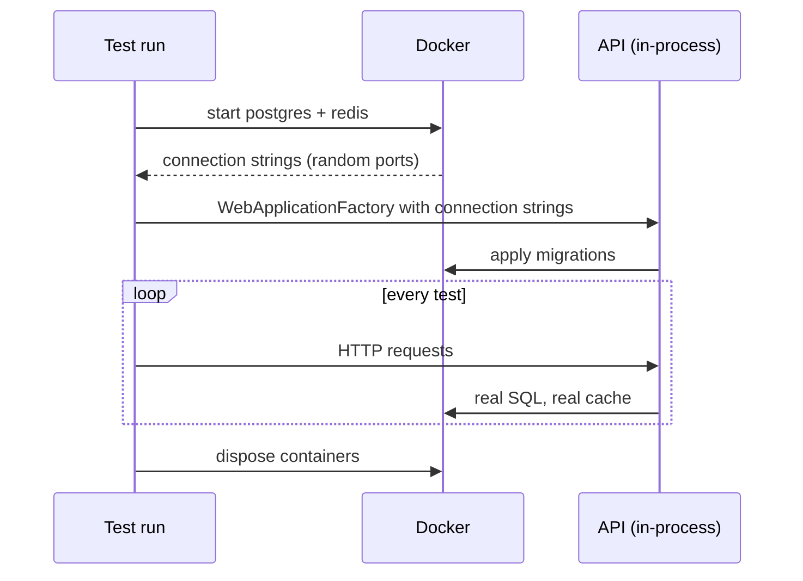

:::note[Series]
Part of the series [*Testing in practice*](/series/testing-in-practice/).
:::

Integration tests need the things your API talks to: a database, a cache, maybe a message broker.
Most teams pick one of two options, and both have a catch. Either the tests use a fake (the EF Core
in-memory provider, SQLite instead of the real engine), which is fast and lies to you. Or they use a
shared database in a dev environment, which is real and belongs to everybody at once.

[Testcontainers](https://dotnet.testcontainers.org/) is the third option: every test run starts its
own real dependencies in Docker containers and throws them away afterwards. This post shows how I
wire that into the `WebApplicationFactory` setup from earlier in this series, and where the costs are.

## The problem: fakes that lie, shared databases that fight

The in-memory provider is the classic trap:

```csharp
builder.ConfigureTestServices(services =>
{
    services.RemoveAll<DbContextOptions<ShopDbContext>>();
    services.AddDbContext<ShopDbContext>(o => o.UseInMemoryDatabase("tests"));
});
```

Tests are fast and green. Then production fails, because the in-memory provider:

- doesn't enforce **unique constraints** or **foreign keys**, so your "409 on duplicate" handling is
  never exercised;
- has no real **transactions** and no isolation levels;
- doesn't run your **raw SQL**, views, or provider-specific functions;
- has different **case sensitivity** and string comparison than PostgreSQL or SQL Server;
- never tests your **migrations**.

Microsoft's own documentation discourages it for testing for exactly these reasons. SQLite is closer,
but it's still a different engine with different types and different SQL.

The shared dev database has the opposite problem. It's the real engine, but its state is whatever the
last person or pipeline left behind. Tests depend on data they didn't create, and two runs at the same
time delete each other's rows. I covered the mitigations (cleanup first, tagging by runner) in the
[GET, POST and DELETE patterns](/blog/2026-api-test-patterns-get-post-delete/). They help, but they're
damage control.

## Testcontainers in a nutshell

Testcontainers is a library that starts Docker containers from test code, waits until they're
ready, gives you connection details, and removes them when the test run ends (even when the process
crashes, via a small sidecar container). There are ready-made modules for PostgreSQL, SQL Server,
Redis, RabbitMQ, Kafka, Azurite, LocalStack and many more.

```bash
dotnet add package Testcontainers.PostgreSql
dotnet add package Testcontainers.Redis
```

## Wiring it into the test base class

The [base class](/blog/2026-api-integration-test-base-class/) already starts the API once per test
assembly. The containers start right before it, in the same `[AssemblyInitialize]`:

```csharp
[TestClass]
public abstract class ApiTestBase
{
    private static PostgreSqlContainer _postgres = null!;
    private static RedisContainer _redis = null!;
    private static ApiFactory _factory = null!;

    protected static HttpClient Client { get; private set; } = null!;

    [AssemblyInitialize]
    public static async Task StartAsync(TestContext _)
    {
        _postgres = new PostgreSqlBuilder()
            .WithImage("postgres:17-alpine")        // pin the version you run in production
            .Build();

        _redis = new RedisBuilder()
            .WithImage("redis:7-alpine")
            .Build();

        // Start both at the same time; each module waits until its service accepts connections.
        await Task.WhenAll(_postgres.StartAsync(), _redis.StartAsync());

        _factory = new ApiFactory(_postgres.GetConnectionString(), _redis.GetConnectionString());
        Client = _factory.CreateClient();
        Client.DefaultRequestHeaders.Authorization = new("Test", TestUsers.Default);
    }

    [AssemblyCleanup]
    public static async Task StopAsync()
    {
        Client.Dispose();
        await _factory.DisposeAsync();
        await Task.WhenAll(_postgres.DisposeAsync().AsTask(), _redis.DisposeAsync().AsTask());
    }
}
```

The factory passes the connection strings to the app as configuration, exactly the way production
gets them:

```csharp
public sealed class ApiFactory(string database, string redis) : WebApplicationFactory<Program>
{
    protected override void ConfigureWebHost(IWebHostBuilder builder)
    {
        builder.UseEnvironment("IntegrationTest");
        builder.UseSetting("ConnectionStrings:Shop", database);
        builder.UseSetting("ConnectionStrings:Cache", redis);
    }
}
```

No service replacement, no fake `DbContext`. The app registers its real EF Core context with the real
provider and simply gets a different connection string. And the migrations run against a real
PostgreSQL on every test run, so a broken migration fails the build instead of the deployment.

```csharp
// In Program.cs or a startup task, only for environments that own their database:
if (app.Environment.IsEnvironment("IntegrationTest"))
{
    await using var scope = app.Services.CreateAsyncScope();
    await scope.ServiceProvider.GetRequiredService<ShopDbContext>().Database.MigrateAsync();
}
```



## The tests don't change

This is the part I like most. The tests still go through HTTP and still know nothing about the
database:

```csharp
[TestMethod]
public async Task Should_Return_409_When_Customer_Number_Already_Exists()
{
    await Client.PostAsync("api/v1/customers", TestFiles.Json("Customers/Payloads/Ada.json"));

    var response = await Client.PostAsync("api/v1/customers", TestFiles.Json("Customers/Payloads/Ada.json"));

    await response.AssertJsonAsync(HttpStatusCode.Conflict, "Customers/Results/NumberAlreadyExists.json", "traceId");
}
```

With the in-memory provider, this test would have needed the uniqueness check in application code
to pass. With a real database, it also verifies that the unique index exists and that the API
translates the constraint violation into a proper `409` instead of a `500`.

The rule from the [test-first post](/blog/2026-test-first-for-apis/) still holds: tests create data
through the API, not by writing into the container's database. Testcontainers changes what the API
talks to, not how tests talk to the API.

## Keeping tests independent

One container per test run means all tests share one database. Two ways to keep them independent:

**Unique data per test** (my default). Every test creates its own customers and orders with unique
numbers or a tag. Nothing to reset, tests can run in parallel, and the same tests also work against a
[deployed environment](/blog/2026-testing-against-multiple-environments/) where you can't reset
anything.

**Reset between tests** when a test genuinely needs an empty database, for example for "list all"
endpoints without filters. [Respawn](https://github.com/jbogard/Respawn) deletes data from all tables
in the right order without dropping the schema:

```csharp
private static Respawner _respawner = null!;

protected static async Task ResetDatabaseAsync()
{
    await using var connection = new NpgsqlConnection(_postgres.GetConnectionString());
    await connection.OpenAsync();

    _respawner ??= await Respawner.CreateAsync(connection, new RespawnerOptions
    {
        DbAdapter = DbAdapter.Postgres,
        SchemasToInclude = ["public"],
        TablesToIgnore = [new Table("__EFMigrationsHistory")]
    });

    await _respawner.ResetAsync(connection);
}
```

Resetting doesn't mix with parallel execution, so I keep those tests in a separate class marked
`[DoNotParallelize]` and use it sparingly.

## Comparison

| | EF Core in-memory | SQLite | Shared dev database | Testcontainers |
|---|---|---|---|---|
| Same engine as production | ❌ | ❌ | ✅ | ✅ |
| Constraints, transactions, raw SQL | ❌ | ⚠️ partly | ✅ | ✅ |
| Migrations tested | ❌ | ⚠️ different dialect | ⚠️ only new ones | ✅ from scratch, every run |
| Isolated per test run | ✅ | ✅ | ❌ | ✅ |
| Works offline / without Docker | ✅ | ✅ | ❌ | ❌ |
| Startup cost | none | none | none | seconds per run (more on first image pull) |

## Pros and cons, honestly

What you get:

- **Real behaviour.** The bugs you find are the bugs production would have.
- **Isolation.** Every run, every developer and every pipeline agent has its own database.
- **Reproducible environments.** The image version is in code, reviewed like code.
- **Works with any test framework**, including MSTest, because it's just async setup code.

What it costs:

- **Docker is required**, on developer machines and on build agents. Hosted Linux agents usually
  have it; some locked-down Windows environments don't.
- **Startup time.** Containers start in seconds, but the first run on a machine pulls images. Keep
  the containers per *assembly*, never per test class or test.
- **A learning curve** around wait strategies, networking between containers and debugging a
  container that didn't start.

## Pitfalls

**Floating image tags.** `postgres:latest` changes under you. Pin the major version you run in
production, and update it deliberately.

**Fixed ports.** Never map a container to a fixed host port. Let Docker choose and read the actual
connection string from the container. Fixed ports collide on shared build agents.

**Starting containers per test class.** It works, and it multiplies your suite's runtime. One set of
containers per assembly, like the API host.

**Configuration that applies too late.** If the app reads its connection string in `Program.cs`
before `ConfigureAppConfiguration` runs, the test silently uses the default from
`appsettings.json`, possibly a real server. `UseSetting` avoids that, and an `appsettings` file for
the `IntegrationTest` environment *without* any real connection strings makes the mistake fail loudly.

**Forgetting what still isn't real.** Testcontainers gives you a real database. It doesn't give you
the production data volume, the network latency or the managed service's quirks. It complements
tests against a deployed environment; it doesn't replace them.

## Make it measurable

- **Track container startup time** in the test output (`Stopwatch` around `StartAsync`). If it grows,
  you're probably pulling images on every run; cache them on the build agent.
- **Count tests that need a reset.** If the `[DoNotParallelize]` class keeps growing, endpoints are
  missing filters that would let tests see only their own data.

## Summary

- The EF Core in-memory provider and SQLite **don't behave like your production database**. Shared
  dev databases are real but **not isolated**.
- Testcontainers starts **real, throwaway dependencies per test run**. Start them once per assembly,
  next to the `WebApplicationFactory`.
- Pass connection strings as **configuration** (`UseSetting`); let the app use its real providers and
  run its real migrations.
- Keep tests independent with **unique data per test**; use Respawn only where an empty database is
  really needed.
- Pin image versions, never use fixed ports, and remember it complements, not replaces, tests against
  deployed environments.
