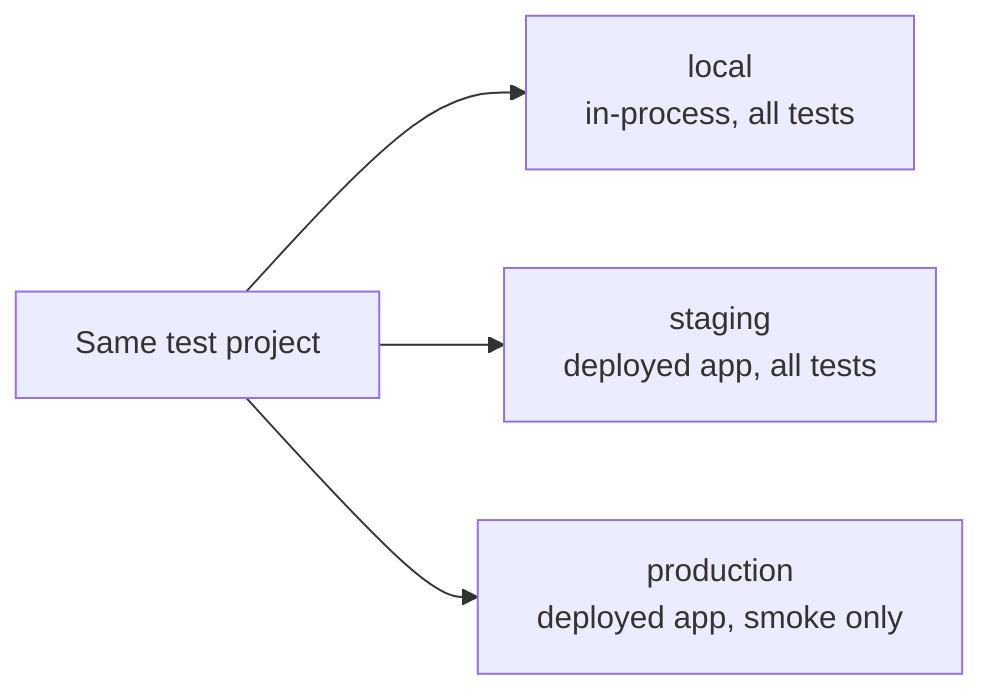

:::note[Series]
Part of the series [*Testing in practice*](/series/testing-in-practice/).
:::

In one codebase I worked on, the pipelines looked healthy: develop ran its tests against the
develop environment, staging against staging, and production... also against staging. Nobody had
decided that on purpose. Production simply didn't have a test setup, so the production pipeline
reused the staging one, and every release went out with a green checkmark that said nothing about
production.

In the same codebase, a few tests existed for specific tenants with their own configuration. Those
were run manually to reproduce bugs and then disabled again before the commit, because the pipeline
couldn't run them.

Both problems have the same root cause: the test suite had **one target baked in**. This post is
about making the target a parameter.

## The problem: the target is hard-wired

The typical setup hides the target in the base class or in `appsettings.Test.json`:

```csharp
[AssemblyInitialize]
public static void StartApi(TestContext _)
{
    _factory = new WebApplicationFactory<Program>()
        .WithWebHostBuilder(b => b.UseEnvironment("Staging"));   // that's the only target there is
    Client = _factory.CreateClient();
}
```

To test against another environment, you change that line locally, run the tests, and hope you
remember to change it back. To run against two environments in the pipeline, you can't.

The workarounds I've seen all have a price:

| Approach | Pro | Con |
|---|---|---|
| One test project per environment | Simple, fully isolated | Copy-paste of tests, every new environment means a new project, you never know which copy is current |
| A second base class that starts the API per test class | No copies of the base | Pays startup per class, existing tests can't be reused without changing their base class |
| Parameterized fixtures in a different test framework | One attribute per class switches the target | Means switching frameworks, and IDE test discovery can get flaky with generated fixtures |
| An environment attribute on each test class | You see which tests run where, one click to run on QA | Needs a rebuild to rediscover tests, categories can't be combined hierarchically |

What I want instead: **the same test code, the target chosen at run time, one run per target.**

## Make the target a run parameter

First, a small type that describes where the tests run:

```csharp
public sealed record TestTarget(
    string Name,                 // "local", "staging", "production"
    Uri? BaseAddress,            // null = host the API in-process
    bool AllowsWrites)
{
    public static TestTarget Local { get; } = new("local", null, AllowsWrites: true);

    public static TestTarget FromRunSettings(TestContext context)
    {
        var name = context.Properties["target"] as string
                   ?? Environment.GetEnvironmentVariable("TEST_TARGET")
                   ?? "local";

        return name switch
        {
            "local"      => Local,
            "staging"    => new("staging", new Uri("https://staging.shop.example.com/"), AllowsWrites: true),
            "production" => new("production", new Uri("https://shop.example.com/"), AllowsWrites: false),
            _ => throw new InvalidOperationException($"Unknown test target '{name}'.")
        };
    }
}
```

MSTest reads `context.Properties` from the `TestRunParameters` section of a `.runsettings` file:

```xml
<!-- staging.runsettings -->
<RunSettings>
  <TestRunParameters>
    <Parameter name="target" value="staging" />
  </TestRunParameters>
</RunSettings>
```

```bash
dotnet test --settings staging.runsettings
```

The environment-variable fallback is for the IDE and for pipelines where a variable is easier than a
file.

## One base class, two hosting modes

There are two fundamentally different ways to "test against staging", and it's worth being explicit
about which one you mean:

1. **In-process, configured like staging.** `WebApplicationFactory` hosts your current code with the
   staging configuration (its database, its downstream services). You test *your branch* against
   *staging's dependencies*. Great for reproducing a tenant-specific bug on your machine.
2. **Out-of-process, against the deployed app.** A plain `HttpClient` calls the real URL. You test
   *what's actually deployed*. That's the only mode that tells you anything about production.

The base class picks the mode from the target:

```csharp
[TestClass]
public abstract class ApiTestBase
{
    private static WebApplicationFactory<Program>? _factory;

    protected static TestTarget Target { get; private set; } = TestTarget.Local;
    protected static HttpClient Client { get; private set; } = null!;

    [AssemblyInitialize]
    public static async Task InitializeAsync(TestContext context)
    {
        Target = TestTarget.FromRunSettings(context);

        if (Target.BaseAddress is null)
        {
            _factory = new ApiFactory();
            Client = _factory.CreateClient();
            Client.DefaultRequestHeaders.Authorization = new("Test", TestUsers.Default);
        }
        else
        {
            Client = new HttpClient { BaseAddress = Target.BaseAddress, Timeout = TimeSpan.FromSeconds(30) };
            var token = await TestTokens.GetForAsync(Target, TestUsers.Default);
            Client.DefaultRequestHeaders.Authorization = new("Bearer", token);
        }
    }

    [AssemblyCleanup]
    public static async Task CleanupAsync()
    {
        Client.Dispose();
        if (_factory is not null) await _factory.DisposeAsync();
    }
}
```

The tests don't change at all. A test that says `Client.GetAsync("api/v1/orders/...")` doesn't know
or care whether the request goes through an in-memory test server or across the internet. How
`TestTokens` gets a real token (and why it never comes from a hard-coded string) is the topic of the
[next post](/blog/2026-testing-with-specific-user-tokens/).

## Not every test belongs on every environment

Running the full suite against production is a bad idea. It creates data, deletes data and runs
load-heavy scenarios. I mark tests with categories and filter per target:

```csharp
[TestMethod]
[TestCategory(TestCategories.Smoke)]          // read-only, safe everywhere
public async Task Should_Return_Product_Catalog() { /* ... */ }

[TestMethod]
[TestCategory(TestCategories.Writes)]         // creates and deletes its own data
public async Task Should_Not_Find_Order_After_It_Was_Deleted() { /* ... */ }
```

```bash
# staging: everything
dotnet test --settings staging.runsettings

# production: smoke tests only
dotnet test --settings production.runsettings --filter "TestCategory=Smoke"
```

And as a safety net, in case someone forgets the filter, the base class refuses writes on targets
that don't allow them:

```csharp
protected static void RequireWrites()
{
    if (!Target.AllowsWrites)
        Assert.Inconclusive($"Test creates data and is skipped on '{Target.Name}'.");
}
```

The pipeline then runs one job per target:

```yaml
jobs:
  integration-tests:
    strategy:
      matrix:
        include:
          - target: staging
            filter: ""
          - target: production
            filter: "TestCategory=Smoke"
    steps:
      - run: dotnet test --settings ${{ matrix.target }}.runsettings --filter "${{ matrix.filter }}"
```



## Test the environment you deploy to

Back to the production pipeline that tested staging. The problems with it are worth spelling out,
because "staging is close enough" is a very common belief:

- **Target mismatch.** Configuration, secrets, network rules and feature flags differ. A green run on
  staging says nothing about those.
- **Environment drift.** Staging gets hotfixes and features at a different pace. It's rarely the same
  build as production at the time of the release.
- **Data differences.** Production has more data, older data and data shapes nobody thought of.
- **False confidence.** The worst part: a green checkmark that people trust.

The fix isn't "run everything on production". It's a **small set of read-only smoke tests against
the real production deployment**, right after it's deployed. Can I authenticate? Does the catalog
load? Does the health endpoint report all dependencies as healthy? If those fail, roll back.

## Shared environments need unique test data

As soon as several actors run tests against the same environment (the pipeline, you, a colleague),
fixed test data becomes a race. One run's cleanup deletes the order another run just created, and
both fail in ways that are impossible to reproduce.

The fix is a per-runner identity in every piece of test data:

```csharp
public static class TestRun
{
    // Stable per machine or build agent, different between machines.
    public static string RunnerName { get; } =
        Sanitize(Environment.GetEnvironmentVariable("AGENT_NAME") ?? Environment.MachineName);

    private static string Sanitize(string value) =>
        new(value.ToLowerInvariant().Where(char.IsLetterOrDigit).Take(20).ToArray());
}
```

Every test tags its data with it (`Reference = $"it-orders-{TestRun.RunnerName}"`), and cleanup
deletes by that tag, as described in the
[GET, POST and DELETE patterns](/blog/2026-api-test-patterns-get-post-delete/). Stable per machine
matters: after an aborted run, the next run on the same machine finds and removes its own leftovers.

## Pitfalls

**Secrets in runsettings.** The runsettings file selects the target. It doesn't contain client
secrets or connection strings. Those come from a secret store at run time.

**In-process mode with production dependencies.** Hosting your branch in-process with the
production configuration means your unreleased code writes to production systems. Don't offer that
combination. The `production` target only exists in out-of-process mode.

**Timeouts.** In-process calls take milliseconds. Calls to a deployed app take longer, and the first
one after a deployment can take much longer. Set realistic timeouts per mode instead of one global
value.

**Tests that silently pass everywhere.** `Assert.Inconclusive` shows up as "skipped", not green.
Watch the skipped count per target in your test report; a sudden jump means a filter is wrong.

## Make it visible

- **Report per target.** Publish test results per matrix job so you can see "staging: 812 passed,
  production: 41 passed" instead of one merged number.
- **Alert on the production smoke run**, not just the build. A failed smoke test after a deployment
  should page someone or trigger a rollback, not wait for the next standup.

## Summary

- Make the **test target a run parameter** (runsettings or environment variable), not a line in the
  base class.
- Be explicit about **in-process** (your code, the environment's dependencies) vs **out-of-process**
  (the deployed app) testing.
- Use **categories** to decide what runs where; production gets **read-only smoke tests** only.
- **Test the environment you deploy to.** A production pipeline that tests staging produces false
  confidence.
- On shared environments, tag all test data with a **per-runner name** and clean up by that tag.
