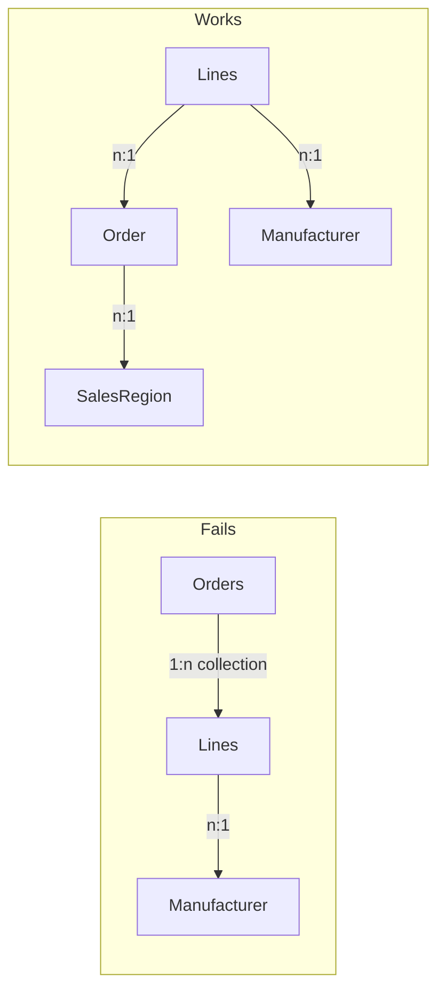

:::note[Series]
Part of the series [*Caching & data*](/series/caching-and-data/).
:::

The first week with a fluent OData client library feels great. You write
`client.For<Order>().Filter(o => o.Status == "Open").Expand(o => o.Lines)`, and it feels like
EF Core against a remote API. Type-safe, discoverable, no URL fiddling.

Then the requirements get real. In one integration I worked on, the service synchronized orders and
order lines between an ERP and a CRM platform that exposes an OData Web API. One day a correction run
was needed: *find all order lines without a manufacturer, for orders that belong to one sales
region.* A simple question. It took days of fighting both the client library and the server to get
an efficient answer, and the team ended up moving its queries to plain `HttpClient`.

This post collects the generic lessons. They apply to any OData client and to most "LINQ to remote
API" abstractions.

## The "before": the query that should have worked

```csharp
var lines = await odata.For<OrderLine>()
    .Expand(l => l.Order)
    .Expand(l => l.Order.SalesRegion)
    .Expand(l => l.Manufacturer)
    .Filter(l => l.Manufacturer == null && l.Order.SalesRegion!.Code == regionCode)
    .FindEntriesAsync();
```

It compiles. The library happily turns it into a URL. The server answers with a 400:

```text
{"error":{"code":"0x80040216","message":"entityRelationshipRole for given navigation property not found"}}
```

The reason isn't in the C# at all. The server **doesn't support filtering across two navigation
levels** (`order/salesregion/code`). One level works, two don't. The client library has no way of
knowing that, because OData is a large specification and every server implements a different subset
of it.

That's the core problem with OData client libraries: **they translate your intent into the full
OData language, but the server only speaks a dialect.**

## Lesson 1: learn the server's limits before you design queries

The CRM in question documents several limits of its OData implementation. Others the team only
found by trial and error. I've seen similar lists for other platforms:

| Limit | Effect |
|---|---|
| Max. 15 `$expand`s per query | Wide queries have to be split |
| No `$expand` inside an expanded **collection** | "Orders → lines → product" in one query fails, unless the top level is selected by key |
| No `$filter` across two or more navigation levels | `order/salesregion/code eq 'X'` → 400 |
| No `$count` together with `$expand` | You can't pre-check the result size of realistic queries |
| No `$skip` | Paging only via server-driven `@odata.nextLink` |

Two observations from that table:

- **"Collections within collections" is where most limits hit.** Many servers allow nesting only
  when the outer query is "logically single", meaning selected by a unique key. Even if your filter
  physically returns one row, the server may refuse.
- **Filtering inside an `$expand` doesn't filter the parent.**
  `$expand=order($filter=salesregion/code eq 'X')` looks like it solves the two-level problem. It
  doesn't. You still get *all* order lines. The ones that don't match just have `order: null`. Your
  code has to post-filter these "ghost" rows, and you've transferred all of them first.

## Lesson 2: turn the query around

The most useful workaround the team found: if you can't go **down** through a collection, start at
the bottom and go **up** through single-valued navigation properties.



Start at order lines, expand up to the order and its region, expand sideways to the manufacturer,
then group by order in C# to rebuild the "orders with their lines" shape you actually wanted. No
1:n navigation in the query, so none of the collection limits apply. It's not elegant, and it moves
work to the client. It works reliably.

When even that isn't enough, check whether the platform has a **native query language** next to
OData. The CRM had one (FetchXML) that supports multi-level filters and joins without any of these
restrictions. The team confirmed it as a full workaround for the two-level filter.

## Lesson 3: the client library has its own bugs

On top of the server's dialect, the library adds its own edge cases. The team documented several in
[Simple.OData.Client](https://github.com/simple-odata-client/Simple.OData.Client), all of them open
issues upstream for years:

- **Filtering by a GUID with the typed syntax** (`Filter(x => x.Id == id)`) threw an
  `UnresolvableObjectException`
  ([#605](https://github.com/simple-odata-client/Simple.OData.Client/issues/605)). Workaround: the
  string syntax `Filter($"id eq {id}")` or `Key(id)`.
- **Selecting date and time properties with the typed syntax** (`Select(x => x.Date)`) threw an
  `ArgumentException`
  ([#243](https://github.com/simple-odata-client/Simple.OData.Client/issues/243)), for `DateTime`,
  `DateTimeOffset` and `DateOnly` alike. Workaround: string syntax.
- **Upgrading the library** to the next major version, which newer platform packages required,
  produced runtime exceptions in the sync. Tricks around trimming didn't help. The team downgraded
  and pinned the old version, then added code rules to keep it from being upgraded by accident.

Each workaround is "use the string syntax", which raises a fair question: if the important queries
end up as strings anyway, what is the typed abstraction still buying you?

## Lesson 4: measure the abstraction

The team's next step was a BenchmarkDotNet comparison: fetch one order by its number with 25
columns, four ways.

| Approach | Mean |
|---|---:|
| OData client library (typed) | ~677 ms |
| `HttpClient` + System.Text.Json | ~70 ms |
| Native query language (FetchXML) over HTTP | ~73 ms |
| Vendor SDK (organization service) | ~73 ms |

That's their environment and their entity, not a universal number. But a factor of **almost ten**
between the library and a plain HTTP call is not noise. That was with schema validation already
turned off and `HttpClient` coming from `IHttpClientFactory`. The cost was in the library itself:
query translation, metadata handling and materialization.

For loading several unrelated entities at once, the picture depended on the shape. Sending
independent HTTP requests together was about as fast as the SDK's "execute multiple" for flat
entities (~107 ms vs ~96 ms). With linked entities, the HTTP variant was clearly faster (~143 ms vs
~557 ms).

## The fix: a thin typed client over HttpClient

What the team moved to was deliberately boring: a typed `HttpClient` (see
[HttpClient — you are (still) using it wrong](/blog/2026-httpclient-you-are-using-it-wrong/)),
System.Text.Json, and a few helpers for the OData parts that actually matter.

```csharp
public sealed record ODataPage<T>(
    [property: JsonPropertyName("value")] IReadOnlyList<T> Value,
    [property: JsonPropertyName("@odata.nextLink")] string? NextLink);

public sealed class CrmClient(HttpClient http)
{
    public async IAsyncEnumerable<T> QueryAllAsync<T>(
        string relativeUrl, [EnumeratorCancellation] CancellationToken ct)
    {
        string? next = relativeUrl;

        while (next is not null)
        {
            using var request = new HttpRequestMessage(HttpMethod.Get, next);
            request.Headers.Add("Prefer", "odata.maxpagesize=500");

            using var response = await http.SendAsync(request, HttpCompletionOption.ResponseHeadersRead, ct);
            response.EnsureSuccessStatusCode();

            var page = await response.Content.ReadFromJsonAsync<ODataPage<T>>(ct)
                       ?? throw new InvalidOperationException($"Empty OData response for {next}");

            foreach (var item in page.Value)
                yield return item;

            next = page.NextLink;   // server-driven paging, no $skip needed
        }
    }
}
```

The query itself is a URL, built with two small helpers so that encoding is never forgotten:

```csharp
public static class OData
{
    // OData string literals escape a single quote by doubling it
    public static string Literal(string value) => $"'{value.Replace("'", "''")}'";

    public static string Query(string entitySet, params (string Option, string Value)[] options) =>
        entitySet + "?" + string.Join("&", options.Select(o => $"{o.Option}={Uri.EscapeDataString(o.Value)}"));
}

var url = OData.Query("orderlines",
    ("$select", "orderlineid,quantity"),
    ("$filter", "_manufacturerid_value eq null and _orderid_value ne null"),
    ("$expand", "orderid($select=ordernumber;$expand=salesregion($select=code))"));

await foreach (var line in crm.QueryAllAsync<OrderLineDto>(url, ct))
{
    // post-filter by region in C#, see lesson 1
}
```

What the team listed as benefits of the native approach:

- **Speed.** Typical calls including deserialization in the range of 30–50 ms, with expands
  40–80 ms, depending on entity and load.
- **Debuggability.** The URL in the code is the URL on the wire. Paste it into curl or Postman and
  you see exactly what the server sees.
- **No translation surprises.** You write what the server supports, nothing more.
- **One dependency less**, and no more blocked upgrades.

And the honest downsides: URL encoding is now your job, the queries are harder to read than LINQ,
and you write each query by hand. For an integration with a few dozen well-known queries, that's a
very good trade.

## Lesson 5: model the data you actually get

Once the queries worked, the next exception came from the data:

```text
System.InvalidOperationException: Cannot get the value of a token type 'Null' as a number.
```

The external system contained far more `null` values than anyone expected, in fields the DTOs
declared as non-nullable `int` or `decimal`. Worse, the same types were used for updates, where
those fields *weren't allowed* to be null. One type can't express both.

The rule I take from it: **wire DTOs for an external system are not your domain model.** Declare
them as nullable as the source really is, validate and convert at the boundary, and use separate
types for reading and writing.

## Pitfalls

**Brute force as the fallback.** When the efficient query fails, the tempting "simple solution" is a
loop: load all orders, then load the lines of each order, one request at a time. It works for the
emergency. It's also hundreds of thousands of calls against a rate-limited API. The team's own notes
said it clearly: they weren't allowed to brute-force the system. Turn the query around (lesson 2) or
use the native query language instead.

**Assuming the spec.** "OData supports `$skip`" is true for the spec, not for every server. Read the
platform's documented limits first, and write a tiny test per OData feature you depend on.

**`$count` as a sanity check.** If the server refuses `$count` with `$expand`, you can't detect
"the total changed while I was paging". Keep paging until `@odata.nextLink` is gone, and if you
need a consistent snapshot, filter on a modification timestamp.

**Silent "ghost" rows.** Filtering inside an `$expand` returns parents with `null` children instead
of fewer parents. Always post-filter, and count how many rows you threw away. If it's most of them,
the query needs a different shape.

## How to keep it under control

- **Contract tests against a sandbox.** For every query the integration depends on, one test against
  a real sandbox environment of the platform. That's where server-dialect issues and library bugs
  show up, not in unit tests with mocked responses.
- **Benchmarks in the repo.** Keep the BenchmarkDotNet comparison around and rerun it when you
  change the approach or the platform changes its API version.
- **Dependency telemetry.** With OpenTelemetry, every outgoing call is a span with URL and duration.
  A sync that suddenly makes ten times as many calls is a brute-force loop that slipped in.
- **Pin and guard risky dependencies.** If a library version is known to break, pin it and add a
  build rule (for example central package management with a comment, or a banned-version check) so
  nobody "fixes" it with an upgrade.

## Summary

- An OData client library translates into the **full OData language**, but every server speaks a
  **dialect**. Unsupported queries fail at runtime with a 400.
- Learn the server's limits: **expand count and nesting, multi-level filters, `$count` with
  `$expand`, `$skip`**.
- **Turn queries around**: start at the child and go up through single-valued navigation, then
  regroup in C#. Use the platform's **native query language** for the hard cases.
- Client libraries add **their own bugs** and overhead. In the benchmark above, the typed client was
  almost **10× slower** than a plain HTTP call.
- A **thin typed `HttpClient`** with careful encoding and server-driven paging is fast, debuggable
  and honest. Model external data as **nullable DTOs**, separate from your domain.
