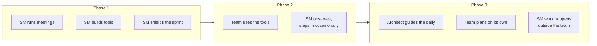

The best Scrum Master I've worked with ended up with almost nothing to do. By the end of the project,
there was no Scrum Master in our dailies at all. The team architect guided them, the team planned its
own sprints, and nobody missed anything.

That sounds like a story about a role that failed. It's the opposite. A Scrum Master's job is to make
a team able to work in an agile way on its own. If that works, the role gets smaller. This post
describes how that happened over roughly four years in a project with six Scrum teams, and what I'd
copy from it.

## Phase 1: the active facilitator

When we started, an external Scrum Master joined the team, and they did far more than the textbook
describes. They integrated into the team, ran our meetings, organized everything around the sprint,
and started activities that had nothing to do with the official job description.

The most visible one was a **planning tool** they built for us, a spreadsheet with a lot of macro logic
that handled templates for recurring tasks, capacity per developer and the generation of the sprint
at the end of planning. I describe it in more detail in the post on
[realistic capacity planning](/blog/2026-realistic-capacity-planning/).

In the dailies, the Scrum Master orchestrated and supervised. In retrospectives, they prepared the
agenda, made sure the material was there, kept the atmosphere blame-free and helped turn the
discussion into concrete actions. During the sprint, they and the Product Owner made sure no new
wishes or stories were pushed into the running sprint. Production bugs were the only exception.

Purists might say that's too much. A Scrum Master shouldn't run the team. In a team that is new to
Scrum, though, I think it's exactly right. You can't self-organize around a process you've never seen
working. Somebody has to show you what a good planning or a good retro feels like first.

## Phase 2: stepping back

Then, gradually, the Scrum Master did less. Not all at once and not with an announcement. They stopped
running the planning and let the team use the tool on its own, intervening only occasionally when
something wasn't running smoothly. They stopped moderating every daily. Their role moved toward
observing the process and fixing issues in the tools they had built.

The important part is that the **tools and habits stayed when the person stepped back**. The planning
tool encoded how we plan. The retro formats encoded how we reflect. The team didn't depend on someone
remembering the process, because the process was built into what we used every day.

## Phase 3: the team runs itself

At the end, there was no Scrum Master in the team's daily work any more. The **team architect guided
the dailies**. The format stayed almost the same as at the beginning, but the content shifted: the
daily became mostly about technical issues, solutions and where someone needed support from another
team member.

The team planned, refined, reviewed and reflected on its own. Some Scrum Master work still existed,
just outside the team's view. There were more events because of scaling Scrum across six teams,
product vision and so on, which the developers didn't attend, but the Scrum Masters did. Everything
the team needed to know came back to us; everything that was just noise stayed away.

## Who did what, over time

| Activity | Phase 1 | Phase 2 | Phase 3 |
|---|---|---|---|
| Daily | Scrum Master moderates | Team, SM observes | Team architect guides |
| Sprint planning | SM leads with the tool | Team uses the tool, SM steps in if needed | Team |
| Retrospective | SM prepares, moderates, drives actions | Moderator keeps it running, team drives the discussion | Team |
| Keeping new work out of the sprint | SM and PO | SM and PO | PO, with the team |
| Scaling and cross-team events | SM | SM | SM, outside the team's view |
| Maintaining the tools | SM builds them | SM fixes issues | Mostly stable |

## Why it worked

Looking back, I see four reasons.

**The Scrum Master built tools, not dependencies.** Everything they did early on left something behind
that the team could use without them. A Scrum Master who moderates brilliantly but leaves nothing
behind makes themselves indispensable, which is the wrong goal.

**Training gave everyone the same foundation.** Every Scrum team in the company had to go through a
five-day professional Scrum training. The goal was autonomy, a clear split of responsibilities and
team spirit. When the Scrum Master stepped back, the team knew *why* the events exist, not only how
to run them.

**Stepping back happened gradually.** There was no day on which the Scrum Master left. The team took
over one thing after another, and each step was small enough to work.

**Someone technical took over the daily.** Handing the daily to the team architect was a natural fit,
because by then our daily was mostly a technical conversation anyway. It also meant the person
guiding it could actually help with the problems people raised.

## Pitfalls

**Stepping back too early.** If the team has never seen a good retro, removing the moderator doesn't
create self-organization. It creates silence. Phase 1 is not optional.

**The daily turns into a status report to the architect.** When a senior technical person guides the
daily, there's a risk that everyone reports *to* them instead of talking *with* each other. The
architect has to facilitate, not collect status.

**Nobody shields the sprint any more.** Keeping new requests out of a running sprint was explicitly
the job of the Scrum Master and the PO. When the Scrum Master steps back, make sure someone still owns
that, or the sprint slowly becomes a to-do list.

**Tools nobody can maintain.** A tool built by one person becomes a risk when that person leaves.
Ours stayed stable, but it's worth checking that someone else in the team understands it.

**Management doesn't change along with the team.** A self-organizing team with a manager who still
expects command and control is going to have problems. My personal recommendation: management should
go through professional Scrum training too, and ideally in person, together with the teams. It builds
a shared language and team spirit.

## How to check where your team stands

A simple exercise for a retro: list every recurring activity around the sprint and write down who
does it today.

| Activity | Who does it today? | Could the team do it next sprint? |
|---|---|---|
| Moderating the daily | | |
| Preparing the planning | | |
| Running the planning | | |
| Moderating the retro | | |
| Following up on retro actions | | |
| Escalating impediments outside the team | | |
| Keeping new requests out of the sprint | | |

Every row that says "Scrum Master" in the second column and "yes" in the third is the next step.
Every row that says "Scrum Master" and "no" is a coaching topic.

## Summary

- Our Scrum Master started as a very active facilitator who ran meetings and built tools, far beyond
  the textbook role.
- Over time they stepped back to an observing role, and in the end the **team architect guided the
  daily** and there was no Scrum Master in the team's daily work.
- It worked because the tools stayed when the person stepped back, everyone had the same training,
  and the hand-over was gradual.
- Watch out for stepping back too early, dailies that become status reports, and nobody shielding the
  sprint.
- The goal of a Scrum Master is a team that doesn't need one in its daily work. Ours got there.
