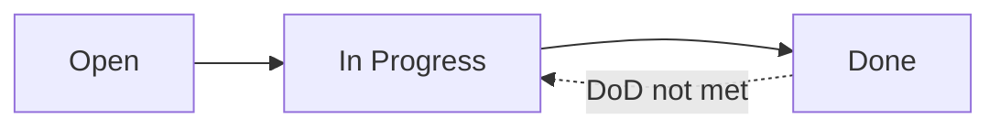

:::note[Series]
Part of the series [*Scrum in the real world*](/series/scrum-in-the-real-world/).
:::

Scrum boards tend to grow. To Do, Analysis, In Development, Code Review, Ready
for Test, In Test, Test Failed, Ready for Deployment, Deployed, Accepted, Done. Each column was added
for a good reason. Together, they turn the board into a waiting room where work sits comfortably in
"almost done" states for days.

In the project with six Scrum teams I worked on for about four years, our board had **three columns**.
That only works if the last column means something. Ours did, because our Definition of Done was
strict. This post is about both halves, because one doesn't work without the other.

## The board

| Column | Meaning |
|---|---|
| **Open** | Planned for the sprint, nobody has started yet |
| **In Progress** | Someone is working on it, including testing, deployment and getting feedback |
| **Done** | Meets the Definition of Done. No exceptions without an explicit decision |

That's it. Code review, testing, deployment and stakeholder feedback are all part of *In Progress*.
They're steps toward Done, not places to park work.

## Why so few columns

**No comfortable intermediate states.** With a "Ready for Test" column, a developer can move a card,
feel done, and start the next story. The work isn't finished, but the board says progress was made.
With three columns, a story is either done or it isn't.

**Fewer hand-overs.** Every column boundary is an invitation for a hand-over between people or roles.
Hand-overs mean waiting. In our setup, at least two developers worked on each story, and they owned it
until it was done, including tests and deployment.

**Less board maintenance.** Nobody discusses whether a card belongs in "In Test" or "Ready for
Deployment".

**The status is honest.** If half the stories are in progress on the last day of the sprint, the board
shows exactly that. You can't hide it in a column that looks almost finished.

## The strict Definition of Done

Three columns move all the rigor into one place: the definition of the last column. Our Definition of
Done, in its real-world form, said roughly this:

> A story is **Done** when the feature has been **officially tested** and **deployed on the target
> machines**, without manual upgrades via USB stick for some of the components. This includes
> **validation by the stakeholder or the Product Owner**, who confirms that the result matches what was
> expected and is what we want to present in the review.

Three parts make it strict:

1. **Tested.** Not "tested on my machine", but through the test cases that belong to the story.
2. **Deployed on the target machines, without manual workarounds.** If a component still needs
   someone with a USB stick to update it, it isn't deployed, it's hand-delivered. That doesn't count.
3. **Accepted by the stakeholder or PO.** The person who wanted the feature confirms it does what they
   expected.

### If it doesn't meet expectations, it's not done

When the result didn't meet the expectations, the story was **not marked as Done** and **not presented
in the review**. The review was for done increments only.

There was one exception, and it was handled deliberately: sometimes stakeholders wanted to see the
progress of something that wasn't finished. That could be discussed, and the **PO decided together with
the team**. An exception was a conscious decision, not a quiet shortcut.

## Testing is part of the story, not after it

To make "tested" concrete, every backlog item had two standard tasks:

- **Create test case**
- **Execute test case**

Both tasks existed **before sprint planning**, and the test case itself was written before planning
too. That way the effort for testing was part of the estimate from the start, and nobody could plan a
story without thinking about how to verify it.

## Feedback before the review

A strict Done doesn't mean waiting until the end of the sprint to find out whether the stakeholder
agrees. We tried to get feedback from stakeholders **as fast as possible** while developing a story. If
something was done, we didn't wait for the review to show it.

That has two effects. Stories that are off track get corrected during the sprint, not after it. And the
review becomes a confirmation and a conversation about the next steps, not a surprise.

## A DoD checklist template

Here's a checklist in the spirit of ours that you can adapt. The first three items are the core; the
rest depend on your product.

| # | Criterion | Checked by |
|---|---|---|
| 1 | Acceptance criteria of the story are met | Developers |
| 2 | Test cases created and executed successfully | Developers |
| 3 | Deployed to the target environment through the regular pipeline, no manual steps | Developers |
| 4 | Stakeholder or PO has seen it and confirmed it matches expectations | PO |
| 5 | Code reviewed by the second developer on the story | Developers |
| 6 | Relevant documentation updated | Developers |
| 7 | No known open bugs against this story | Developers + PO |

If one of these isn't true, the card stays in *In Progress*.

## Done in the review

Our sprint review was built on Done:

- All teams that had a **done increment** on the product took part. That could be one team or several.
- The PO gave a short briefing to the stakeholders about what was completed, usually with one or two
  developers.
- The increment was presented **live on the real machine**.
- Each developer who built a done increment presented it.
- Questions were answered, and critical points were collected and turned into new backlog items.

A live demo on the real machine is the final check of the Definition of Done. If it doesn't work
there, it wasn't done.

## Three columns vs. a detailed board

| | Three columns + strict DoD | Many columns |
|---|---|---|
| Shows where exactly a story is | ⚠️ you have to ask | ✅ |
| Encourages finishing over starting | ✅ | ❌ partial progress looks like progress |
| Number of hand-overs | low | high |
| Board maintenance | minimal | constant |
| Honest status at sprint end | ✅ done or not | ⚠️ "almost done" columns |
| Needs a strong DoD | ✅ absolutely | ⚠️ the columns carry some of it |

The one real downside of three columns is that *In Progress* covers a lot. If you need to know whether
a story is waiting for feedback or still in development, you ask the people working on it, which is
what the daily is for.

## Pitfalls

**Three columns with a weak Done.** If Done means "code merged", three columns just make the board
less informative. The strict DoD is not optional.

**Sneaking columns back in.** "Can we just add a Review column?" is how ten-column boards start. Ask
what problem the column solves and whether the DoD already covers it.

**Exceptions without a decision.** Showing unfinished work in the review is sometimes useful. But it
should be an explicit decision by the PO with the team, and everyone should know it isn't done.

**Testing as an afterthought.** If test tasks get created during the sprint, the estimates were wrong
from the start. Have them in place before planning.

**Waiting for the review to get feedback.** The review is the latest point for feedback, not the
first.

## How to enforce it

- Make **create test case** and **execute test case** part of your story template, so they exist
  automatically.
- Deploy only through the pipeline. If the target environment can only be updated manually, fix that
  first, because otherwise "deployed" means nothing.
- At the start of each review, check every presented item against the DoD. If one doesn't pass, it goes
  back to *In Progress*, and that's fine.
- In the retro, look at stories that bounced back from Done. They tell you which part of the DoD is
  unclear.

## Summary

- Our board had only **three columns: Open, In Progress, Done**. Testing, deployment and feedback are
  part of *In Progress*.
- That works only with a **strict Definition of Done**: tested, deployed to the target machines without
  manual workarounds, and accepted by the stakeholder or PO.
- Stories that don't meet expectations aren't done and aren't shown in the review, unless the PO and the
  team explicitly decide otherwise.
- Test tasks exist before planning, and feedback is collected during the sprint, not only in the review.
- Fewer columns, harder Done: less waiting, fewer hand-overs and an honest board.
