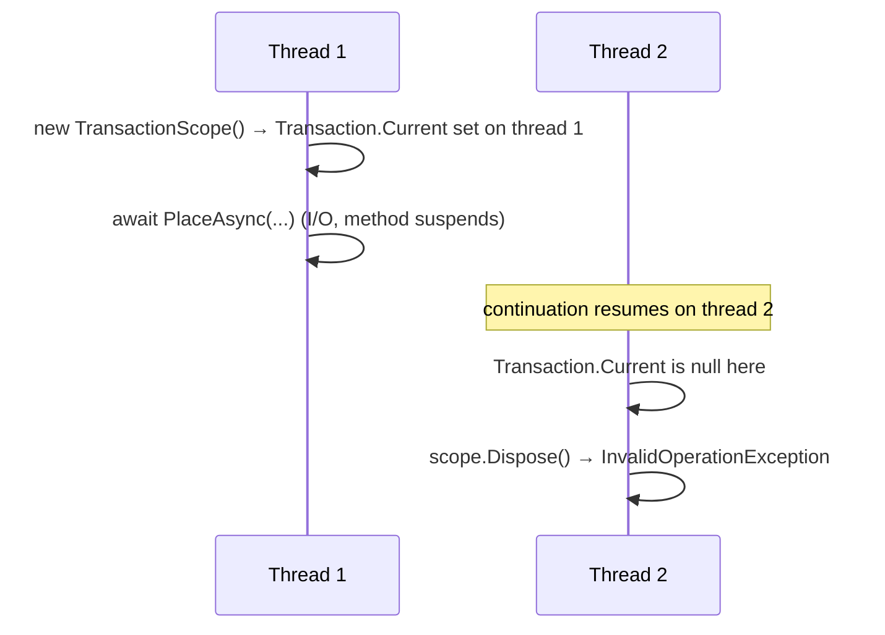

This one usually arrives as a test failure that makes no sense:

```
System.InvalidOperationException: A TransactionScope must be disposed on the same thread
that it was created.
```

In one codebase I worked on, it appeared right after an upgrade of the database driver. The integration
tests used a `TransactionScope` that was never completed, so every test rolled back its changes. That
setup had worked for a long time. After the upgrade, the tests failed in `Dispose`.

The driver wasn't the bug. It just changed timing enough to expose a problem that had been there all
along.

## The code

```csharp
[TestMethod]
public async Task Placing_an_order_reserves_stock()
{
    using var scope = new TransactionScope();          // ❌ default: no async flow

    await orders.PlaceAsync(new PlaceOrder(CustomerId: 42, Sku: "SKU-1", Quantity: 2));

    var stock = await stockRepository.GetAsync("SKU-1");
    Assert.AreEqual(8, stock.Available);

    // no scope.Complete() → rolled back on Dispose
}
```

## Why it happens

`TransactionScope` sets an **ambient transaction**: `Transaction.Current`. Database connections that
open inside the scope see it and enlist automatically. That's the convenient part: you don't pass a
transaction object to every repository.

By default, `Transaction.Current` is stored **per thread**. That made sense in 2005, when code ran
start-to-finish on one thread. With `async`/`await`, it doesn't. After an `await` that actually
suspends, the rest of the method can continue on a different thread-pool thread, especially in
ASP.NET Core and test runners, where there's no synchronization context to bring you back.



Two things break:

1. **Code after the first `await` doesn't see the transaction.** A connection opened there doesn't
   enlist, so its changes are committed immediately, outside the transaction. That one is silent.
2. **`Dispose` runs on another thread**, and `TransactionScope` refuses, with the exception above.

Whether the continuation really switches threads depends on timing: whether the I/O completed
synchronously, how busy the pool is, how the driver implements its async methods. That's why it can work
for years and then break with a driver update, or only fail on the build server.

:::note[ConfigureAwait doesn't matter here]
`ConfigureAwait(true)` or `(false)` makes no difference. In ASP.NET Core and in test runners there's no
synchronization context, so the continuation runs on whichever pool thread is free either way. The fix
is in how the scope stores its state, not in where the continuation runs.
:::

## The fix: TransactionScopeAsyncFlowOption.Enabled

Since .NET Framework 4.5.1, `TransactionScope` can store the ambient transaction in the
`ExecutionContext` instead of the thread. The `ExecutionContext` flows across `await`, so the transaction
follows your logical flow, whichever thread runs it.

```csharp
using var scope = new TransactionScope(TransactionScopeAsyncFlowOption.Enabled);

await orders.PlaceAsync(new PlaceOrder(CustomerId: 42, Sku: "SKU-1", Quantity: 2));
var stock = await stockRepository.GetAsync("SKU-1");
```

That's it. **Every `TransactionScope` in async code needs this option.** It's not on by default for
backward-compatibility reasons, which is exactly why it keeps biting people.

## The other defaults you probably don't want

While you're touching every `new TransactionScope(...)` anyway, look at two more defaults.

**Isolation level: Serializable.** A `TransactionScope` created without options uses
`IsolationLevel.Serializable`, the strictest level. Your database's default is usually
`ReadCommitted`. Serializable takes range locks, so concurrent requests block each other or deadlock
under load, and nobody understands why the same code behaves differently with and without the scope.

**Timeout: one minute.** The default timeout is 60 seconds, and the machine-wide maximum is ten minutes
unless configured otherwise. A long-running import inside a scope gets aborted with a confusing
`TransactionAbortedException`.

So the version I'd actually write, behind a small factory so nobody has to remember three parameters:

```csharp
public static class Transactions
{
    public static TransactionScope Begin(TimeSpan? timeout = null) =>
        new(TransactionScopeOption.Required,
            new TransactionOptions
            {
                IsolationLevel = IsolationLevel.ReadCommitted,
                Timeout = timeout ?? TimeSpan.FromSeconds(30)
            },
            TransactionScopeAsyncFlowOption.Enabled);
}
```

```csharp
using (var scope = Transactions.Begin())
{
    await orders.SaveAsync(order, ct);
    await outbox.AddAsync(new OrderPlaced(order.Id), ct);
    scope.Complete();
}
```

## Distributed transactions: the escalation trap

As long as a scope uses a single connection to a single database, the transaction stays local and
cheap. Open a **second** connection inside the same scope, even to the same database with the same
connection string, and many providers try to **escalate to a distributed transaction**.

On .NET Framework, that silently involved MSDTC. On .NET (Core), distributed transactions are only
supported on Windows since .NET 7, and only if you opt in with
`TransactionManager.ImplicitDistributedTransactions = true`. Otherwise you get an exception the moment
the second connection enlists. On Linux containers, there is no support at all.

The safe rule: **one connection per scope.** Open it once and pass it along, or let a unit of work own it.

## Do you need TransactionScope at all?

Ambient transactions are convenient, and they're also invisible: you can't see in a method signature
whether it participates in a transaction. For most application code, an explicit transaction is clearer:

```csharp
await using var transaction = await db.Database.BeginTransactionAsync(ct);

db.Orders.Add(order);
db.OutboxMessages.Add(OutboxMessage.From(new OrderPlaced(order.Id)));
await db.SaveChangesAsync(ct);

await transaction.CommitAsync(ct);
```

And if all changes go through one `SaveChangesAsync`, EF Core already wraps them in a transaction. You
don't need either.

| Approach | Good for | Watch out for |
|---|---|---|
| `TransactionScope` (with async flow) | Several repositories/libraries that open their own connections; test rollback | Serializable default, escalation with multiple connections, invisible participation |
| `DbContext.Database.BeginTransactionAsync` | Multiple `SaveChanges` or raw SQL on one context | Only covers that context's connection |
| Single `SaveChangesAsync` | Most write operations | Nothing extra needed |
| `DbConnection.BeginTransactionAsync` (ADO.NET, Dapper) | Explicit control in data-access code | Pass the transaction to every command |

For **test isolation**, `TransactionScope` is still a nice trick, but it fails as soon as the code under
test opens a second connection or uses a transaction itself. Tools like Respawn, which reset the
database between tests, or a fresh database per test class in a Testcontainers setup, are more robust
alternatives.

## Make it impossible to forget

The parameterless constructor is the one that causes the trouble, along with every other overload
without `TransactionScopeAsyncFlowOption`. Ban them with
[BannedApiAnalyzers](https://www.nuget.org/packages/Microsoft.CodeAnalysis.BannedApiAnalyzers):

```text
# BannedSymbols.txt
M:System.Transactions.TransactionScope.#ctor;Use Transactions.Begin() (async flow, ReadCommitted)
M:System.Transactions.TransactionScope.#ctor(System.Transactions.TransactionScopeOption);Use Transactions.Begin()
M:System.Transactions.TransactionScope.#ctor(System.Transactions.TransactionScopeOption,System.Transactions.TransactionOptions);Use Transactions.Begin()
```

The factory itself gets a `#pragma` with a comment, and everyone else gets a build error with the reason.
For the silent variant (a connection that didn't enlist after an `await`), an integration test that
writes, throws before `Complete()`, and then asserts the data is **not** there catches it reliably.

## Summary

- `TransactionScope` stores the ambient transaction **per thread** by default. After an `await`, you may be
  on another thread: the transaction is gone, and `Dispose` throws.
- Always use **`TransactionScopeAsyncFlowOption.Enabled`** in async code. `ConfigureAwait` doesn't help.
- The defaults are **Serializable** and **one minute**. Set `ReadCommitted` and a sensible timeout explicitly.
- A **second connection** in the same scope can escalate to a distributed transaction, which .NET supports
  only on Windows and only on opt-in.
- Prefer **explicit transactions** or a single `SaveChangesAsync` where you can.
- **Ban** the unsafe constructors and wrap the right one in a factory.
