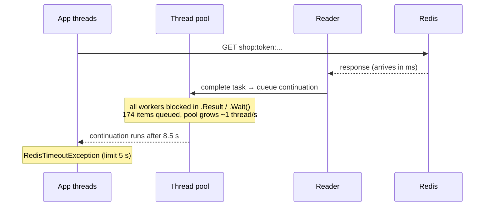

:::note[Series]
Part of the series [*Caching & data*](/series/caching-and-data/).
:::

The integration tests ran fine on every developer machine. They ran fine against the dev
environment. In the CI pipeline, every now and then, they failed with this:

```text
StackExchange.Redis.RedisTimeoutException: Timeout awaiting response
(outbound=0KiB, inbound=0KiB, 8536ms elapsed, timeout is 5000ms), command=GET,
next: GET shop:token:3f9a..., inst: 0, qu: 0, qs: 0, aw: False, bw: Inactive,
rs: ReadAsync, ws: Idle, in: 3126, serverEndpoint: shop-cache.example.com:6380,
mc: 1/1/0, mgr: 10 of 10 available, clientName: build-agent-07(SE.Redis-v2.6.70),
IOCP: (Busy=0,Free=1000,Min=1,Max=1000),
WORKER: (Busy=36,Free=32731,Min=2,Max=32767),
POOL: (Threads=36,QueuedItems=174,CompletedItems=267734), v: 2.6.70
```

The connection string was correct. At the very moment the pipeline failed, the same Redis instance
answered instantly from a laptop. So, is Redis slow? Is the network flaky? Should we raise the timeout
to 15 seconds?

None of the above. The answer is in the message. Most people only read the first line, and that's a
pity, because StackExchange.Redis puts a small diagnostic report into every timeout exception. This
post explains how to read it and what the usual causes are.

## What "timeout" means here

StackExchange.Redis sends all commands of an application over **one multiplexed connection**. A
command is written to the socket, the client moves on, and a dedicated reader picks up responses in
order and completes the matching tasks.

A timeout means: **this command's task wasn't completed within `SyncTimeout`/`AsyncTimeout`** (5
seconds by default). It doesn't say *where* the time went. It could be:

- the command was never sent (it was stuck in the client's queue),
- it was sent, but Redis hadn't answered yet,
- Redis had answered, but **nobody on the client got around to processing the response**.

The third one is by far the most common in .NET applications, and the message tells you which one it
was.

## Reading the message field by field

| Field | Meaning | What to look for |
|---|---|---|
| `outbound` / `inbound` | KiB in flight when the timeout happened | Large numbers: big values are clogging the connection |
| `qu` | Commands **queued**, not yet written to the socket | High: the client can't write fast enough (CPU, bandwidth, huge payloads) |
| `qs` | Commands **sent**, waiting for a response | High: the server or the network is slow |
| `in` | Bytes sitting in the **inbound socket buffer**, not yet read by the client | > 0 with `qs` low: the answer is there, the client isn't processing it |
| `aw` / `bw` | Active writer / backlog writer state | `bw` active for long: commands are backlogged, often after a reconnect |
| `rs` / `ws` | Reader / writer state | Snapshot of what the I/O loop was doing |
| `mc` | Multiplexer connect stats | Numbers that grow over time mean reconnects |
| `mgr` | Socket manager threads available | "0 of 10 available": the dedicated I/O threads are all busy |
| `IOCP` / `WORKER` | .NET thread pool: busy, free, min, max | **Busy > Min**: the pool had to grow, which is slow |
| `POOL` | Thread pool threads and **queued work items** | `QueuedItems` in the hundreds: work is waiting for a thread |

Now read the example again:

- `qu: 0, qs: 0`: nothing waiting to be sent, nothing waiting for Redis. The server isn't the
  bottleneck.
- `in: 3126`: about 3 KB of response data already arrived and is waiting in the socket buffer.
- `WORKER: (Busy=36, ..., Min=2)`: 36 busy worker threads, but the minimum is 2. Every thread
  beyond the minimum is added slowly by the thread pool's hill-climbing, roughly one or two per
  second.
- `POOL: (... QueuedItems=174 ...)`: 174 work items waiting for a thread.
- `8536ms elapsed`: the response was there long before that. Completing the task and running the
  continuation needs a thread pool thread, and there wasn't one.

That's the textbook signature of **thread pool starvation** on the client. `Min=2` also explains why
it only showed up in CI: a small build agent with two cores has a minimum of two worker threads, and
anything that blocks threads (parallel tests, sync-over-async calls) exhausts that quickly. A developer laptop with 16 or more
cores has a much larger minimum, so the same code never hits the limit there.



## Cause 1: thread pool starvation (the usual suspect)

The classic trigger is **sync over async**, blocking a thread pool thread while waiting for an async
operation:

```csharp
public sealed class TokenProvider(IDatabase redis, ITokenClient tokens)
{
    public string GetToken()
    {
        var cached = redis.StringGetAsync("shop:token:catalog").Result;   // blocks a pool thread
        if (cached.HasValue) return cached!;

        var token = tokens.FetchAsync().GetAwaiter().GetResult();       // blocks another one
        redis.StringSetAsync("shop:token:catalog", token, TimeSpan.FromMinutes(50)).Wait();
        return token;
    }
}
```

Under load, many requests do this at the same time. Every one of them holds a thread while
waiting for a continuation that itself needs a thread. The pool grows slowly, and in the meantime
Redis responses pile up unprocessed. Redis is the first to complain because it has a short timeout,
but HTTP calls and database queries suffer the same way.

The fix is async all the way:

```csharp
public sealed class TokenProvider(IDatabase redis, ITokenClient tokens)
{
    public async Task<string> GetTokenAsync(CancellationToken ct)
    {
        var cached = await redis.StringGetAsync("shop:token:catalog");
        if (cached.HasValue) return cached.ToString();

        var token = await tokens.FetchAsync(ct);
        await redis.StringSetAsync("shop:token:catalog", token, TimeSpan.FromMinutes(50));
        return token;
    }
}
```

Common places where sync over async hides: constructors and DI factories (`AddSingleton(sp =>
...Result)`), `IOptions` setup, synchronous interfaces from older libraries, `Parallel.ForEach` with
async lambdas, and test code that calls `.Result` because "it's just a test".

:::caution[Raising the minimum thread count]
`ThreadPool.SetMinThreads(200, 200)` (or `System.Threading.ThreadPool.MinThreads` in
`runtimeconfig.json`) makes the pool hand out threads immediately up to that number. It's a valid
**mitigation** while you hunt down the blocking code, and the StackExchange.Redis docs mention it.
It's not a fix. Blocked threads still cost memory and context switches, and with enough load you hit
the new limit too.
:::

## Cause 2: large values

All commands share **one connection** and responses come back **in order**. A single 5 MB value
blocks everything behind it until it's fully transferred, which is head-of-line blocking. Signs in
the message: large `outbound`/`inbound` values, `qs` greater than zero, and the timed-out command is
often a *small* `GET` that was simply unlucky enough to be queued behind a large one.

Fixes, roughly in order of preference:

1. **Don't cache huge things.** If a result is huge, it's usually a list. Cache a page, or cache only
   the IDs. One team I worked with ran into the per-item size limits of their managed Redis with large
   filtered result sets and added a simple rule: only write the result to the cache if it has fewer
   than a given number of items. That's a pragmatic quick fix, and I'll come back to it in the
   [caching abstractions](/blog/2026-caching-abstractions-memory-redis-hybrid/) post.
2. **Use hashes** and read only the fields you need (see the
   [data types](/blog/2026-redis-data-types-in-practice/) post).
3. **Compress** values above a threshold (Brotli or GZip from `System.IO.Compression`). JSON
   compresses very well.
4. As a last resort, a **second multiplexer** for the few heavy keys, so they don't block the
   latency-sensitive traffic.

## Cause 3: the server really is busy

Sometimes it *is* Redis. Then you'll see `qs` climbing while the client's thread pool looks healthy.
Typical causes:

- **Expensive commands**: `KEYS`, `SMEMBERS`/`HGETALL` on huge collections, `SORT`, long Lua scripts.
  Redis executes commands on a single thread, so one slow command delays everyone. Check `SLOWLOG GET`.
- **CPU or memory pressure** on the server: high server load, evictions, or a persistence fork
  (RDB/AOF rewrite) on a large instance.
- **Bandwidth limits** of a small managed tier. The smallest cloud tiers have very little network
  bandwidth, and a few large values per second can saturate it.

## Cause 4: connection handling

- **A multiplexer per request** or per scope. Every new `ConnectionMultiplexer` performs a handshake
  and TLS negotiation and opens new sockets. Register it **once as a singleton**.
- **Reconnect storms.** A growing `mc` and `bw: Active` mean the connection drops and commands are
  backlogged. Look at network stability, idle timeouts on load balancers, and server-side
  maintenance events.

A robust baseline configuration:

```csharp
var options = ConfigurationOptions.Parse(builder.Configuration.GetConnectionString("Redis")!);
options.AbortOnConnectFail = false;           // keep retrying in the background instead of failing startup
options.ConnectRetry = 3;
options.ConnectTimeout = 5_000;
options.SyncTimeout = 5_000;                  // don't "fix" timeouts by raising these
options.AsyncTimeout = 5_000;
options.ClientName = $"{builder.Environment.ApplicationName}-{Environment.MachineName}";

builder.Services.AddSingleton<IConnectionMultiplexer>(ConnectionMultiplexer.Connect(options));
```

`ClientName` shows up in the timeout message and in `CLIENT LIST` on the server, which makes it much
easier to see *which* service is in trouble.

## Why not just raise the timeout?

| Approach | Effect |
|---|---|
| Raise `SyncTimeout` / `AsyncTimeout` | Hides the symptom. Requests now hang 15 s instead of failing after 5 s. |
| `SetMinThreads` | Valid mitigation for starvation, buys time, doesn't remove the blocking. |
| Remove sync over async | Fixes the most common root cause. |
| Smaller values, hashes, compression | Fixes head-of-line blocking. |
| Bigger Redis tier | Fixes a genuinely overloaded server, but only that. |

A cache exists to make things faster. A cache call that's allowed to take 15 seconds has lost its
reason to exist. If Redis can't answer in time, it's usually better to fail fast and fall back to the
source, or to a local in-memory copy.

## How to see it coming

- **Thread pool metrics.** `dotnet-counters monitor --counters System.Runtime` shows
  `threadpool-thread-count` and `threadpool-queue-length`. A queue length that doesn't return to
  zero under load is starvation in progress, long before the first timeout. Export the same metrics
  via OpenTelemetry for production.
- **Redis instrumentation.** `OpenTelemetry.Instrumentation.StackExchangeRedis`
  (`.AddRedisInstrumentation()`) turns every command into a span, so you can see slow commands and
  their size per request.
- **Connection events.** Subscribe to `ConnectionFailed`, `ConnectionRestored` and `ErrorMessage` on
  the multiplexer and log them. Reconnects that nobody logs look exactly like random timeouts.
- **Server metrics.** Server load, CPU, memory, evictions and network bandwidth of the Redis instance
  itself. If those are flat while your clients time out, the problem is on the client.
- **Ban the blocking calls.** An analyzer that flags `.Result`, `.Wait()` and
  `GetAwaiter().GetResult()` (for example `VSTHRD002` from
  [Microsoft.VisualStudio.Threading.Analyzers](https://www.nuget.org/packages/Microsoft.VisualStudio.Threading.Analyzers))
  removes the most common cause before it reaches production.

## Summary

- A `RedisTimeoutException` means a task wasn't completed in time, **not** necessarily that Redis
  was slow.
- Read the message: **`qs`** high → server or network; **`qu`** high → client can't write;
  **`in` > 0 and `WORKER Busy > Min`** → thread pool starvation on the client.
- The most common cause is **sync over async**. Go async all the way; use `SetMinThreads` only as a
  mitigation.
- **Large values** block the shared connection for everyone. Cache smaller things, use hashes,
  compress.
- Use **one singleton multiplexer**, set a `ClientName`, and watch thread pool and Redis metrics
  instead of raising timeouts.
