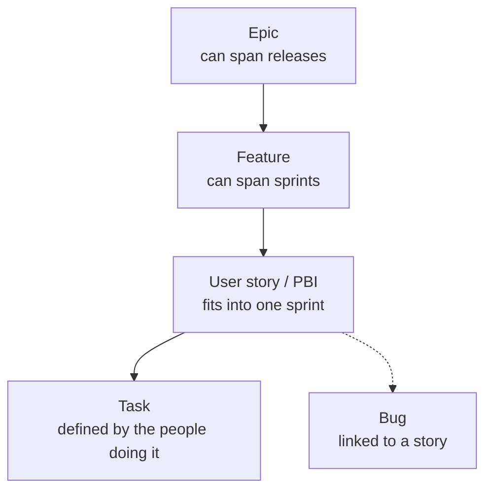

Most bad sprints I've seen didn't fail in development. They failed in the story. The story described a
solution instead of a problem, the acceptance criteria were vague or quietly doubled the scope, and the
team only found out halfway through the sprint.

In the project with six Scrum teams I worked on for about four years, we put a lot of effort into the
structure of user stories and acceptance criteria. This post collects what we used: the templates, the
good and bad examples, and the fields that had to be filled before a story could be planned.

## Where a user story fits

The work item hierarchy we used was the classic one:



- An **epic** is the largest body of work. It can span several releases.
- A **feature** is part of an epic and can span several sprints.
- A **user story** (a Product Backlog Item, or PBI, in many tools) is a piece of work that is
  implemented **within one sprint**.
- A **task** is part of a story, defined by the people who implement it.

The one-sprint rule is the most important property of a story. If it doesn't fit into a sprint, it's a
feature, and needs to be split.

## The basic structure

A good user story answers three questions:

- **Who** is the user? (stakeholder, persona, role or system)
- **What** do they want to do? (action)
- **Why** do they want to do it? (value or justification)

That's the well-known template:

```
AS A    {role | user | persona | system}
I WANT  {action}
SO THAT {value or justification}
```

The *so that* part is the one most often skipped, and it's the most valuable. It's the part that lets
the team find a better solution than the one the requester had in mind.

## Describe the problem, not the solution

When you ask the business for requirements instead of solutions, the same applies to user stories. A
story should describe the target result. Here's an example, translated into a shop domain.

❌ **Sounds reasonable:**

> As a support agent, I want to be able to search for an order when a customer calls.

What is really needed here? A search field is one possible solution. The actual problem is something
else:

✅ **Describes the problem:**

> As a support agent, I want to see the order a customer is calling about and who is responsible for it,
> so that I don't have to search for a long time while the customer gets more and more upset on the phone.

Now the team can think about solutions: caller identification, a list of recent orders, a direct
forward to the responsible colleague. Maybe a search field is still the answer. But it's the team's
decision now, based on the actual problem.

## The extended template

Two pieces of information are often missing from a story and change the implementation a lot.

**Performance expectations.** If part of the story is about speed, the developers need to know up front.
It changes their design.

**What should stop.** Sometimes a story replaces something that already exists but works badly. Then
the team needs to know what the stakeholder wants to *stop* doing, and what the actual problem is.

Adding those gives an extended template:

```
AS A {user | persona | system},
[INSTEAD OF {current condition}]
I WANT TO {action} [IN {mode} TIME | IN {performance unit} TO {utility unit}]
[SO THAT {value or justification}]
[NO LATER THAN {deadline}]
```

Applied to the example:

> As a support agent, **instead of searching through all orders manually**, I want to see the order a
> customer is calling about and who is responsible for it **within a maximum of one minute**, so that the
> customer doesn't get more and more upset while waiting on the phone. **We need this no later than in
> two months.**

Every bracketed part is optional. Use it when it's true, leave it out when it isn't.

## Acceptance criteria

Acceptance criteria (AC) are the conditions a story must meet to be accepted. They're not part of the
Scrum Guide, but they're one of the most useful tools for improving backlog items.

The key property: **AC are pass/fail.** A criterion is either met or not met. There's no "mostly".

Good acceptance criteria are:

- **Clear**, so everyone understands them.
- **Concise**, so there's no room for interpretation.
- **Testable** or verifiable.
- **Focused on the user's result.**
- About the **what**, not the **how**.

### Format: Given / When / Then

We used the Gherkin structure as a good default:

```gherkin
Scenario: Remove an item on the checkout page
  Given a customer has two products in the cart
  And the customer is on the checkout page
  When the customer removes one product
  Then the cart contains one product
  And the order total is updated
```

It forces you to state preconditions, the action and the expected result separately, which already
removes most ambiguity. And it translates almost directly into a test case.

## Three classic mistakes

### 1. Telling the team how to build it

❌ *The shopping cart uses checkboxes to select which items to delete.*

✅ *The shopping cart lets the user select which items to delete.*

How the selection works is the team's decision.

### 2. Going beyond the story

Story: *As an online shopper, I want to remove items from my cart on the checkout page, so that I can
make last-minute changes without going back.*

❌ *Users can remove items on the checkout page, and the product detail page shows a "Quick Buy" option.*

✅ *Users can remove items on the checkout page.*

The "Quick Buy" part has nothing to do with the story. It quietly adds work, and suddenly the story no
longer fits into a sprint.

### 3. Being vague

❌ *The quick checkout form shows the cart in a well-designed form with improved usability.*

What is "well-designed"? What is "improved usability"? Nobody can test that.

✅ *The quick checkout form shows the invoice address, payment and delivery options in full, and the
selected products in a table with line numbers, article number, description, quantity, net price, tax
and gross price, with bold column headers and a sum row for net price, tax and gross price.*

That's longer, but it's testable. In cases like this, a screenshot or mockup is often better than a long
sentence.

## Common mistakes to avoid

| Mistake | Why it hurts |
|---|---|
| Ignoring the user perspective | AC turn into a technical checklist |
| Telling developers *how* | Takes away the team's design decisions |
| Writing AC too early | They're outdated before refinement |
| Writing AC during the sprint | The team estimated something undefined |
| Broad criteria | Can't be tested, everything is open to interpretation |
| Vague criteria | Same, plus endless discussions at the review |
| Too many criteria | A sign the story should be split |

## What has to be filled in before planning

A story with a good description isn't automatically ready to plan. In our work tracker, these fields had
to be filled in **at the latest at sprint planning**:

- Title
- State and reason
- Area
- Iteration (without a sprint until it's planned)
- Description (the story itself)
- Acceptance criteria
- Priority
- Parent feature under related work
- Time criticality and due date, if needed

In addition, the effort had to be estimated **at the latest in refinement**, and from a planning
perspective the story needed **all necessary tasks set up** and assigned to it. Including the test tasks:
every story had a "create test case" and an "execute test case" task, in place before planning.

## Pitfalls

**Stories that are really tasks.** "Add an index to the orders table" is not a user story. It's a task
or a technical item. If there's no user and no value, don't force the template on it.

**The *so that* that repeats the *I want*.** "I want to export orders so that I can export orders" isn't a
justification. Ask "why?" once more.

**AC as a hidden spec.** Thirty criteria on one story means it's too big. Split it.

**AC that only the PO understands.** If the developers can't turn a criterion into a test case, it isn't
clear enough.

## Summary

- A user story fits into **one sprint** and answers **who, what and why**.
- Describe the **problem**, not the solution. The *so that* lets the team find the best solution.
- Use the **extended template** when performance, what should stop, or a deadline matter.
- Acceptance criteria are **pass/fail**, clear, testable and about the *what*. Given/When/Then is a
  good default.
- Avoid the three classics: implementation details, scope creep and vagueness.
- Before planning: required fields filled, effort estimated, tasks including test tasks in place.
