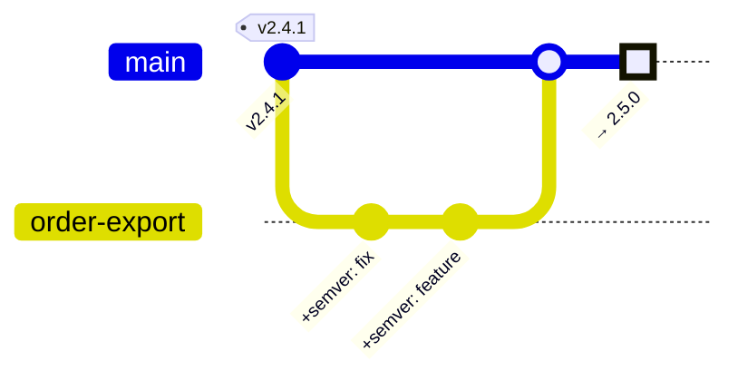

A version number is a promise. `2.4.1 → 2.4.2` says "safe to update, a bug was fixed".
`2.4.1 → 3.0.0` says "read the release notes, something will break". If your version numbers don't keep
that promise, consumers stop trusting them, and they either never update or update blindly. Both are
bad.

The most common anti-pattern I see in internal package feeds is the hand-maintained version:

```xml
<PropertyGroup>
  <Version>1.0.0</Version>
</PropertyGroup>
```

It starts at `1.0.0` and stays there until a push fails because the version already exists. Then someone
bumps it to `1.0.1`, regardless of whether the change was a fix or a breaking API change. In other repos
the pipeline appends the build number, so you get `1.0.4711`, which is unique but means nothing.

My position is simple: **if you publish NuGet packages, automated semantic versioning is not optional.**
Without meaningful versions, a package feed is just a fancier way of copying DLLs around.

## Why it goes wrong

Versioning by hand fails for boring reasons:

- The version lives in a file, so changing it is a **separate step** that's easy to forget.
- The person who bumps it isn't necessarily the person who knows **what kind of change** went in.
- Feature branches and pre-releases need **unique, ordered versions** too, and nobody wants to maintain
  `1.3.0-beta.7` by hand.
- Local builds produce packages with the **same version as the last release**, which leads to fun
  debugging sessions with stale caches.

All the information needed for a good version is already in the repository: the last release tag, the
commits since then, the branch you're on. GitVersion simply reads it.

## How GitVersion works

GitVersion walks the git history from `HEAD` back to the last version source (usually a tag such as
`v2.4.1`, or a `next-version` from the config), looks at the commits in between and the current branch,
and calculates the next semantic version.



The bump is driven by **commit messages**. By default, GitVersion looks for these markers:

| Commit message contains | Example: from 1.4.2 |
|---|---|
| `+semver: breaking` or `+semver: major` | 2.0.0 |
| `+semver: feature` or `+semver: minor` | 1.5.0 |
| `+semver: fix` or `+semver: patch` | 1.4.3 |
| `+semver: none` or `+semver: skip` | no bump |

The highest marker since the last tag wins. Branches get pre-release labels according to the workflow
you configure (`1.5.0-alpha.3` on a feature branch, for example), so every build has a unique,
correctly ordered version.

## Setting it up

There are two ways to use it. The **MSBuild task** runs during every build, locally and in CI, and sets
`Version`, `AssemblyVersion`, `FileVersion` and `InformationalVersion` for you. The **CLI / CI
actions** calculate the version once in the pipeline and pass it to `dotnet pack`. I prefer the MSBuild
variant for libraries, because a local `dotnet pack` then produces the same version the pipeline
would.

With [Central Package Management](/blog/2026-central-package-management/), add it once for every project:

```xml
<!-- Directory.Packages.props -->
<ItemGroup>
  <GlobalPackageReference Include="GitVersion.MsBuild" Version="6.1.0" />
</ItemGroup>
```

Without CPM, reference it as a build-only dependency so it doesn't flow to your consumers:

```xml
<PackageReference Include="GitVersion.MsBuild" Version="6.1.0">
  <PrivateAssets>all</PrivateAssets>
  <IncludeAssets>runtime; build; native; contentfiles; analyzers; buildtransitive</IncludeAssets>
</PackageReference>
```

Then remove every hand-written `Version`, `AssemblyVersion` and `FileVersion` from the project files and
from [Directory.Build.props](/blog/2026-directory-build-props/). Two sources of truth for the version is
worse than one bad one.

### GitVersion.yml

Put a `GitVersion.yml` at the repository root. A configuration for a trunk-based repository with
short-lived feature branches:

```yaml
workflow: GitHubFlow/v1
next-version: 1.0.0
tag-prefix: '[vV]?'

commit-message-incrementing: Enabled
major-version-bump-message: '\+semver:\s?(breaking|major)'
minor-version-bump-message: '\+semver:\s?(feature|minor)'
patch-version-bump-message: '\+semver:\s?(fix|patch)'
no-bump-message: '\+semver:\s?(none|skip)'

assembly-versioning-scheme: MajorMinorPatch
assembly-file-versioning-scheme: MajorMinorPatchTag
assembly-informational-format: '{InformationalVersion}'
```

The bump patterns shown are the defaults. I still write them down, because then every developer can
see in the repository which words matter. `next-version` sets the starting point for a repository that
has no tags yet. After the first release, tags take over.

:::caution[Upgrading from GitVersion 5]
Many wikis and pipelines still carry GitVersion 5.x configuration. Version 6 introduced `workflow`
presets, renamed the deployment modes and removed several old keys such as `legacy-semver-padding`. An
old `GitVersion.yml` either fails or silently behaves differently. Read the migration guide and diff the
calculated versions before and after (`dotnet-gitversion /showvariable FullSemVer`) before you switch.
:::

### Assembly version: be careful with strong names

If your assemblies are strong-named and still consumed by .NET Framework applications, changing the
`AssemblyVersion` on every patch release forces binding redirects on your consumers. In that case use
`assembly-versioning-scheme: Major` (so `AssemblyVersion` is `2.0.0.0` for all of 2.x) and let
`FileVersion` and `InformationalVersion` carry the details. For modern .NET-only libraries,
`MajorMinorPatch` is fine.

## The pipeline: fetch the history

GitVersion needs history and tags. Most CI systems do a **shallow clone** by default, and that's the
number one reason GitVersion "doesn't work in CI". In GitHub Actions:

```yaml
- uses: actions/checkout@v4
  with:
    fetch-depth: 0          # full history and tags

- uses: actions/setup-dotnet@v4
  with:
    global-json-file: global.json

- run: dotnet pack -c Release -o artifacts
```

In Azure Pipelines, set `fetchDepth: 0` and `fetchTags: true` on the `checkout` step. Newer pipelines
default to a shallow fetch.

When you release, tag the commit (`git tag v2.5.0`) and push the tag. From then on that tag is the new
baseline. Many teams let the pipeline create the tag after a successful release, which keeps the tags
and the published packages in sync.

## Alternatives compared

| | Hand-written `<Version>` | Build number suffix | GitVersion | Nerdbank.GitVersioning | MinVer |
|---|---|---|---|---|---|
| Unique version per build | ❌ | ✅ | ✅ | ✅ | ✅ |
| Semantic meaning (fix/feature/breaking) | if someone remembers | ❌ | ✅ from commit messages | major/minor in `version.json`, patch = commit height | from tags only |
| Same version locally and in CI | ✅ | ❌ | ✅ | ✅ | ✅ |
| Pre-release labels per branch | ❌ | ❌ | ✅ configurable | ✅ | basic |
| Configuration effort | none | low | medium | low | very low |

GitVersion is the most powerful option and also the one with the most knobs. If you want something
simpler and your team is fine with bumping major/minor in a file, Nerdbank.GitVersioning or MinVer are
good choices. What matters is that the version is **derived**, not typed.

## Pitfalls

**Developers forget the marker.** That's the big one. If a breaking change goes in without
`+semver: breaking`, GitVersion happily produces a minor or patch version, and the whole system is worse
than useless, because the number now lies with authority. You need enforcement (see below).

**Squash merges eat the markers.** With squash merging, only the squash commit message survives. Make
the PR title or squash message carry the marker, not the individual commits.

**Detached HEAD and unusual branch names.** CI systems often check out a detached commit. GitVersion
handles the common providers, but custom branch naming schemes need matching branch configuration,
otherwise you get surprising pre-release labels.

**Slow builds in huge repositories.** The MSBuild task runs per project. In large solutions, calculate
the version once (CLI or CI action) and pass it to the build as a property, or rely on GitVersion's
cache.

**Local packages with release versions.** With the MSBuild task, a local pack on `main` produces a
version that looks like a release. Never push local packages. Publishing belongs to the pipeline.

## Enforce it

Two layers work well together.

**1. Make the marker mandatory.** A `commit-msg` git hook gives immediate feedback locally. Share it via
the repository and `git config core.hooksPath .githooks`:

```bash
#!/bin/sh
# .githooks/commit-msg
if ! grep -qE '\+semver:\s?(breaking|major|feature|minor|fix|patch|none|skip)' "$1"; then
  echo "Commit message needs a +semver marker (breaking | feature | fix | none)."
  exit 1
fi
```

Hooks can be bypassed, so add the same check on the server: a required PR check that validates the PR
title, which is what ends up in the squash commit.

**2. Let the build detect breaking changes.** The .NET SDK can compare your package's public API with
the last released version:

```xml
<PropertyGroup Condition="'$(IsPackable)' == 'true'">
  <EnablePackageValidation>true</EnablePackageValidation>
  <PackageValidationBaselineVersion>2.4.1</PackageValidationBaselineVersion>
</PropertyGroup>
```

`dotnet pack` now fails if you removed or changed public API compared to 2.4.1. If the change is
intentional, that's your reminder to bump the major version. Keep the baseline at the last release (the
pipeline can update it automatically after each release), and you've closed the gap between "what the
commit message claims" and "what the code actually did".

## Summary

- Hand-maintained version numbers drift and lie. **Derive** versions from git history instead.
- GitVersion calculates semantic versions from tags, branches and `+semver:` markers in commit messages.
- Reference **`GitVersion.MsBuild`** once (e.g. as a `GlobalPackageReference`) and remove all
  hand-written versions.
- CI needs the **full history** (`fetch-depth: 0`), and releases need **tags**.
- Check old configs when upgrading to **GitVersion 6**; modes and keys changed.
- Enforce the markers with a **commit hook and a PR check**, and catch undeclared breaking changes with
  **package validation** against the last release.
