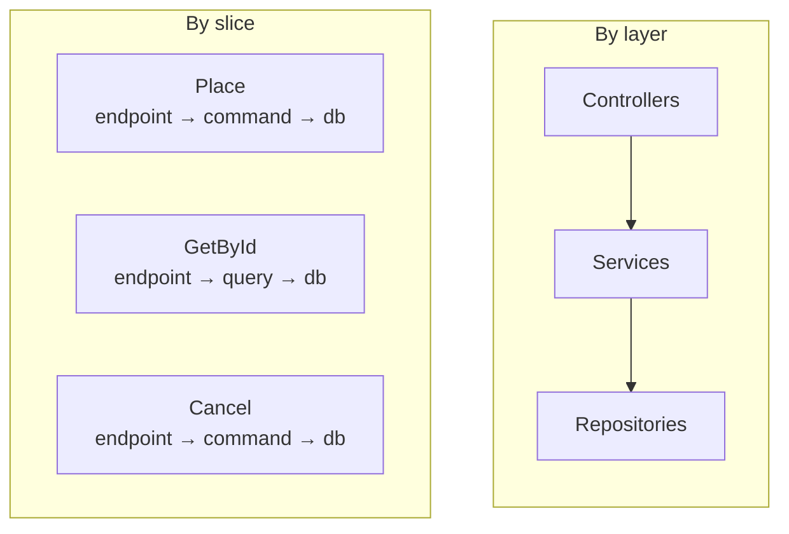

A bug report comes in: *"Placing an order with a voucher returns 500."* In a classic layered
backend, the path to the cause looks like this: open `Controllers/OrdersController.cs`, scroll past
eleven other actions, jump into `Services/OrderService.cs` (1,400 lines), find the call into
`Repositories/OrderRepository.cs`, then check `Models/OrderDto.cs` and `Validators/OrderValidator.cs`.
Five folders, five files, and most of what you read has nothing to do with placing an order.

Then you fix the bug, and the fix touches `OrderService`, a class that six other endpoints also
use. Now you have to retest all of them.

This post explains why I stopped organizing backends by technical layer and started organizing
them by **use case**. That idea is known as *vertical slice architecture*, a term Jimmy Bogard
made popular. It's not new and it's not complicated. It just changes the question your folder
structure answers.

## The layered structure and where it hurts

Most of us learned to structure a web API like this:

```text
MyShop.Api
├── Controllers
│   ├── OrdersController.cs
│   └── CustomersController.cs
├── Services
│   ├── OrderService.cs
│   └── CustomerService.cs
├── Repositories
│   └── OrderRepository.cs
├── Models
│   ├── OrderDto.cs
│   └── CreateOrderRequest.cs
└── Validators
    └── OrderValidator.cs
```

The code that belongs to one feature is spread over every folder. Each folder groups things that
are *technically* similar but *functionally* unrelated. What tends to happen over time:

```csharp
public sealed class OrderService(
    IOrderRepository orders,
    ICustomerRepository customers,
    IProductRepository products,
    IVoucherRepository vouchers,
    IStockClient stock,
    IPaymentClient payments,
    IShippingClient shipping,
    IInvoiceGenerator invoices,
    IEmailSender email,
    IOrderExportWriter exportWriter,
    IClock clock,
    ILogger<OrderService> logger)
{
    public Task<OrderDto> PlaceAsync(CreateOrderRequest request, CancellationToken ct) { /* ... */ }
    public Task<OrderDto?> GetByIdAsync(int id, CancellationToken ct) { /* ... */ }
    public Task<IReadOnlyList<OrderDto>> SearchAsync(OrderFilter filter, CancellationToken ct) { /* ... */ }
    public Task CancelAsync(int id, CancellationToken ct) { /* ... */ }
    public Task<Stream> ExportAsync(ExportFormat format, CancellationToken ct) { /* ... */ }
    // ... ten more
}
```

Twelve dependencies, and every single method uses maybe three of them. In one codebase I worked on,
the equivalent class was a "facade" with twelve injected services in its constructor, sitting
behind a controller that only forwarded calls. Nobody planned that. It grew one feature at a time,
because the service was simply the place where "order stuff" went.

The concrete problems:

- **Low cohesion.** Code that changes together (the request, validation, logic and response of one
  use case) lives far apart. Code that never changes together lives in the same class.
- **High coupling.** Two features share a service method "because it's almost the same". A change
  for one breaks the other.
- **Hard to delete.** Removing a feature means hunting through every layer. In practice nobody
  dares to, so dead code stays forever.
- **Shared models drift.** One `OrderDto` used for create, read and search slowly collects
  optional properties that only make sense in one of the three.

## The slice: one folder per use case

A vertical slice contains everything one use case needs, from the HTTP endpoint down to data
access:

```text
MyShop.Api
└── Api
    └── Orders
        └── V1
            ├── _Shared_
            │   ├── Order.cs
            │   └── OrderEntityMapper.cs
            ├── Place
            │   ├── PlaceOrderEndpoint.cs
            │   ├── PlaceOrderRequest.cs
            │   ├── PlaceOrderResponse.cs
            │   ├── PlaceOrderValidator.cs
            │   └── PlaceOrderCommand.cs
            ├── GetById
            ├── Search
            └── Cancel
```



Each slice has its own request and response types, its own validator and its own command or query.
Inside the slice you can pick whatever implementation fits. A read endpoint might be a single Dapper
query. A complex write might use a rich domain model. The slices don't have to agree.

The command for placing an order only depends on what placing an order needs:

```csharp
namespace MyShop.Api.Orders.V1;

internal sealed class PlaceOrderCommand(
    ShopDbContext db,
    IStockClient stock,
    TimeProvider time)
{
    public async Task<PlaceOrderResponse> ExecuteAsync(PlaceOrderRequest request, CancellationToken ct)
    {
        var reservation = await stock.ReserveAsync(request.Lines, ct);

        var order = new OrderEntity
        {
            CustomerId = request.CustomerId,
            PlacedAt   = time.GetUtcNow(),
            Lines      = request.Lines.Select(l => new OrderLineEntity(l.ProductId, l.Quantity)).ToList(),
            ReservationId = reservation.Id
        };

        db.Orders.Add(order);
        await db.SaveChangesAsync(ct);

        return new PlaceOrderResponse(order.Id, order.PlacedAt);
    }
}
```

Three dependencies, all of them used. When the voucher bug comes in, you open
`Orders/V1/Place` and everything is there.

## Why slice the code this way

**Single responsibility, for real.** Each class has one job: the endpoint maps HTTP, the validator
validates, the command executes, the mapper translates. Not "one responsibility per layer", which
in practice means fifteen responsibilities in one service.

**Change stays local.** Most feature requests and bug fixes touch exactly one use case. With slices
they touch exactly one folder. Code review gets easier, because the diff is in one place and
doesn't affect other endpoints.

**Debugging is faster.** Small, focused classes mean the stack trace points to a class that does one
thing. You don't need to read an entire service to understand which branch failed.

**Onboarding is easier.** The folder tree reads like a feature list. A new team member sees
`Orders/V1/Place`, `Orders/V1/Cancel`, `Customers/V1/Register` and knows what the API does before
reading a line of code.

**Deleting is cheap.** A feature that's no longer needed is one folder and one registration line.
That's not a small thing. A codebase where deleting is easy stays smaller.

**It fits CQRS naturally.** Every slice is either a command (changes state) or a query (reads state).
I'll cover that in [*CQRS with MediatR, without the ceremony*](/blog/2026-cqrs-with-mediatr-without-ceremony/).

**Testing focuses on behaviour.** Since each slice is an HTTP endpoint with a clear contract, the
natural test is an API test against that endpoint, not a unit test full of mocks for a service
method. Unit tests are still possible for the interesting logic, but they're no longer the default.

## What it costs

Slices are not free, and I don't want to pretend they are.

**Some duplication.** Two slices may have similar request types or similar queries. That's
intentional. Similar code that changes for different reasons isn't really duplication, and merging
it creates the coupling we wanted to get rid of. My rule of thumb: duplicate until the third
occurrence, and then decide whether it's really the same concept.

**The `_Shared_` folder can turn into a junk drawer.** Every slice-based codebase needs a place for
the domain model and common mappers. Keep it small and deliberate. If something in `_Shared_` is used
by only one slice, move it back into that slice.

**More files.** A simple CRUD API with slices has more files than the same API with one controller and
one service. For a tiny internal tool with four endpoints, that's overhead you might not want.

**Consistency needs discipline.** The structure only works if every slice follows the same pattern.
In one team's guidelines I read a rule I fully agree with: **don't mix the old and new structure in
the same solution.** Either migrate, or keep the existing structure. Two competing conventions are
worse than either one alone.

:::caution[Watch the vocabulary]
The two terms get swapped surprisingly often: "horizontal" for the per-feature structure, "vertical"
for the layers. It took me a while to keep them straight too. It doesn't matter much what you call
it, as long as everyone uses the same words. Write it down once, with a folder tree.
:::

## Layers vs slices at a glance

| | Layered (by technology) | Vertical slices (by use case) |
|---|---|---|
| Where is the code for one feature? | Spread over 4–6 folders | One folder |
| Typical class size | Grows with every feature | Stays small |
| Dependencies per class | Union of all features | Only what the use case needs |
| Effect of a change | Can affect other endpoints | Local to one slice |
| Delete a feature | Search all layers | Delete a folder |
| Duplication | Low, but with coupling | Some, by design |
| Good fit | Small apps, very uniform CRUD | APIs that grow over years, several teams |

## Pitfalls

**Slices calling slices.** `CancelOrderCommand` injecting `GetOrderByIdQuery` from another slice looks
convenient. After a while, every slice depends on three others, and you're back to a web of
coupled services, only in more folders. If two slices need the same read, move that read to
`_Shared_` or to a dedicated query that both use explicitly.

**Generic base classes for everything.** A `CrudEndpoint<TEntity, TDto>` base class saves typing for
the first ten endpoints and blocks you at the eleventh, which needs something special. Slices work
best when they're boring and explicit.

**Putting infrastructure into slices.** Authentication, logging, error handling and OpenAPI setup are
cross-cutting. They belong in the host setup or in pipeline behaviors, not copied into every slice.

**Mixing namespaces with folders.** If every technical subfolder becomes a namespace segment, you get
`MyShop.Api.Orders.V1.Place.Endpoints` and need eight `using` directives. I keep the namespace at the
version level (`MyShop.Api.Orders.V1`) and turn off namespace suggestions for the subfolders in the
IDE. More on that in the post about [folder structures](/blog/2026-folder-structure-by-feature/).

## Make the boundaries enforceable

A slice structure that's only a convention erodes, just like any other. An architecture test can
check that slices don't depend on each other. With
[NetArchTest](https://github.com/BenMorris/NetArchTest):

```csharp
[TestMethod]
public void Slices_must_not_depend_on_other_slices()
{
    // Type name prefixes of the slices: PlaceOrderCommand, PlaceOrderEndpoint, ...
    var slices = new[] { "PlaceOrder", "GetOrderById", "SearchOrders", "CancelOrder" };
    var assembly = typeof(PlaceOrderCommand).Assembly;
    var sliceTypes = assembly.GetTypes()
                             .Where(t => t.Namespace == "MyShop.Api.Orders.V1")
                             .ToArray();

    foreach (var slice in slices)
    {
        var otherSliceTypes = sliceTypes
            .Where(t => slices.Any(s => s != slice && t.Name.StartsWith(s, StringComparison.Ordinal)))
            .Select(t => t.FullName!)
            .ToArray();

        var result = Types.InAssembly(assembly)
            .That().HaveNameStartingWith(slice)
            .ShouldNot().HaveDependencyOnAny(otherSliceTypes)
            .GetResult();

        Assert.IsTrue(result.IsSuccessful,
            $"Slice '{slice}' depends on another slice: {string.Join(", ", result.FailingTypeNames ?? [])}");
    }
}
```

Because the namespaces stop at the version level, as recommended above, the test identifies slices
by type name prefix. A naming convention like `<Action><Entity><Role>` makes that reliable. The
exact mechanism matters less than having the rule checked on every build. That's the idea behind
[self-defending codebases](/blog/2026-self-defending-codebases/).

## Summary

- Layered structures group code by **what it is**. Slices group code by **what it does**.
- A slice contains everything one use case needs: endpoint, request, response, validation, command
  or query, mapping.
- You get local changes, small classes, easy deletion and a folder tree that reads like a feature
  list.
- You pay with some duplication and the discipline to keep `_Shared_` small and the pattern
  consistent.
- Don't mix two structures in one solution, and **enforce** slice boundaries with architecture tests.
