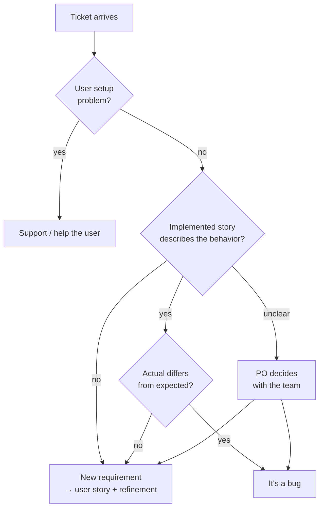

"It's a bug." Few sentences carry more weight in a software project. A bug jumps the queue, it implies
the team made a mistake, and it usually doesn't go through refinement. So everybody has an incentive
to call their wish a bug.

In the project with six Scrum teams I spent about four years on, we needed a clear answer to "is this
actually a bug?". Without one, the backlog fills with feature requests in disguise and the sprint gets
interrupted by things that were never promised. This post describes the definition we used, the three
cases for handling bugs, and the template that made bug reports useful.

## The definition

Here's the rule, in my words:

> **A bug is something a stakeholder sees as wrong, compared to a defined system behavior that is covered
> by an implemented user story.**

The important part is the second half. A bug needs a reference. If you can't point to a user story
that describes the expected behavior, and show that the actual behavior differs from it, then it's not a
bug. It may still be important, but it's something else.

## First question: is it a real bug?

Most bugs reached the team as a ticket from a business user through the ticket system. The first thing to
do with such a ticket was to **check whether it's a real bug at all**. In practice, a reported "bug"
often turns out to be one of these:

| What it looks like | What it actually is | Where it goes |
|---|---|---|
| "The page doesn't load" | A (temporary) problem with the user's device, OS or browser settings | Support, not the backlog |
| "The export is missing the delivery date" | A **new requirement**: the story never included it | A new user story, through refinement |
| "The total is calculated wrong" | Behavior differs from what the story specified | **A real bug** |
| "It should work differently" | Changed expectations | A new or changed story |

Tickets often contain a mix, for example a real bug plus a new requirement. Those need to be sorted out
and split.

To decide whether it's a real bug, find the **already implemented user story** to compare it against.
Only if the actual behavior is different from the expected behavior described in the story is it a true
bug. When it's unclear, the **Product Owner decides together with the team**.



## Three cases for handling real bugs

Who finds a bug, and when, changes how it's handled. We distinguished three cases.

### Case 1: the team finds it during development

The best case. The team **fixes it while completing the story**. No separate bug item is needed; it's
documented in the story's testing task, with a reference to the developer who fixed it. Finding bugs
yourself, ideally within the sprint, is always better than having the business find them later.

### Case 2: a tester or QA finds it during testing

A business tester or quality analyst finds the problem while testing a story in the sprint. Then:

1. Create a **bug item** and link it to the user story.
2. Move the story **back to In Progress**.

The story isn't done until the bug is fixed. This ties directly into a strict
[Definition of Done](/blog/2026-three-column-board-strict-definition-of-done/).

### Case 3: users find it after the sprint

The bug shows up in production, after the story was done. Then:

1. Create the bug in the **backlog** (or log the ticket that already exists there).
2. The **PO prioritizes** it.
3. The **team decides when** to handle it.

Production bugs were the one kind of work we allowed to interrupt a running sprint, if they were urgent
enough. Everything else went through the backlog.

| | Found by | When | What happens |
|---|---|---|---|
| **Case 1** | The team | During development | Fix it as part of the story, document in the testing task |
| **Case 2** | Tester / QA | During testing in the sprint | Bug item linked to the story, story back to In Progress |
| **Case 3** | Users | After the sprint | Bug in the backlog, PO prioritizes, team schedules |

## What a good bug report contains

A bug that can't be reproduced can't be fixed. The minimum structure mirrors a user story:

- **Who** reported it? (stakeholder, persona, role)
- **What** do they see as wrong? (actual behavior)
- **What** did they expect instead? (expected behavior)
- **Why** does it matter? (value or justification)

In the work tracker, we turned that into a fixed template.

**Title**

```
<ticket reference> – <short description of the wrong behavior>
```

**Repro steps**

```
Ticket link:
Reported by (user or group):
Short description of the problem:

Preconditions:
-

Steps to reproduce:
1.

Expected result:
-

Actual result:
-

Screenshots / attachments (referenced here):
-
```

**System info**

```
Device, OS and browser version of the user:
Link to the affected record (e.g. order 4711 in the test system):
Environment (DEV / TEST / QA / PROD):
```

On top of that, a few fields had to be filled **at the latest in sprint planning**: state and reason,
area, iteration (initially without a sprint), priority, the related user story under related work,
the activity if applicable, and time criticality if needed. The link to the related story is the most
important one, because it's the proof that this is a bug at all.

### What people usually forget

Even with the template, the same details tend to be missing. These made the biggest difference:

- **The error log.** If an error dialog offers a log file to download, ask for it.
- **Links to the actual data.** "Order 4711 in the test system" makes steps reproducible. "An order"
  doesn't.
- **Input values.** Which values were entered in which fields?
- **Intermediate results.** Especially when the steps go through several forms or dialogs.
- **Screenshots.** A picture often says more than a long description.

## The life cycle of a bug

| Status | Meaning |
|---|---|
| **New** | Not started yet, or interrupted for a longer time |
| **Active** | Someone is working on it |
| **Resolved** | Fixed, waiting for deployment to the highest environment where it occurred |
| **Closed** | Fixed and deployed to the highest environment where it occurred |

The distinction between resolved and closed matters. A bug found in production isn't closed when the fix
is merged; it's closed when the fix is in production. If a bug was found in a test environment in a
feature that was never deployed further, it can be closed once the fix is confirmed there.

## Pitfalls

**Accepting every ticket as a bug.** Without the "which story?" check, the backlog fills with feature
requests that skipped refinement and estimation.

**Arguing about labels instead of value.** "It's not a bug, it's a new requirement" is correct, but it
shouldn't end the conversation. A missing feature can still be the most important item in the backlog.
The label only decides *how* it enters the backlog.

**Bug items for everything the team finds itself.** In case 1, a separate bug item is overhead. Fix it
and document it in the testing task.

**Bugs without a link to the story.** Then nobody can verify the expected behavior later, and the
discussion starts from scratch.

**Closing too early.** Resolved isn't closed. Track it until the fix reaches the environment where the
problem occurred.

## How to keep it under control

- Make the bug template the **default** in your tracker, so the structure is there before anyone types.
- Add "related user story linked" as a required check before a bug goes into a sprint.
- In the retro, look at the bugs from case 3. Every production bug is a hint which part of the Definition
  of Done or the test cases had a gap.
- Count how many incoming tickets turn out to be new requirements. A high number usually means the
  stories or acceptance criteria were unclear.

## Summary

- A bug is a deviation from **defined behavior covered by an implemented user story**. No story, no bug.
- First check whether a ticket is a real bug, a user setup problem or a new requirement. When in doubt,
  the PO decides with the team.
- **Case 1:** the team finds it and fixes it within the story. **Case 2:** testers find it, a bug item is
  linked and the story goes back to In Progress. **Case 3:** users find it, it goes into the backlog and
  the PO prioritizes.
- Use a fixed template with repro steps, expected vs. actual results and system info, and don't forget
  logs, links to data and screenshots.
- Resolved isn't closed: a bug is closed when the fix is deployed where the bug occurred.
