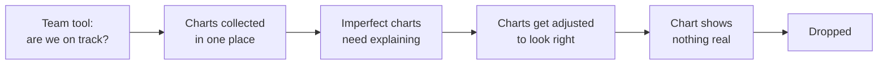

I spent about four years on a project with six Scrum teams working on the same product. Looking
back, a lot of what we started with survived: the daily, the review, refinement, retrospectives.
One artifact didn't. We started with burndown charts, used them for a while, and then **dropped them
completely**. No replacement chart, no "burndown 2.0". They were just gone.

This post is about why. It isn't really a story about charts. It's about what happens to any metric
once people start caring more about how it looks than about what it shows.

## Where we started

At the beginning, every team had a sprint burndown. Remaining work on the y-axis, sprint days on the
x-axis, an ideal line from top left to bottom right, and the actual line hopefully somewhere close
to it. That's textbook Scrum tooling, and every tool generates it for free.

Then came a reasonable-sounding proposal: **put the burndown charts of all six teams in one place**,
so everyone could see the state of the whole product at a glance.

On paper that's transparency. In practice it changed who the chart was for.

## What went wrong

A team-level burndown is a tool for the team. It answers one question in the daily: "Are we still on
track to finish what we committed to, or do we need to talk?" A jagged line, a plateau in the middle
of the sprint, a cliff on the last day: all of that is information the team can act on.

Once the charts were collected and looked at from above, imperfect charts became something to
explain. And there's a very easy way to avoid explaining an imperfect chart: you make it less
imperfect. Remaining hours get "corrected", tasks get re-estimated mid-sprint, work moves around
until the line looks plausible again.

That's what happened to us. The charts were adjusted so they would please management instead of
showing the real state of development. I want to be clear that I don't think this was anybody's evil
plan, and it doesn't belong to one role. It's the natural result of a setup in which a team-internal
tool turns into a reporting instrument. Everyone involved did what the system rewarded.

The consequence was simple: **a chart that has been adjusted to look good tells you nothing**. Worse,
it tells you something wrong with full confidence. It didn't help us improve, and it hid the true
state of affairs. So we decided to abandon burndown charts altogether.

## Why this happens: Goodhart's law in a sprint

The economist Charles Goodhart's observation is usually quoted as: *when a measure becomes a target,
it ceases to be a good measure.* A burndown is a measure. The moment "a nice burndown" becomes the
goal, people optimize the line instead of the work.

A few properties make burndowns particularly vulnerable:

- **They are trivial to manipulate.** Remaining effort is a number someone types in. Nothing
  external checks it.
- **Healthy sprints often look "bad".** In our setup, every story had at least two developers on it
  and a strict Definition of Done (tested, deployed to the target environment, confirmed by the
  stakeholder or Product Owner). Stories like that tend to finish late in the sprint and all at
  once. The honest line is flat for days and then drops. That's not a problem, but it looks like one.
- **Side-by-side comparison invites ranking.** Six teams have six different domains, six different
  ways of slicing tasks and six different estimation habits. Putting their charts next to each other
  suggests a comparison that doesn't exist.
- **The audience changed, the chart didn't.** A team needs detail and noise. Management needs a
  trend and a forecast. One chart can't serve both, and when it tries, the team side loses.

## What we did instead

Dropping the chart didn't mean dropping transparency. We moved it to places that are much harder to
make look nicer than they are.

**A board with only three columns.** Open, In Progress, Done. With so few columns there's nowhere to
park work in a comfortable intermediate state. A story is either done or it isn't. I'll go into the
board and our Definition of Done in a separate post.

**A strict Definition of Done.** "Done" meant tested and deployed on the target machines, without
manual workarounds for some components, and confirmed by the stakeholder or PO. A story that didn't
meet the expectations wasn't marked done and wasn't presented in the review. You can massage hours.
You can't massage "it runs on the target machine and the stakeholder accepted it".

**A technical daily.** Our dailies focused on technical issues, possible solutions and where someone
needed support from others. That surfaced trouble much earlier than a line on a chart, because the
people who had the trouble said so.

**Early stakeholder feedback.** We didn't wait for the review to show results. When something was
done, we asked for feedback right away. If a story was off track, the stakeholder noticed during the
sprint, not at the end of it.

**A review with live demos.** In the review, the developers who built an increment presented it live,
on the real machine. Critical points were collected and ended up as new backlog items. That's the
most honest progress report I know.

## Burndown vs. the alternatives

| | Burndown chart | Board + strict DoD | Live review |
|---|---|---|---|
| Shows progress during the sprint | ✅ | ✅ | ❌ end of sprint only |
| Hard to make look better than it is | ❌ remaining hours are typed in | ✅ done is binary | ✅ it works or it doesn't |
| Useful across several teams | ⚠️ invites false comparison | ✅ per team | ✅ everyone sees the product |
| Shows *why* something is late | ❌ | ⚠️ blocked items are visible | ✅ through questions and discussion |
| Cost to maintain | low, but daily | low | one meeting per sprint |

I'm not saying burndowns are useless. In a team that keeps the chart to itself, it can be a fine
conversation starter in the daily. The problem starts when it leaves the team room.

## Pitfalls if you keep your burndown

If you want to keep the chart, these are the signs that it's turning into theater:

- **The actual line hugs the ideal line every sprint.** Real work isn't that smooth. A perfect line
  is more suspicious than a jagged one.
- **Remaining work goes up and down without scope changes.** Re-estimating is fine. Re-estimating so
  the line looks better isn't.
- **People discuss the chart instead of the work.** If the daily starts with "why is the line flat?"
  rather than "what's blocking us?", the chart has taken over.
- **The chart is used outside the team.** That's the moment the audience changes. Give management
  something built for them, like the review, a release forecast or simply the list of done increments,
  and leave the burndown with the team.

## How to tell whether your sprint is really on track

Without a chart, a few questions in the daily do the job:

1. Which stories are in progress, and how many people are on each?
2. Is anything blocked, and is the reason documented?
3. Which stories could we show to the stakeholder today?
4. Is there a story we should talk to the PO about, because it won't make it?

The last one matters most. If a story isn't going to make it, the right move is an honest
conversation with the Product Owner, not a nicer line.

## Summary

- We started with burndown charts for six teams and proposed collecting them in one place.
- Once the charts became something to show upward, they were adjusted to look good and stopped
  reflecting the real state. That's a system effect, not one role's fault.
- A measure that has become a target is no longer a good measure. Burndowns are especially easy to
  bend.
- We replaced them with a three-column board, a strict Definition of Done, a technical daily, early
  stakeholder feedback and live reviews, all of which are hard to fake.
- If you keep your burndown, keep it inside the team.
