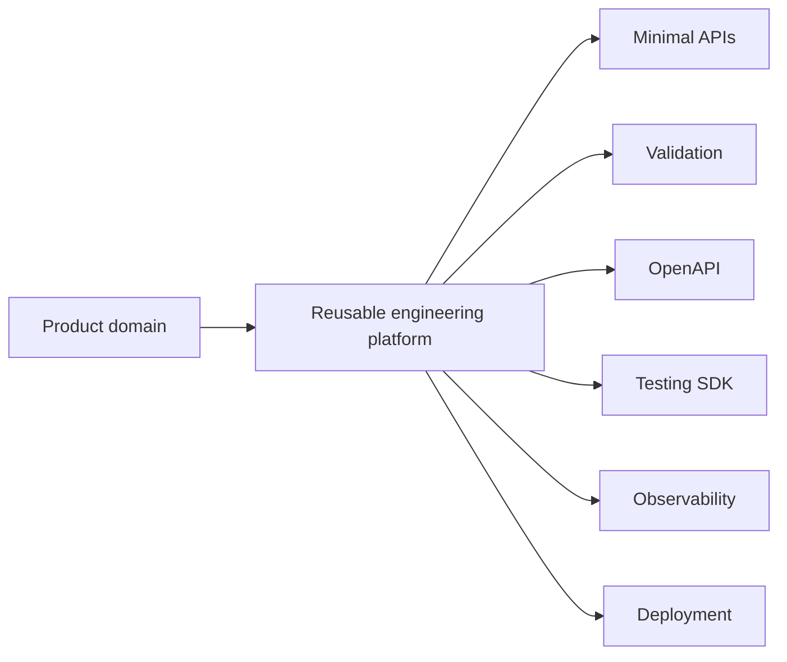

import { Card, CardGrid, LinkCard } from '@astrojs/starlight/components';
import LatestPosts from '../../components/LatestPosts.astro';

<div class="whoami">

```text
$ whoami

Name............... Rene Peuser
Role............... Principal Software Architect
Speciality......... Framework and platform engineering
Mission............ Make product teams faster through reusable foundations
Primary stack...... C# · .NET · ASP.NET Core · Minimal APIs
Passion............ Testing · OpenAPI · Developer Experience · Automation
```

</div>

## What I do

<CardGrid stagger>
	<Card title="Principal Software Architect" icon="laptop">
		More than two decades of software engineering, from industrial automation and HMIs to
		enterprise cloud platforms and framework engineering.
	</Card>
	<Card title="Framework & SDK Engineer" icon="setting">
		Reusable .NET foundations, Minimal API platforms, validation engines, OpenAPI tooling, test
		SDKs and developer automation.
	</Card>
	<Card title="Open-Source Maintainer" icon="open-book">
		Nine packages and more than 4.1 million cumulative downloads on NuGet (as of July 2026).
	</Card>
	<Card title="Conference Speaker" icon="star">
		Speaker at BASTA! and trainer for architecture, testing, WPF, MVVM, clean code and modern .NET.
	</Card>
</CardGrid>

## Latest posts

<LatestPosts count={4} />

## I build engineering multipliers

A well-designed framework does more than remove duplicate code. It creates consistent APIs,
centralizes cross-cutting concerns, raises the quality floor, and turns architectural knowledge into
executable software.



## Featured work

<CardGrid>
	<LinkCard
		title="Capability meta-framework"
		description="A metadata-driven engine exposing heterogeneous cloud capabilities through consistent contracts, validation and OpenAPI schemas."
		href="/projects/capability-meta-framework/"
	/>
	<LinkCard
		title="Enterprise Minimal API platform"
		description="Designing, validating, documenting, testing and operating a large API surface without repeating infrastructure."
		href="/projects/minimal-api-platform/"
	/>
	<LinkCard
		title="AspNetCore.Simple.MsTest.Sdk"
		description="A public test SDK for concise request/response API tests — 700k+ downloads."
		href="/projects/testing-sdk/"
	/>
	<LinkCard
		title="Engineering journey"
		description="From VB6 HMIs and PLCs in the 1990s to cloud platform engineering today."
		href="/career/timeline/"
	/>
</CardGrid>
