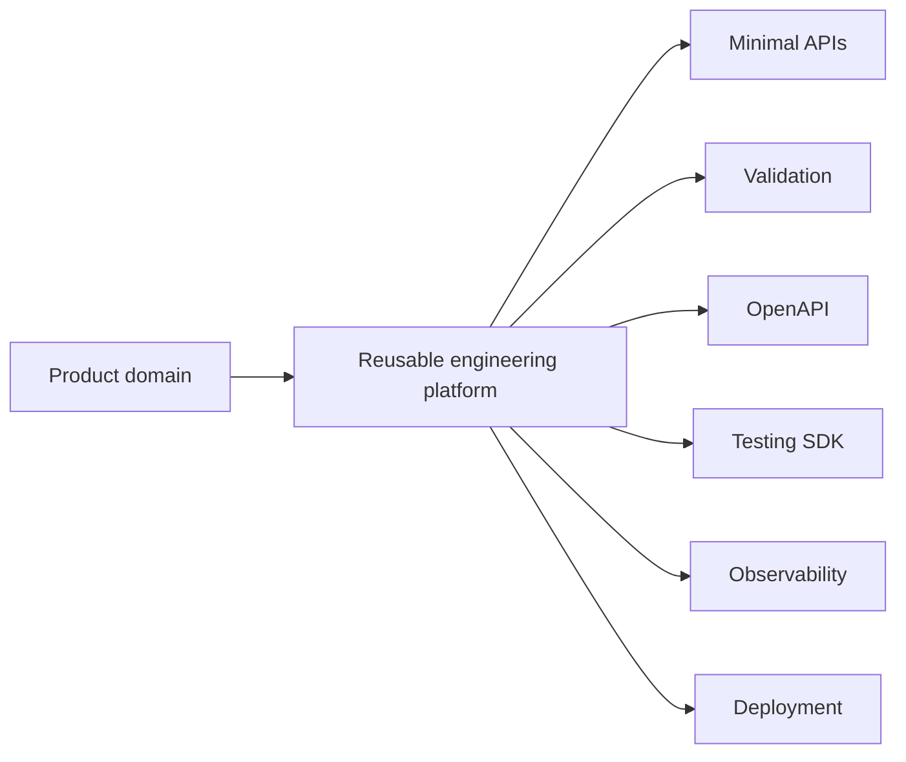

import { Card, CardGrid, LinkCard, Steps } from '@astrojs/starlight/components';
import LatestPosts from '../../components/LatestPosts.astro';
import NuGetTotal from '../../components/NuGetTotal.astro';

<div class="whoami">

```text
$ whoami

Name............... Rene Peuser
Role............... Principal Software Architect
Speciality......... Framework and platform engineering
Mission............ Make product teams faster through reusable foundations
Primary stack...... C# · .NET · ASP.NET Core · Minimal APIs
Passion............ Testing · OpenAPI · Developer Experience · Automation
```

</div>

## From VB6 to self-defending codebases

Almost two decades in one thread: turning knowledge that lives in people's heads into software that
enforces it. It started with VB6 screens next to industrial machines and, for now, ends with codebases
that explain their own rules to humans and AI agents.

<Steps>

1. **2007 · Roots.** [VB6 user interfaces next to the machine](/blog/2007-vb6-hmi-roots/), then first steps with WPF and MVVM.
2. **2012–2013 · Modernizing UIs.** [Hosting WPF controls in VB6 via COM interop](/blog/2012-hosting-wpf-controls-in-vb6/), localization and interactive canvases.
3. **2016–2017 · Framework thinking.** Reusable building blocks, generated test data and [Roslyn analyzers](/blog/2017-roslyn-analyzers-and-argument-checks/).
4. **2019–2024 · Automating the codebase.** [Architecture tests](/blog/2019-testing-the-solution-itself/), a public test SDK, client generators and RunJit.
5. **2026 · Self-defending codebases.** [Team rules that enforce themselves](/blog/2026-self-defending-codebases/).

</Steps>

<LinkCard title="Read the whole journey" description="Twelve chapters, written as retrospectives from the original source code." href="/series/from-vb6-to-self-defending-codebases/" />

## What I do

<CardGrid stagger>
	<Card title="Principal Software Architect" icon="laptop">
		More than two decades of software engineering, from industrial automation and HMIs to
		enterprise cloud platforms and framework engineering.
	</Card>
	<Card title="Framework & SDK Engineer" icon="setting">
		Reusable .NET foundations, Minimal API platforms, validation engines, OpenAPI tooling, test
		SDKs and developer automation.
	</Card>
	<Card title="Open-Source Maintainer" icon="open-book">
		Nine packages and more than <NuGetTotal /> cumulative downloads on [NuGet](/open-source/nuget/) (live figures).
	</Card>
	<Card title="Conference Speaker" icon="star">
		Speaker at [BASTA!](https://basta.net/speaker/rene-peuser/) and [My Coding Zone](/talks/my-coding-zone/), and trainer for architecture,
		testing, WPF, MVVM, clean code and modern .NET.
	</Card>
</CardGrid>

## Latest posts

<LatestPosts count={4} />

## Blog series

More than 110 posts, organized in series. Read one series front to back or pick single posts.
[All series at a glance →](/series/)

<CardGrid>
	<LinkCard title="ASP.NET Core from the ground up" description="A production-ready API step by step: hosting, DI, configuration, security, errors, OpenAPI." href="/series/aspnetcore-from-the-ground-up/" />
	<LinkCard title="Architecture in practice" description="Vertical slices, CQRS, context objects, contracts and lightweight ADRs." href="/series/architecture-in-practice/" />
	<LinkCard title=".NET pitfalls" description="HttpClient, async/await, nullability and other traps that pass code review." href="/series/dotnet-pitfalls/" />
	<LinkCard title="REST & OpenAPI design" description="Soft delete, PATCH, polymorphism, extensible enums and breaking-change checks." href="/series/rest-and-openapi-design/" />
	<LinkCard title="Testing in practice" description="Integration tests, snapshot tests, Testcontainers and AI-friendly tests." href="/series/testing-in-practice/" />
	<LinkCard title="Code quality & tooling" description="Central Package Management, analyzers, NuGet, formatting and CodeQL." href="/series/code-quality-and-tooling/" />
	<LinkCard title="Caching & data" description="Redis, caching abstractions, HybridCache, query providers and Dapper." href="/series/caching-and-data/" />
	<LinkCard title="Cloud, DevOps & observability" description="Terraform, KQL, Grafana, OpenTelemetry and Azure basics." href="/series/cloud-devops-observability/" />
	<LinkCard title="Validation & error handling" description="Exception handling and logging exceptions the right way." href="/series/validation-and-error-handling/" />
	<LinkCard title="Scrum in the real world" description="What worked with six teams over several years, and what we dropped." href="/series/scrum-in-the-real-world/" />
	<LinkCard title="Code smells & their fixes" description="Events, simulation flags, out parameters, null checks, global state and the patterns that replace them." href="/series/code-smells-and-their-fixes/" />
</CardGrid>

## I build engineering multipliers

A well-designed framework does more than remove duplicate code. It creates consistent APIs,
centralizes cross-cutting concerns, raises the quality floor, and turns architectural knowledge into
executable software.



## Featured work

<CardGrid>
	<LinkCard
		title="Capability meta-framework"
		description="A metadata-driven engine exposing heterogeneous cloud capabilities through consistent contracts, validation and OpenAPI schemas."
		href="/projects/capability-meta-framework/"
	/>
	<LinkCard
		title="Enterprise Minimal API platform"
		description="Designing, validating, documenting, testing and operating a large API surface without repeating infrastructure."
		href="/projects/minimal-api-platform/"
	/>
	<LinkCard
		title="AspNetCore.Simple.MsTest.Sdk"
		description="A public test SDK for concise, file-backed request/response API tests."
		href="/projects/testing-sdk/"
	/>
	<LinkCard
		title="Talk: Self-defending codebases"
		description="My Coding Zone, Nov 2026 — making team rules executable with Roslyn, analyzers and AI-generated rules."
		href="/talks/my-coding-zone/"
	/>
	<LinkCard
		title="Engineering journey"
		description="From VB6 HMIs and PLCs in the 1990s to cloud platform engineering today."
		href="/career/timeline/"
	/>
</CardGrid>
